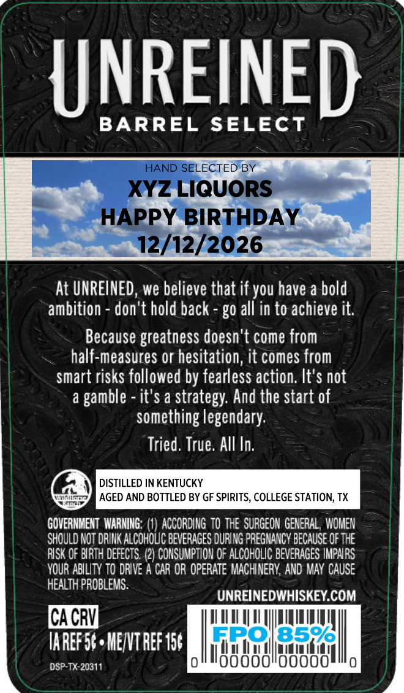
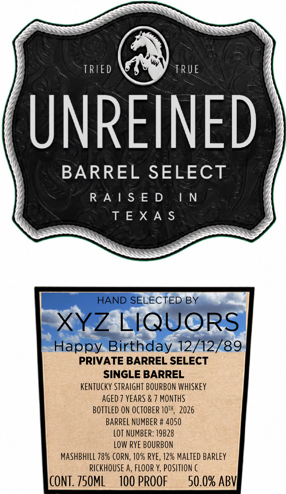

# TTB COLA Label Images - TTBID 26286001000715

**Brand Name:** UNREINED

**Fanciful Name:** BARREL SELECT

**Issue Date:** 10/20/2026

**Origin Code:** 44

**Product Class/Type:** 101

**Source:** [TTB Public COLA Registry](https://ttbonline.gov/colasonline/viewColaDetails.do?action=publicFormDisplay&ttbid=26286001000715)

## Label Images

### Back Label

### Front Label

### Label 3

## Extracted Label Text

*Text extracted via OCR - may contain errors*

*1 image(s) excluded: text did not meet readability threshold*

**Detected Proof:** 100
**Detected Age:** 7 Years

### Back Label

UNREINED
BARREL
SELECT
HAND SELECTED BY
XYZ LIQUORS
HAPPY BIRTHDAY
12/12/2026
At UNREINED, we believe that if you have a bold
ambition
don't hold back
g0 all in to achieve it.
Because greatness doesn't come from
half-measures or hesitation, it comes from
smart risks followed by fearless action: It'$ not
a
it'$ a
'strategy: And the start of
something legendary:
Tried, True; AlI In;
DISTILLED IN KENTUCKY
AGED AND BOTTLED BY GF SPIRITS, COLLEGE STATION; TX
GOVERHMENT  WARNING: (1) ACCORDING  tO thE  SURGEON GENERAL , WOMEN
SHOULD NOT DRINK ALcHOuC beveRaGES DURING PREGHANCV BECaUSE OF The
RISK OF BIRTH DEFECTS: (2) CONSUMPTION 0F ALCOHOLIC BEvERAGES IMPARS
YOUR ABILITY TO dRIVE A CAR OR OPERATE MACHINERY; AND MAY CAUSE
HEALTH PROBLEMS.
UNREINEDWHISKEY COM
CACRV
IAREFF5 , MENVT REF 156
ERO
8596
DSP-TX-20311
oooooidoooo
gamble

### Front Label

SSN

SS

SS

ESN

TRIED

TRUE

NREINED

BARREL SELECT

RAISED

IN

=

TEXAS

HAND SELECTED, BY

XYZ LlQUORS

Happy Birthday.12/12/89

PRIVATE BARREL SELECT

SINGLE BARREL

KENTUCKY STRAIGHT BOURBON WHISKEY

AGED 7 YEARS & 7 MONTHS

BOTTLED ON OCTOBER 10", 2026

BARREL NUMBER # 4050

LOT NUMBER: 19828

LOW RYE BOURBON

MASHBHILL 78% CORN, 10% RYE, 12% MALTED BARLEY

RICKHOUSE A, FLOOR Y, POSITION C

CONT. 750ML

100 PROOF

50.0% ABV}
