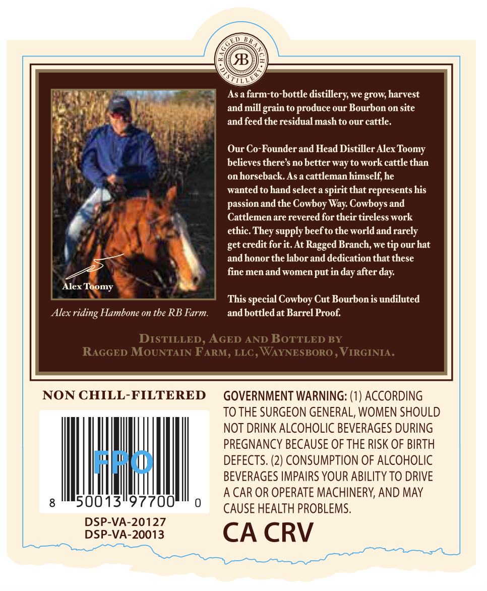
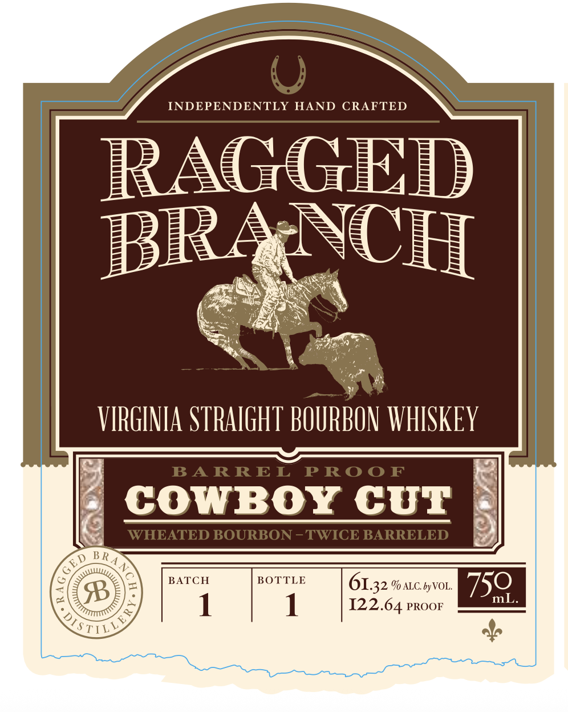

# TTB COLA Label Images - TTBID 26287001000086

**Brand Name:** RAGGED BRANCH

**Fanciful Name:** COWBOY CUT WHEATED BOURBON

**Issue Date:** 10/19/2026

**Origin Code:** 05

**Product Class/Type:** 101

**Source:** [TTB Public COLA Registry](https://ttbonline.gov/colasonline/viewColaDetails.do?action=publicFormDisplay&ttbid=26287001000086)

## Label Images

### Back Label

### Front Label

## Extracted Label Text

*Text extracted via OCR - may contain errors*

### Back Label

As a farm-to-bottle
distillery we grow, harvest
and mill grain to produce our Bourbon on site
and feed the residual mash to our cattle.
Our Co-Founder and Head Distiller Alex
believes there $ no better way to work cattle than
on horseback  As a cattleman himself; he
wanted to hand select a spirit that represents his
passion and the Cowboy Way Cowboys and
Cattlemen are revered for their tireless work
ethic
supply beefto the world andrarely
get credit forit, At Ragged Branch, we tip ourhat
andhonor the labor and dedication that these
fine men and women put in
after
Alex
This special Cowboy Cut Bourbon is undiluted
Alex
Hambone on tbe RB Farm.
and bottledat Barrel Proof
DISTILLED , AGED AND BoTTLED BY
RAGGED MOUNTAIN FARM, LLC , WAYNESBORO
VIRGINIA .
NON CHILL-FILTERED
GOVERNMENT WARNING: (1) ACCORDING
TO THE SURGEON GENERAL; WOMEN SHOULD
NOT DRINK ALCOHOLIC BEVERAGES DURING
PREGNANCY BECAUSE OF THE RISK OF BIRTH
"iw
DEFECTS. (2) CONSUMPTION OF ALCOHOLIC
BEVERAGES IMPAIRS YOUR ABILITY TO DRIVE
A CAR OR OPERATE MACHINERY, AND MAY
50013"97700
CAUSE HEALTH PROBLEMS.
DSP-VA-20127
DSP-VA-20013
CA CRV
Toomy
They
day
day:
Toomy
riding

### Front Label

INDEPENDENTLY
HAND
CRAFTED
RAGGED
BRA NCH
VIRGINIA STRAIGHT BOURBON WHISKEY
BA RREL
PRo0 F
COWBor CUT
WHEATED BOURBON -TWICE BARRELED
BATCH
BOTTLE
%f ALC by VOL_
750
mL
 1
I22.64 PROOF
"STILI
B RA
GED
2
6132 '
