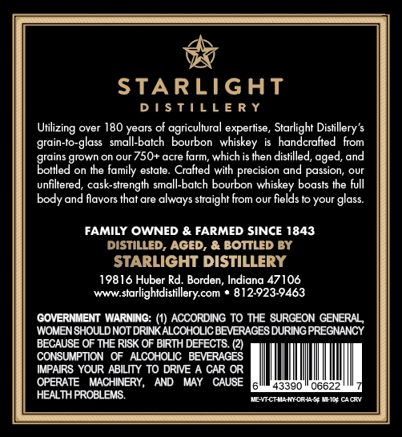
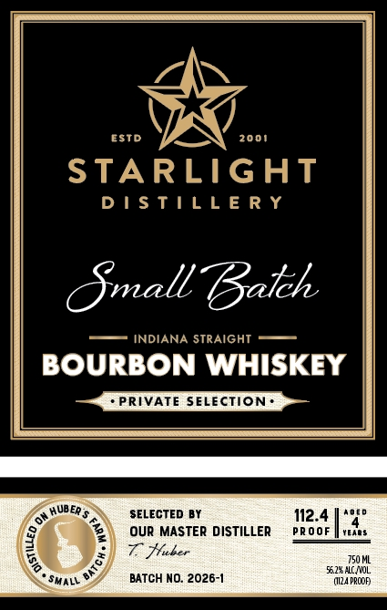

# TTB COLA Label Images - TTBID 26287001000091

**Brand Name:** STARLIGHT DISTILLERY

**Fanciful Name:** SMALL BATCH

**Issue Date:** 10/19/2026

**Origin Code:** 19

**Product Class/Type:** 101

**Source:** [TTB Public COLA Registry](https://ttbonline.gov/colasonline/viewColaDetails.do?action=publicFormDisplay&ttbid=26287001000091)

## Label Images

### Back Label

### Front Label

## Extracted Label Text

*Text extracted via OCR - may contain errors*

### Back Label

DISTILLERY
Urlizing over 180 years of agricultural expertise, Starlight Distillery’s
grain-to-glass small-batch bourbon whiskey is handcrafted from
grains grown on our 750+ acre farm, which is then distilled, aged, and
Bottled on the family estate. Crafted with precision and passion, our
unfiltered, cask-strength small-batch bourbon whiskey boasts the full
body and flavors that are always straight from our fields to your glass.
FAMILY OWNED & FARMED SINCE 1843
DISTILLED, AGED, & BOTTLED BY
STARLIGHT DISTILLERY
19816 Huber Rd. Borden, Indiana 47106
www.starlightdistllery.com * 812:923-9463
GOVERNMENT WARNING: (1) ACCORDING TO THE SURGEON GENERAL,
WOMEN SHOULD NOT DRINK ALCOHOLIC BEVERAGES DURING PREGNANCY
BECAUSE OF THE RISK OF BIRTH DEFECTS. (2)
‘CONSUMPTION OF ALCOHOLIC BEVERAGES
IMPAIRS YOUR ABILITY TO DRIVE A CAR OR
OPERATE MACHINERY, AND MAY CAUSE
HEALTH PROBLEMS. METECEAAHFORAS MEI CARY

### Front Label

ESTD
2001
STARLIGHT
D | $ TIL L E R Y
Omall Bateh
INDIANA STRAIGHT
BOURBON WHISKEY
PRIVATE SELECTION
HUBER $
SELECTED BY
112.4
Our MASTER DISTILLER
PR ooF
YEae $
T Huber
750 ML
51.2% ALL_ OL
SMALL
BATCH NO: 2026-|
(II24 PRCOF
6
BATE
