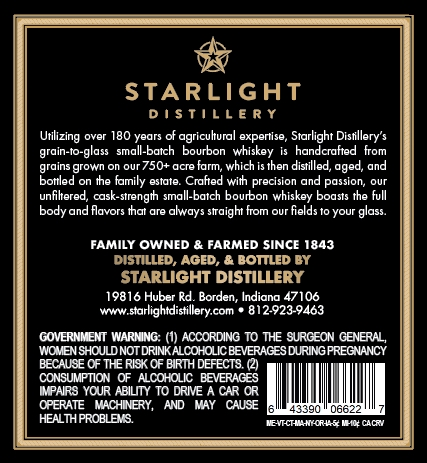
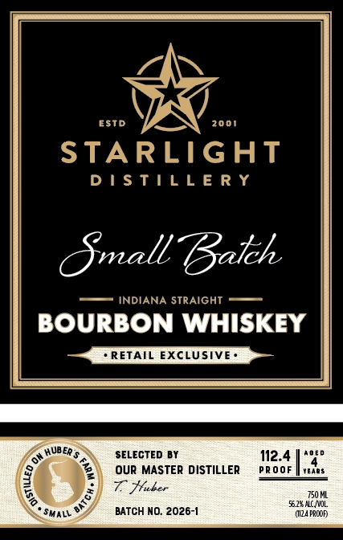

# TTB COLA Label Images - TTBID 26287001000095

**Brand Name:** STARLIGHT DISTILLERY

**Fanciful Name:** SMALL BATCH

**Issue Date:** 10/19/2026

**Origin Code:** 19

**Product Class/Type:** 101

**Source:** [TTB Public COLA Registry](https://ttbonline.gov/colasonline/viewColaDetails.do?action=publicFormDisplay&ttbid=26287001000095)

## Label Images

### Back Label

### Front Label

## Extracted Label Text

*Text extracted via OCR - may contain errors*

### Back Label

STARLIGHT
D / $TiL L € R Y
Urilizing
Ovam
180 years of agriculural expertise, Starlight Disiillery' $
grain-to-glass   small-batch
bourbon whiskey
handcrafted from
grown
750+ acre farm; which is then distilled, aged
and
pcaited
Ihe tamily estate
Crattfed with precision and passion
unfilered, cask-strength small-batch bourbon whiskey boasts the full
body and flavors that are always straight from our fields to your glass.
FAMILY OWNED & FARMED SINCE 1843
Distilled; AgED; & Bottled By
STARLIGHT DISTILLERY
19816 Huber Rd. Borden, Indiana
Www starlightdistillery com
812923-9463
GOVERNMENT WARNING: (1) ACCORDING TO THE SURGEON GENERAL ,
WCMEN SHOULD NOT DRINKALCOHOLIC BEVERAGES DURING PREGNANCY
BECAUSE OF THE RISK OF BIRTH DEFECTS (2
CONSUMPTION
ALCOHOLIC   BEVERAGES
MPAIRS YOUR ABIVTY TO DRIVE
CAR OR
OPERATE
MACHINERY,
AND
MAY
CAUSE
43390
06622
HEALTHPROBLES
Menmctr trall{nncace
47106

### Front Label

ESTD
2001
STARLIGHT
D ! $ TIL L E R Y
Omall Baleh
INDIANA STRAIGHT
BOURBON WHISKEY
RETAIL EXCLUSIVE'
HUBER $
SELECTED BY
112.4
OuR MASTER DISTILLER
PR ooF
YEae $
7 Huber
750 ML
551.2" ALL AOL
SMALL
BATCH NO: 2026-1
(I12A PPCOF
8
BAT C
