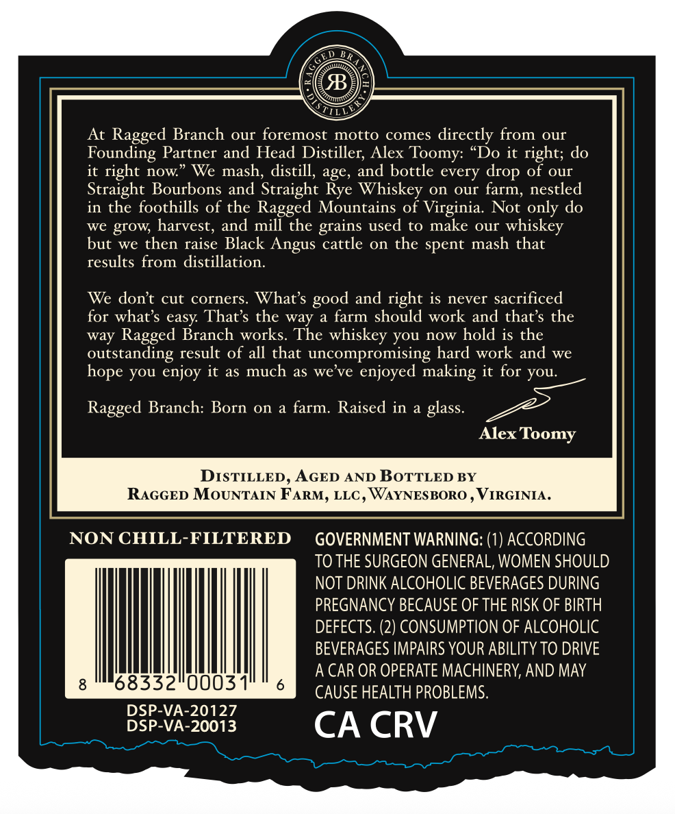
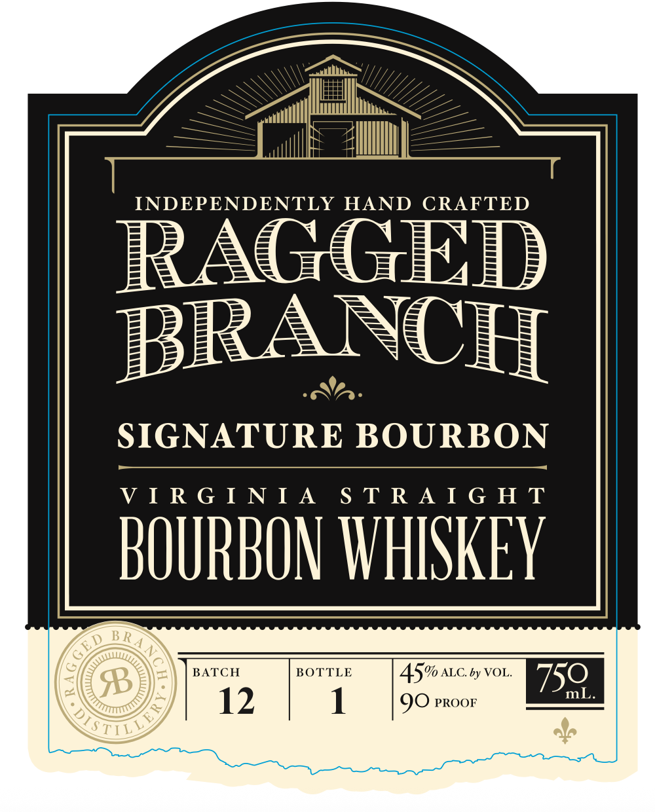

# TTB COLA Label Images - TTBID 26287001000098

**Brand Name:** RAGGED BRANCH

**Fanciful Name:** SIGNATURE BOURBON

**Issue Date:** 10/19/2026

**Origin Code:** 05

**Product Class/Type:** 101

**Source:** [TTB Public COLA Registry](https://ttbonline.gov/colasonline/viewColaDetails.do?action=publicFormDisplay&ttbid=26287001000098)

## Label Images

### Back Label

### Front Label

## Extracted Label Text

*Text extracted via OCR - may contain errors*

### Back Label

At Ragged Branch
ouI foremost motto comes directly from
our
Founding Partner and Head Distiller; Alex Toomy:
Do it right; do
it
right now
We mash, distill
age, and bottle every
of Our
Straight Bourbons and Straight Rye Whiskey on our farm, nestled
in the foothills of the Ragged Mountains of Virginia.
Not only do
we grow; harvest, and mill the
used to make our
whiskey
but we then raise Black
Angus cattle on the spent mash that
results from distillation.
We dont cut corners
What s
and right is never sacrificed
for what $ easy That $ the way
farm should work and that $ the
way Ragged Branch works
The
whiskey you now hold is the
outstanding result of all that uncompromising hard work and we
you enjoy it as much as we've
enjoyed making it for you:
Ragged Branch: Born on
a farm;
Raised in
glass.
Alex Toomy
DISTILLED , AGED AND BOTTLED BY
RAGGED MoUNTAIN FARM, LLC , WAYNESBORO
VIRGINIA.
NON CHILL-FILTERED
GOVERNMENT WARNING: (1) ACCORDING
TO THE SURGEON GENERAL, WOMEN SHOULD
NOT DRINK ALCOHOLIC BEVERAGES DURING
PREGNANCY BECAUSE OF THE RISK OF BIRTH
DEFECTS: (2) CONSUMPTION OF ALCOHOLIC
BEVERAGES IMPAIRS YOUR ABILITY TO DRIVE
A CAR OR OPERATE MACHINERY, AND MAY
68332"0003
CAUSE HEALTH PROBLEMS.
DSP-VA-20127
DSP-VA-20013
CA CRV
drop
grains
good
hope

### Front Label

INDEPENDENTLY HAND CRAFTED
BRANCH
SIGNATURE BOURBON
VIRGINIA STRAIGHT

138) BATCH BOTTLE 45% auc. ty vou. 759 |
12 1 QO proor
STILY fp
