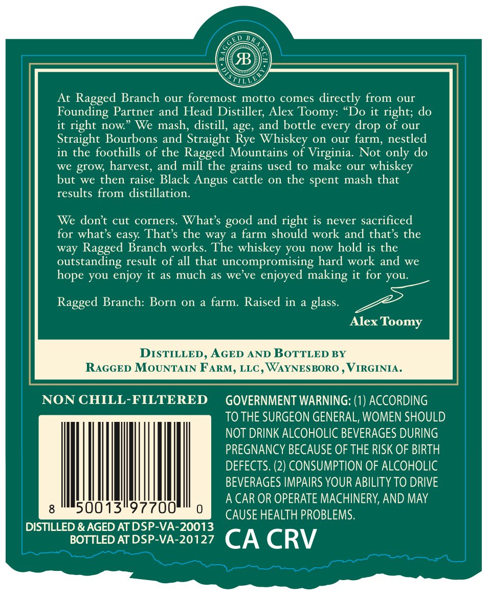
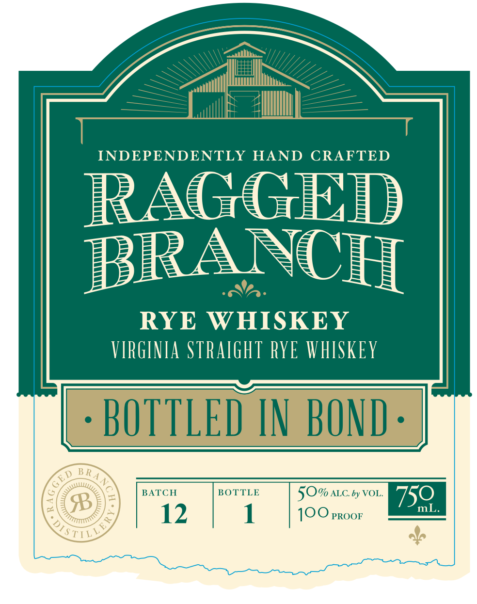

# TTB COLA Label Images - TTBID 26287001000104

**Brand Name:** RAGGED BRANCH

**Fanciful Name:** STRAIGHT RYE WHISKEY BOTTLED IN BOND

**Issue Date:** 10/30/2026

**Origin Code:** 05

**Product Class/Type:** 110

**Source:** [TTB Public COLA Registry](https://ttbonline.gov/colasonline/viewColaDetails.do?action=publicFormDisplay&ttbid=26287001000104)

## Label Images

### Back Label

### Front Label

## Extracted Label Text

*Text extracted via OCR - may contain errors*

**Detected Proof:** 100

### Back Label

B
At
Ragged Branch our foremost motto comes directly from our
Founding Partner and Head Distiller; Alex Toomy: "Do it right; do
it right now
We mash, distill, age, and bottle every drop of our
Straight Bourbons and Straight Rye Whiskey on our farm; nestled
in the foothills of the Ragged Mountains of Virginia.
Not only do
we grow; harvest, and mill the
used to make
our
whiskey
but we then raise Black Angus cattle on the spent mash that
results from distillation.
We dont cut corners. What's
and right is never sacrificed
for what'$ easy That s the way
a farm should work and that's the
way
Ragged Branch works: The whiskey you now hold is the
outstanding result of all that uncompromising hard work and
we
you enjoy it as much as we've
enjoyed making it for you:
Ragged Branch: Born
on
farm. Raised in
glass.
Alex Toomy
DISTILLED , AGED AND BOTTLED BY
RAGGED MOUNTAIN FARM, LLC , WAYNESBORO
VIRGINIA .
NON CHILL-FILTERED
GOVERNMENT WARNING: (1) ACCORDING
TO THE SURGEON GENERAL, WOMEN SHOULD
NOT DRINK ALCOHOLIC BEVERAGES DURING
PREGNANCY BECAUSE OF THE RISK OF BIRTH
DEFECTS. (2) CONSUMPTION OF ALCOHOLIC
BEVERAGES IMPAIRS YOUR ABILITY TO DRIVE
A CAR OR OPERATE MACHINERY, AND MAY
50013"97700
CAUSE HEALTH PROBLEMS.
DISTILLED & AGED AT DSP-VA-20013
BOTTLED AT DSP-VA-20127
CA CRV
grains
good
hope

### Front Label

INDEPENDENTLY
HAND
CRAFTED
RAGGED
BRANCH
RYE WHISKEY
VIRGINIA STRAIGHT RYE VHISKEY
BOTTLED IN  BOND
60 BRA
BATCH
BOTTLE
50% ALC by VOL
750
B
mL-
12
1
100 PROOF
TILL
2
