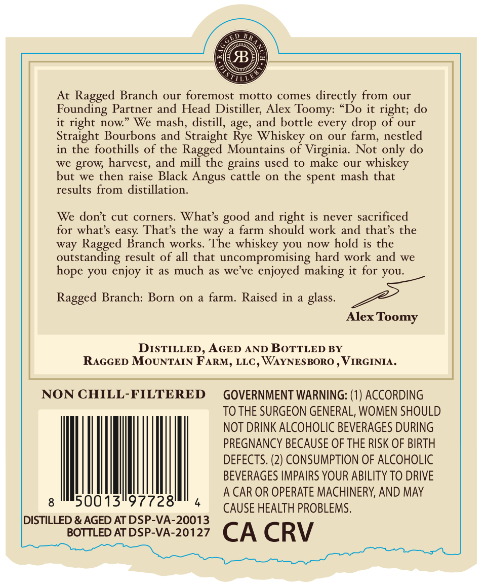
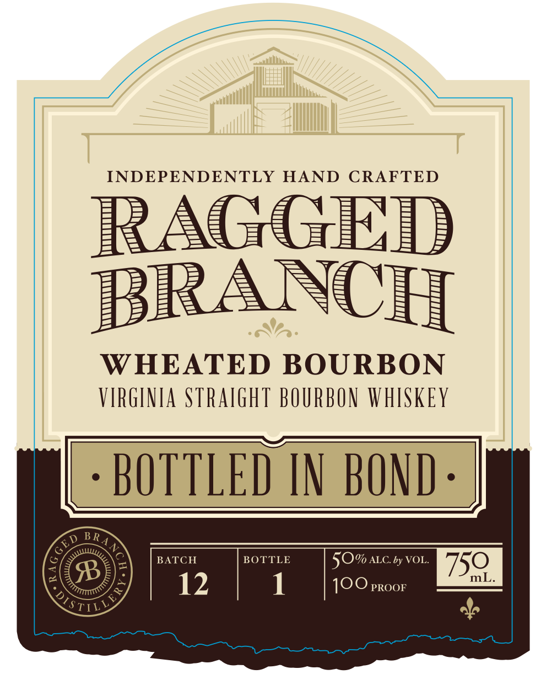

# TTB COLA Label Images - TTBID 26287001000118

**Brand Name:** RAGGED BRANCH

**Fanciful Name:** WHEATED BOURBON BOTTLED IN BOND

**Issue Date:** 10/21/2026

**Origin Code:** 05

**Product Class/Type:** 111

**Source:** [TTB Public COLA Registry](https://ttbonline.gov/colasonline/viewColaDetails.do?action=publicFormDisplay&ttbid=26287001000118)

## Label Images

### Back Label

### Front Label

## Extracted Label Text

*Text extracted via OCR - may contain errors*

**Detected Proof:** 100

### Back Label

At Ragged Branch our foremost motto comes directly from
our
Founding Partner and Head Distiller; Alex Toomy:
'Do it right; do
it right now
We mash, distill, age, and bottle every
of our
Straight Bourbons and Straight Rye Whiskey on our farm, nestled
in the foothills of the Ragged Mountains of Virginia.
Not only do
we
harvest, and
mill the grains used to
make our
whiskey
but we then raise Black
Angus cattle
on the spent mash that
results from
distillation.
We dont cut corners
What s
and right is never sacrificed
for whats easy That's the way
farm should work and thats the
way Ragged Branch works. The whiskey you now hold is the
outstanding result of all that uncompromising hard work and we
you enjoy it as much
as we ve
enjoyed making it for you:
Ragged Branch: Born on
a farm.
Raised in
glass_
Alex Toomy
DISTILLED , AGED AND BOTTLED BY
RAGGED MOUNTAIN FARM, LLC , WAYNESBORO
VIRGINIA _
NON CHILL-FILTERED
GOVERNMENT WARNING: (1) ACCORDING
TO THE SURGEON GENERAL, WOMEN SHOULD
NOT DRINK ALCOHOLIC BEVERAGES DURING
PREGNANCY BECAUSE OF THE RISK OF BIRTH
DEFECTS. (2) CONSUMPTION OF ALCOHOLIC
BEVERAGES IMPAIRS YOUR ABILITY TO DRIVE
A CAR OR OPERATE MACHINERY, AND MAY
50013"97728'
CAUSE HEALTH PROBLEMS.
DISTILLED & AGED AT DSP-VA-20013
BOTTLED AT DSP-VA-20127
CA CRV
drop
grow;
good
hope

### Front Label

INDEPENDENTLY
HAND
CRAFTED
RAGGED
BRANCH
WHEATED BOURBON
VIRGINIA Straighi BOURBON WHISKEY
BOTTLED IN BOND
BATCH
BOTTLE
5O% ALCby VOL:
750
B
mL
12
1
100 PROOF
STILL
BR
GED
