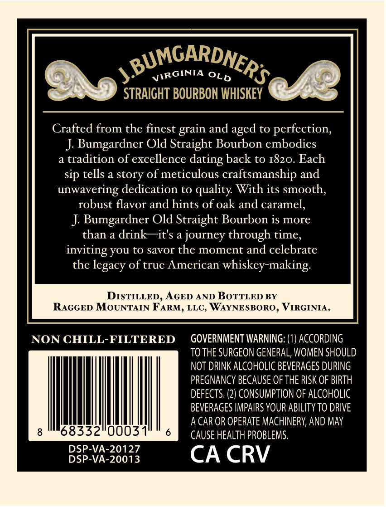
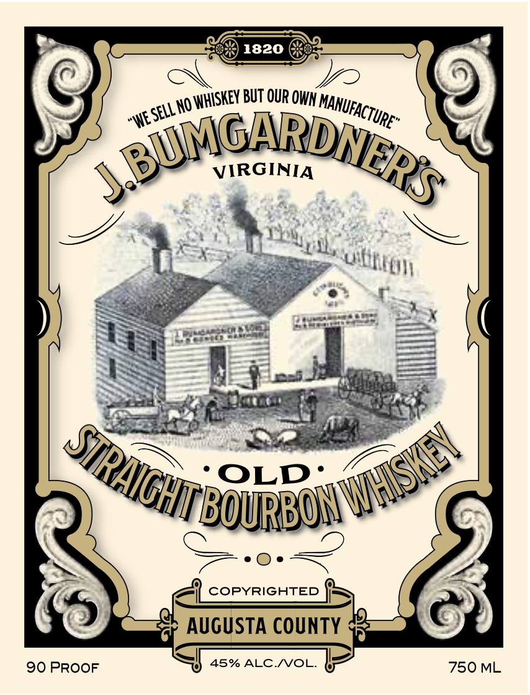

# TTB COLA Label Images - TTBID 26287001000128

**Brand Name:** J. BUMGARDNER'S VIRGINIA OLD STRAIGHT BOURBON WHISKEY

**Issue Date:** 11/12/2026

**Origin Code:** 05

**Product Class/Type:** 101

**Source:** [TTB Public COLA Registry](https://ttbonline.gov/colasonline/viewColaDetails.do?action=publicFormDisplay&ttbid=26287001000128)

## Label Images

### Back Label

### Front Label

## Extracted Label Text

*Text extracted via OCR - may contain errors*

**Detected Proof:** 90

### Back Label

BuMGardNeRs
STRAICHT BOURBON WHISKEY
Crafted from the finest _
and
to
perfection,
J Bumgardner Old Straight Bourbon embodies
a tradition of excellence
back to 1820. Each
sip tells a story of meticulous craftsmanship and
unwavering dedication to quality With its smooth;
robust flavor and hints of oak and caramel,
J Bumgardner Old Straight Bourbon is more
than a drink ~it's a journey through time,
inviting you to savor the moment and celebrate
the
legacy of true American whiskey-making
DISTILLED , AGED
AND BOTTLED BY
RAGGED MOUNTAIN FARM, LLC, WAYNESBORO, VIRGINIA _
NON CHILL-FILTERED
GOVERNMENT WARNING: (1) ACCORDING
TO THE SURGEON GENERAL, WOMEN SHOULD
NOT DRINK ALCOHOLIC BEVERAGES DURING
PREGNANCY BECAUSE OF THE RISK OF BIRTH
DEFECTS. (2) CONSUMPTION OF ALCOHOLIC
BEVERAGES IMPAIRS YOUR ABILITy TO DRIVE
A CAR OR OPERATE MACHINERY; AND MAY
68332"00031
CAUSE HEALTH PROBLEMS.
DSP-VA-20127
DSP-VA-20013
CA CRV
VIRGINIA
OLD
aged
grain
dating

### Front Label

1820
BUT OUR (
No
'WE S
SeDMCARDie,S
VIRGINIA
OLD
COPYRIGHTED
AUGUSTA COUNTY
90 PROOF
45% ALC NOL
750 ML
WHISKEY
OWN
MANUFACTURE"
SELL
'BouRBONwHSKEN _
STRACHIE
