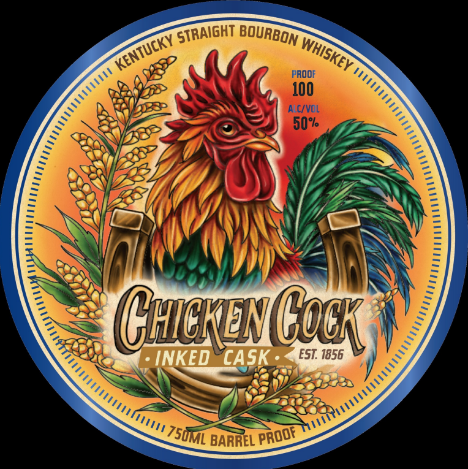
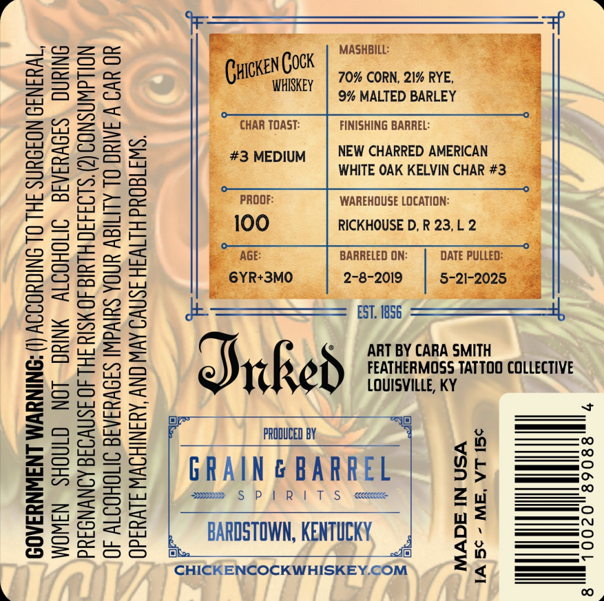

# TTB COLA Label Images - TTBID 26287001000280

**Brand Name:** CHICKEN COCK

**Fanciful Name:** INKED CASK

**Issue Date:** 10/27/2026

**Origin Code:** 35

**Product Class/Type:** 101

**Source:** [TTB Public COLA Registry](https://ttbonline.gov/colasonline/viewColaDetails.do?action=publicFormDisplay&ttbid=26287001000280)

## Label Images

### Label 1

### Label 2

## Extracted Label Text

*Text extracted via OCR - may contain errors*

**Detected Proof:** 100

### Label 1

PROOF
100
ALC/VOL
50%
ChekiivGock
INKED
CASK
EST  1856
BARREL
STRAIGHT
BOURBON
KENTUCKY
WHISKEY ,
75UML
PROOr

### Label 2

(I) ACCORDING TO THE SURGEON GENERAL,

GOVERNMENT WARNING

WOMEN SHOULD NOT DRINK ALCOHOLIC BEVERAGES DURING
PREGNANCY BECAUSE OF THE RISK OF BIRTH DEFECTS. (2) CONSUMPTION

OF ALCOHOLIC BEVERAGES IMPAIRS YOUR ABILITY TO DRIVE A CAR OR

OPERATE MACHINERY, AND MAY CAUSE HEALTH PROBLEMS.

&

70% CORN, 21% RYE,
9% MALTED BARLEY

FINISHING BARREL:

NEW CHARRED AMERICAN
WHITE OAK KELVIN CHAR #3.

WAREHOUSE LOCATION:
RICKHOUSE D, R 23,L 2 —

BARRELED ON:

DATE

PRODUCED BY,

ART BY CARA SMITH
FEATHERMOSS TATTOO COLLECTIVE
LOUISVILLE, KY

IO}

GRAIN & BARREL

oe SPIRITS

BARDSTOWN, KENTUCKY.

f=)

CHICKENCOCKWHISKEY.COM

MADE IN USA
1A 5¢ - ME, VT 15¢
