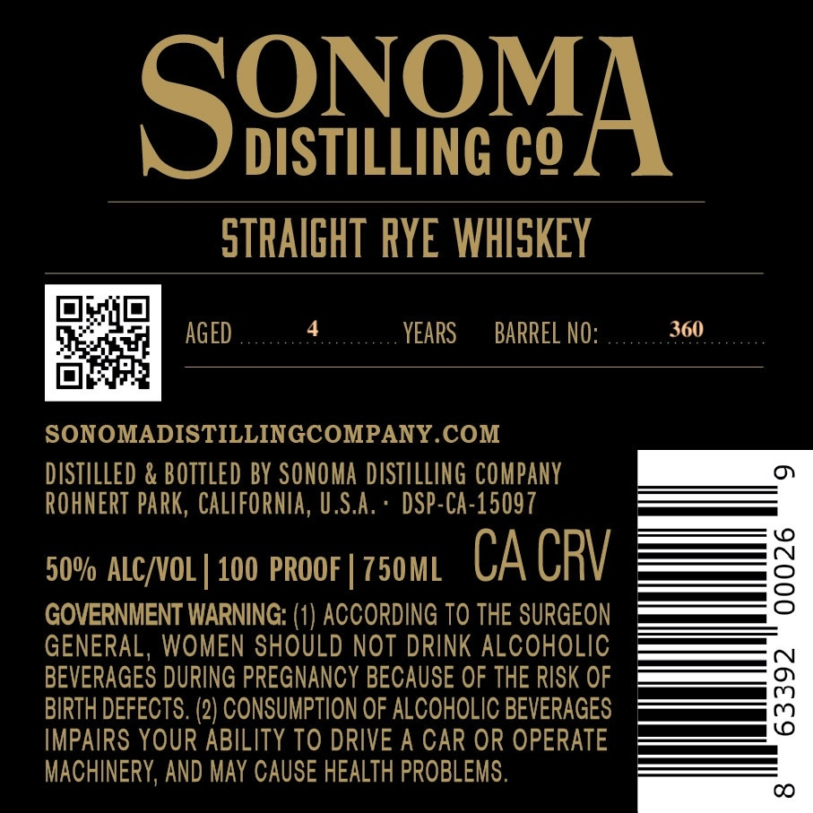
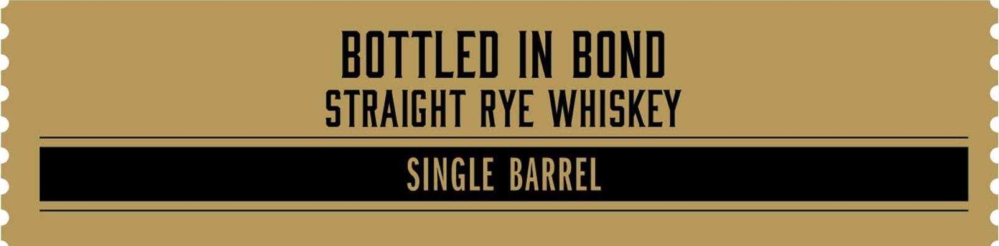
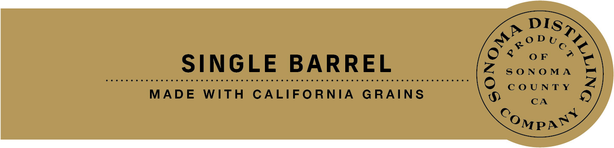

# TTB COLA Label Images - TTBID 26287001000301

**Brand Name:** SONOMA DISTILLING COMPANY

**Issue Date:** 10/19/2026

**Origin Code:** 01

**Product Class/Type:** 112

**Source:** [TTB Public COLA Registry](https://ttbonline.gov/colasonline/viewColaDetails.do?action=publicFormDisplay&ttbid=26287001000301)

## Label Images

### Back Label

### Front Label

### Label 4

## Extracted Label Text

*Text extracted via OCR - may contain errors*

**Detected Proof:** 100

### Back Label

SoiowA
DISTILLING €Q
STRAIGHT RYE WHISKEY
AGED
YEARS
BARREL NO:
360
SONOMADISTILLINGCOMPANY COM
DISTILLED & BOTTLED BY SONOMA  D ISTILLING CoMpany
ROHNERT PaRk,  CaLIFORNIA , U,S.A:
DSP-CA-15097
50v ALC/VOL | 100 PROOF
750ML
CA CRV
2
GOVERNMENT WARNING: (1) ACCORDING TO THE SURGEON
GENERAL, WOMEN SHOULD NOT DRINK ALCOHOLIC
BEVERAGES DURING PREGNANCY BECAUSE OF THE RISK OF
BIRTH DEFECTS. (2) CONSUMPTION OF ALCOHOLIC BEVERAGES
3
IMPAIRS YOUR ABILITY TO DRIVE A CAR OR OPERATE
MACHINERY, AND May CAUSE HEALTH PROBLEMS.
CO

### Front Label

BOTTLED IN BOND
STRAIGHT RYE WHISKEY

SINGLE BARREL

### Label 4

DIS

O% oF

Sn

(OD te7 5

xe

SINGLE BARREL

Zz SONOMA

MADE WITH CALIFORNIA GRAINS

COUNTY

CA

(e

oO

MP awe
