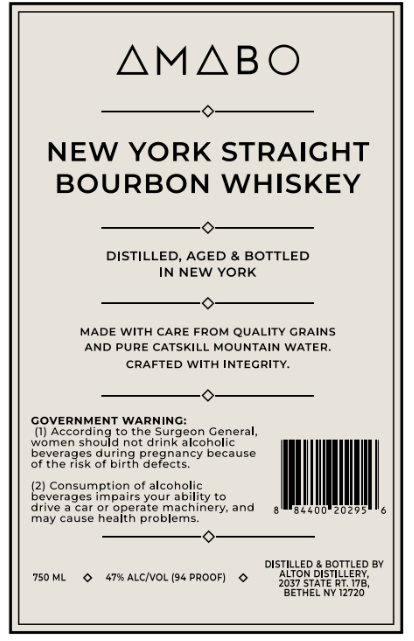
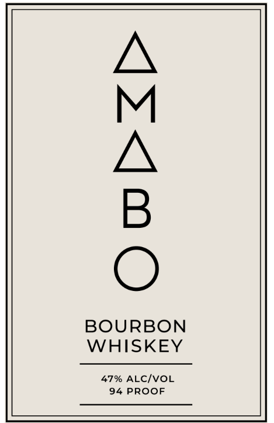

# TTB COLA Label Images - TTBID 26287001000329

**Brand Name:** AMABO BOURBON WHISKEY

**Issue Date:** 10/19/2026

**Origin Code:** 02

**Product Class/Type:** 141

**Source:** [TTB Public COLA Registry](https://ttbonline.gov/colasonline/viewColaDetails.do?action=publicFormDisplay&ttbid=26287001000329)

## Label Images

### Back Label

### Front Label

## Extracted Label Text

*Text extracted via OCR - may contain errors*

*1 image(s) excluded: text did not meet readability threshold*

**Detected Proof:** 94

### Back Label

AMABO
NEW YORK STRAIGHT
BOURBON WHISKEY
DISTILLED_
AGED
BOTTLED
IN NEW YORK
MADE WITH CARE FROM QUALiTY CRAINS
AND PURE CATSKILL MOUNTAIN WATER;
CRAFTED With INTECRITY:
GOVERNMENT WARNING:
(I) According to the Surgeon General,
Ldm
Ghauo
drink alcoholic
bevcrgcs
dunna
orconjncy
pecjusc
of the risk of birth defects.
(21 Consumption 0f alcoholic
beverages
Imdaisyoui
ability t0
arive
car 0r operate machinery; ana
202
Id
cause health problems
DISTILLED
BOTTLED BY
750 ML
479 ALC{VOL (94 ProoF)
ALTON DISTILLERY
28ETHENy12726'
not
