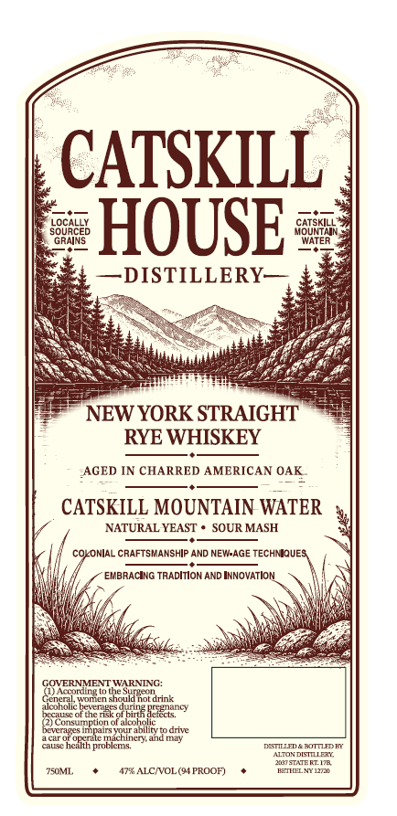
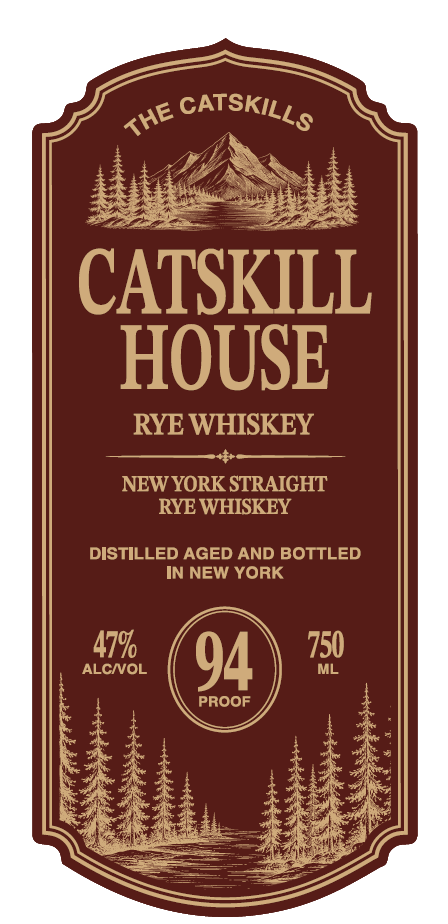
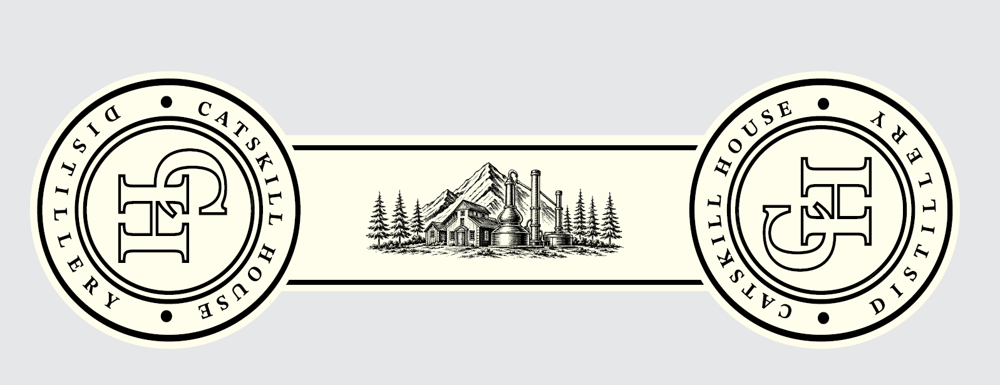

# TTB COLA Label Images - TTBID 26287001000340

**Brand Name:** CATSKILL HOUSE RYE WHISKEY

**Issue Date:** 11/09/2026

**Origin Code:** 02

**Product Class/Type:** 102

**Source:** [TTB Public COLA Registry](https://ttbonline.gov/colasonline/viewColaDetails.do?action=publicFormDisplay&ttbid=26287001000340)

## Label Images

### Back Label

### Front Label

### Label 2

## Extracted Label Text

*Text extracted via OCR - may contain errors*

*1 image(s) excluded: text did not meet readability threshold*

**Detected Proof:** 91

### Back Label

CATSKILL
s8Ga845
HOUSE
fousny
DISTILLERY
NEW YORK STRAIGHT
RYE WHISKEY
AGED IN CHARRED AMERICAN OAK
CATSKILL MOUNTAIN WATER
NATURAL YEAST
SOUR MASH
COXONIAL CRAFTSMANSHiP AND NEVLAGE TecHMQUES
EMBRACING TRADITION AND INNOVATION
GOVERNMENT WARNING:
Accnranelu (ntz
Ccnerl woni
cn should HoUdrink
AUcutlulc bcrer
plLAL-
orchctisk odhiqa aeecncy
(2) Cunsurpption ol alcoholic
Dcurncs
nutahilin
drive
4cur ur uperule ML
ctunenand [Luy
Cal2 hcalth nmbicma
@anDZapDI
CTO DISTLLET
LIet4B
750MT.
47R ALC VOL (91PROOF)
RETHMI U

### Front Label

CATSKILL
HOUSE
RYE WHISKEY
NEW YORK STRAIGHT
RYE WHISKEY
DISTILLED AGED AND BOTTLED
IN NEW YORK
ALCNOL
479
94
750
ML
PROOF
CATSKILLS
THE
