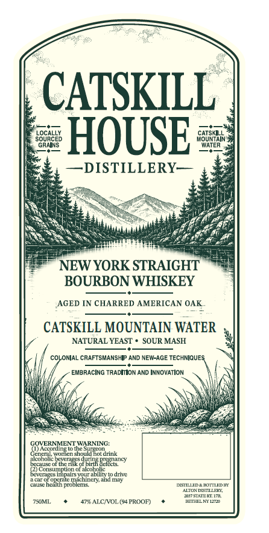
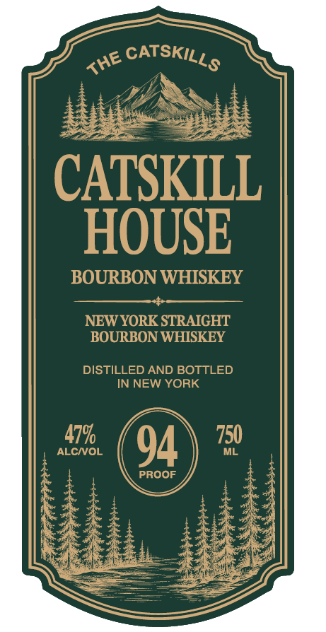
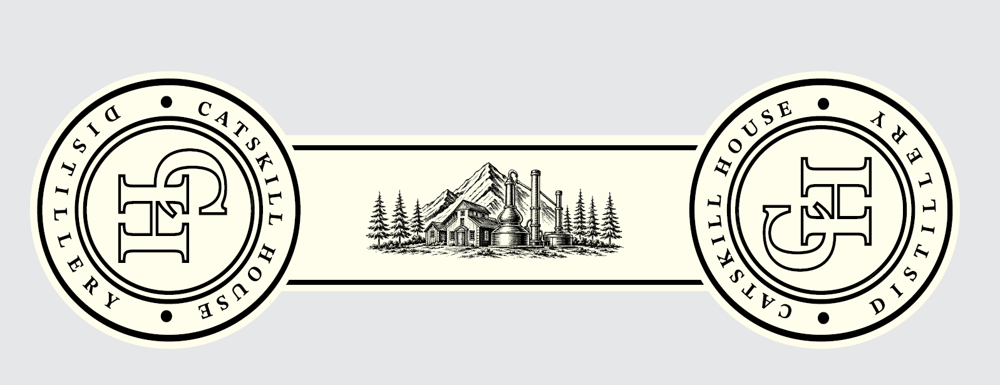

# TTB COLA Label Images - TTBID 26287001000344

**Brand Name:** CATSKILL HOUSE BOURBON WHISKEY

**Issue Date:** 11/06/2026

**Origin Code:** 02

**Product Class/Type:** 101

**Source:** [TTB Public COLA Registry](https://ttbonline.gov/colasonline/viewColaDetails.do?action=publicFormDisplay&ttbid=26287001000344)

## Label Images

### Back Label

### Front Label

### Label 2

## Extracted Label Text

*Text extracted via OCR - may contain errors*

*1 image(s) excluded: text did not meet readability threshold*

**Detected Proof:** 94

### Back Label

CATSKILL
LOCALLY
CATSKILL
SQHRCEP
HOUSE
VoUtERIN
~DISTILLERY
NEW YORK STRAIGHT
BOURBON WHISKEY
AGED IN CHARRED AMERICAN OAK
CATSKILL MOUNTAIN WATER
NATURAL YEAST
SOUR MASH
COLONIAL CRAFTSMANSHI? AND NEW-AGE TECHNIQUES
EMBRACING TRADION AND INNOVATION
GOYERINMENT WARUNING:
(1) According tn the
Cenrta
Wm
Cn sheSldBoarink
aIconomc
bccausc
ot the gesotppimk Ecizct cy
bocrat
Cons  ntioi oulcolalicy .
todm
a C
hen-auQ Lit
causc
'heau5 prc
proplems
DESTLLED Z BOTTUDE
To - DMEILFH
J7SIAZELIZH
7SOML
47RALCVOL (YTROOD)
EEIAJ7

### Front Label

CATSKILL
HOUSE
BOURBON WHISKEY
NEW YORK STRAIGHT
BOURBON WHISKEY
DISTILLED AND BOTTLED
IN NEW YORK
47%
750
ALCIOL
94
ML
PROOF
CATSKILLS
THE
