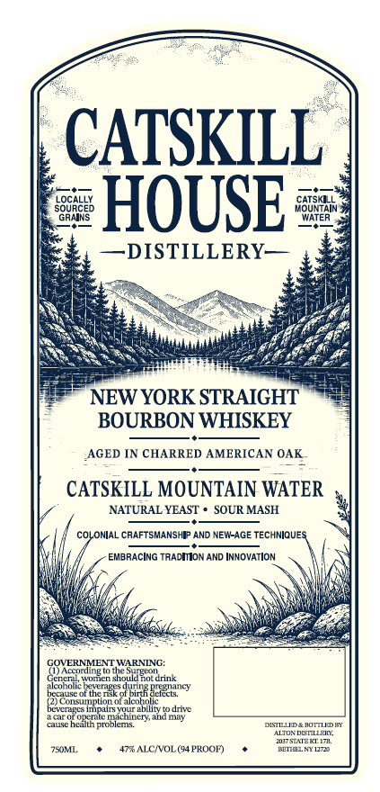
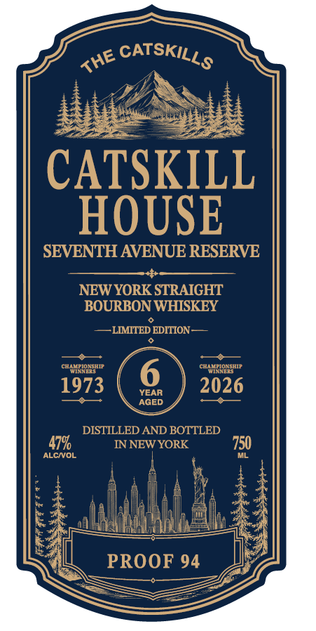
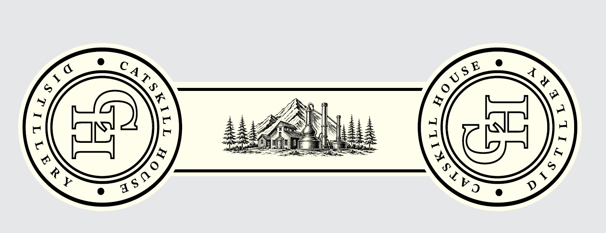

# TTB COLA Label Images - TTBID 26287001000353

**Brand Name:** CATSKILL HOUSE SEVENTH AVENUE RESERVE

**Issue Date:** 11/10/2026

**Origin Code:** 02

**Product Class/Type:** 101

**Source:** [TTB Public COLA Registry](https://ttbonline.gov/colasonline/viewColaDetails.do?action=publicFormDisplay&ttbid=26287001000353)

## Label Images

### Back Label

### Front Label

### Label 2

## Extracted Label Text

*Text extracted via OCR - may contain errors*

*1 image(s) excluded: text did not meet readability threshold*

**Detected Proof:** 94

### Back Label

CATSKILL
SOGaCE8
HOUSE
coUs il
GRNINS
WATER
~DISTILLERY
NEW YORK STRAIGHT
BOURBON WHISKEY
AGED IN CHARRED AMERICAN OAK
CATSKILL MOUNTAIN WATER
NATURAL YEAST
SOUR MASH
COLONiAL CRAFTSMANSHI? AND NEW-AGE TECHNIQUES
EMBRACING TRADIION AND INNOWATION
COVERNMENTWARNINC:
Cenera
44TCO VOngCn shouidBorarink
alcunuc
hcramg
ot themgksol
Eztzcts cy
{)Consunplon ofalcoho
bCvETgrs impairs yqur abilityto dnt
IC
nem
achltery and miy
camgcnea
problems
MSTIEDAHOTLEDE
ALTONX DCTIZLLER
OmaFVIIZEITH
7SOML
4RALCNVOL (4PROOF)
EEHENEI

### Front Label

CATSKILL
HOUSE
SEVENTH AVENUE RESERVE
NEW YORK STRAIGHT
BOURBON WHISKEY
LMMTED EDITION
CHAMRIOESHIP
CHAMRIOASHIP
1973
YEAR
2026
AGED
DISTILLED AND BOTTLED
479
IN NEW YORK
750
ALCNOL
PROOF 94
CATSKILLS
THE
