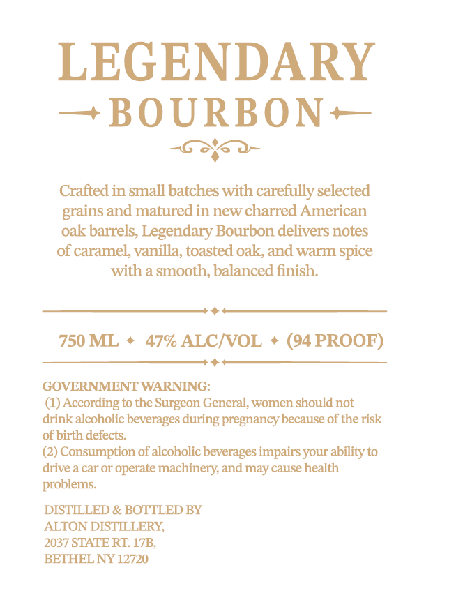
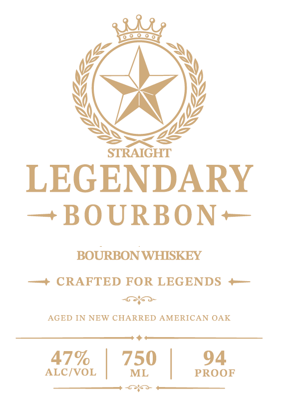

# TTB COLA Label Images - TTBID 26287001000356

**Brand Name:** LEGENDARY BOURBON

**Issue Date:** 11/06/2026

**Origin Code:** 02

**Product Class/Type:** 101

**Source:** [TTB Public COLA Registry](https://ttbonline.gov/colasonline/viewColaDetails.do?action=publicFormDisplay&ttbid=26287001000356)

## Label Images

### Back Label

### Front Label

## Extracted Label Text

*Text extracted via OCR - may contain errors*

**Detected Proof:** 94

### Back Label

LEGENDARY
BOURBON
Crafted in small batches with carefully selected
grains and matured in new charred American
oak barrels; Legendary Bourbon delivers notes
of caramel, vanilla, toasted oak, and warm spice
with a smooth, balanced finish:
750 ML
47% ALCIVOL
(94 PROOF)
GOVERNMENTWARNING:
(1) According to the Surgeon General, women should not
drink alcoholic beverages during pregnancy because of the risk
of birth defects.
Consumption of alcoholic beverages impairs
ability to
drive a car or operate
machinery; and may cause health
problems:
DISTILLED & BOTTLED BY
ALTON DISTILLERY,
2037 STATE RT 17B,
BETHEL NY 12720
your

### Front Label

LEGENDARY
— BOURBON+

BOURBON WHISKEY
— + CRAFTED FOR LEGENDS +—
as
AGED IN NEW CHARRED AMERICAN OAK

47%

ALC/VOL

750 |

Pose

rose
