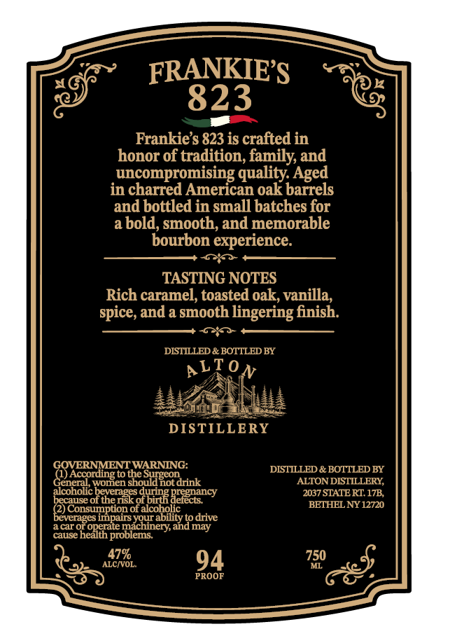
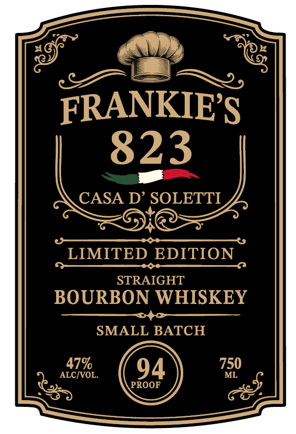

# TTB COLA Label Images - TTBID 26287001000368

**Brand Name:** FRANKIE'S 823 BOURBON WHISKEY

**Issue Date:** 11/06/2026

**Origin Code:** 02

**Product Class/Type:** 101

**Source:** [TTB Public COLA Registry](https://ttbonline.gov/colasonline/viewColaDetails.do?action=publicFormDisplay&ttbid=26287001000368)

## Label Images

### Back Label

### Front Label

## Extracted Label Text

*Text extracted via OCR - may contain errors*

### Back Label

FRANKIES
823
Frankies 823 is crafted in
honor of tradition, family and
uncompromising quality Aged
in charred American oak barrels
and bbottled in small batches for
a bold, smooth; and memorable
bourbon experience:
TASTING NOTES
Rich caramel; toasted oak; vanilla;
spice, and a smooth lingering finish_
DISTLLED & BOTTLED BY
ALToN
DISTILLERY
CSHERNMENTWARNING:
the
DISTILLED & BOTTLED BY
General
necao rdorgep thosldHord
not drink
ALTON DISTILLERY;
becouseob
the sk odbig Beiectancy
2037 STATERT 17B,
because
BETHEL NY 12720
Evconsumponor
oucobolivy
to drive
caror
KEpGg
and may
cause
problems
ALCIVOL
479
94
750
ML
PROOF
thet

### Front Label

FRANKIES
823
CASA D' SOLETTI
LIMITED EDITION
STRAIGHT
BOURBON WHISKEY
SMALL BATCH
479
94
750
ALCIVOL
ML
PROOF
