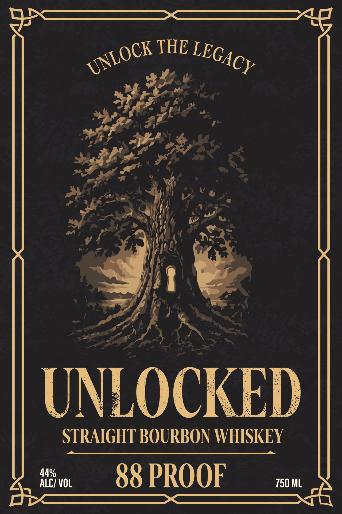
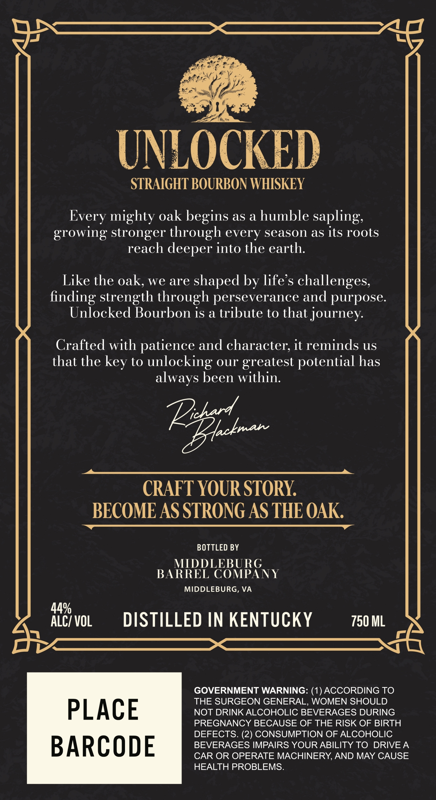
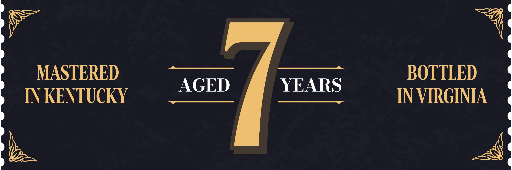

# TTB COLA Label Images - TTBID 26287001000373

**Brand Name:** UNLOCKED

**Issue Date:** 10/20/2026

**Origin Code:** 05

**Product Class/Type:** 101

**Source:** [TTB Public COLA Registry](https://ttbonline.gov/colasonline/viewColaDetails.do?action=publicFormDisplay&ttbid=26287001000373)

## Label Images

### Back Label

### Label 1

### Label 2

## Extracted Label Text

*Text extracted via OCR - may contain errors*

**Detected Proof:** 88

### Back Label

THE
UNLOCKED
STRAIGHT BOURBON WHISKEY
AZCZ vol
88 PROOF
750 ML
UNLOCK
LEGACY

### Label 1

UNLOCKED
STRAIGHT BOURBON WHISKEY
Every mighty oak begins as a humble sapling:
growing stronger through every season as its roots
reach deeper into the earth:
Like the oak; we are shaped by life s challenges;
finding strength through perseverance and purpose:
Unlocked Bourbon is a tribute to that journey:
Crafted with patience and character; it reminds us
that the
to
unlocking our greatest potential has
always been within:
Pez;d
{cknan
CRAFT YOUR STORY
BECOME AS STRONG AS THE OAK
BOTTLED BY
MIDDLEBURG
BARREL COMPANY
MIDDLEBURG, VA
44%
ALCI VOL
DISTILLED IN KENTUCKY
750 ML
GOVERNMENT WARNING: (1) ACCORDING TO
THE SURGEON GENERAL, WOMEN SHOULD
PLACE
NOT DRINKALCOHOLIC BEVERAGES DURING
PREGNANCY BECAUSE OF THE RISK OF BIRTH
DEFECTS: (2) CONSUMPTION OF ALCOHOLIC
BARCODE
BEVERAGES IMPAIRS YOUR ABILITY TO DRIVE A
CAR OR OPERATE MACHINERY,AND MAY CAUSE
HEALTH PROBLEMS:
key

### Label 2

MASTERED
BOTTLED
AGED
YEARS
IN KENTUCKY
IN VIRGINIA
