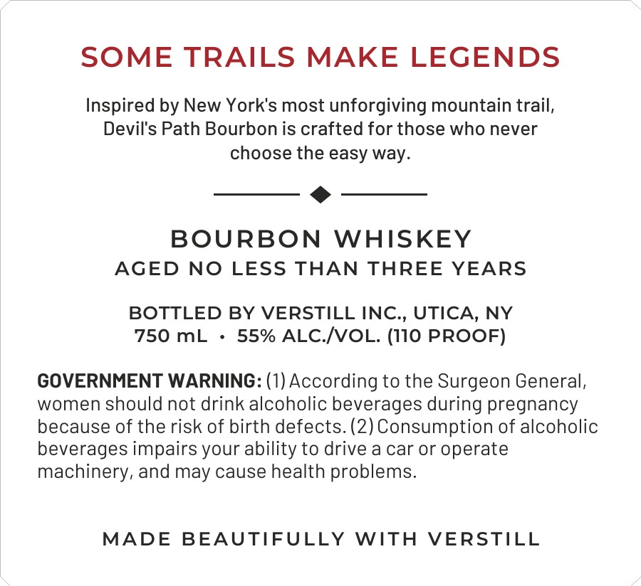
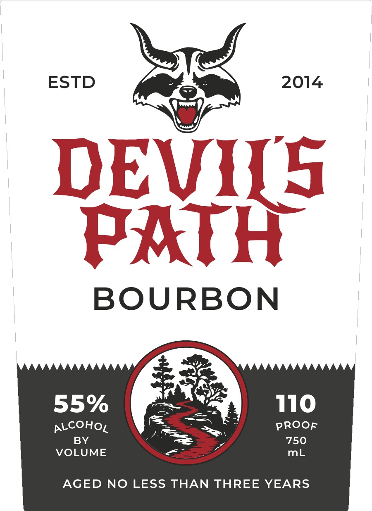

# TTB COLA Label Images - TTBID 26287001000430

**Brand Name:** Verstill Inc.

**Issue Date:** 10/19/2026

**Origin Code:** 02

**Product Class/Type:** 141

**Source:** [TTB Public COLA Registry](https://ttbonline.gov/colasonline/viewColaDetails.do?action=publicFormDisplay&ttbid=26287001000430)

## Label Images

### Back Label

### Front Label

## Extracted Label Text

*Text extracted via OCR - may contain errors*

**Detected Proof:** 110

### Back Label

SOME TRAILS MAKE LEGENDS
Inspired by New York's most unforgiving mountain trail,
Devil's Path Bourbon is crafted for those who never
choose the easy way
BOURBON
WHISKEY
AGED
NO LESS THAN THREE YEARS
BOTTLED BY VERSTILL INC , UTICA, NY
750 mL
55% ALC IVOL. (I10 PROOF)
GOVERNMENT WARNING: (1) According to the Surgeon General,
women should not drink alcoholic beverages during pregnancy
because of the risk of birth defects. (2) Consumption of alcoholic
beverages impairs your ability to drive a car or operate
machinery, and may cause health problems:
MADE
BEAUTIFULLY
WITH
VERSTILL

### Front Label

ESTD
2014
DENKS
BOURBON
55%
110
ALCOHOL
PROOF
BY
750
VOLUME
mL
AGED NO LESS THAN THREE YEARS
