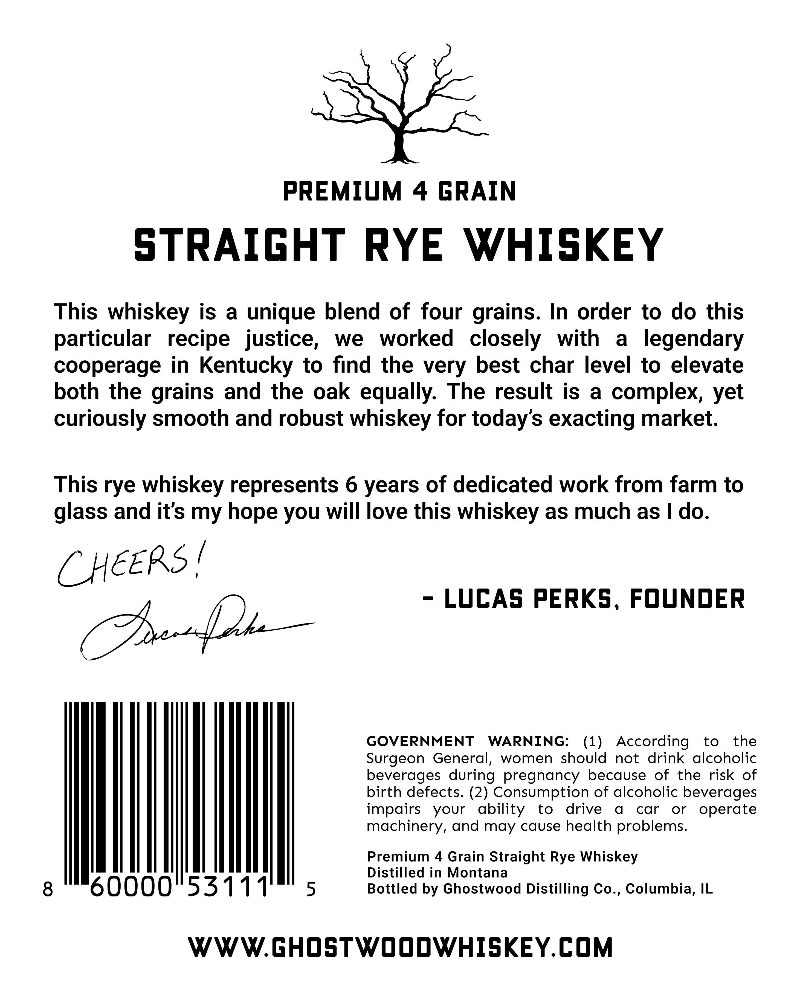
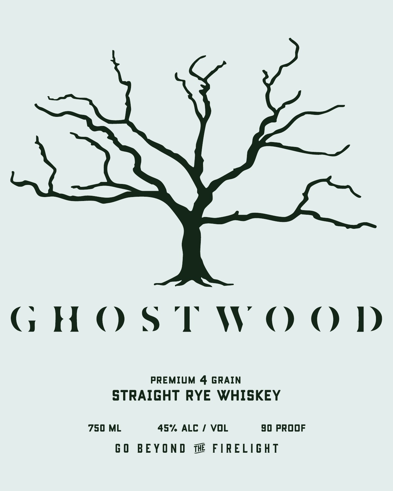

# TTB COLA Label Images - TTBID 26287001000444

**Brand Name:** GHOSTWOOD

**Issue Date:** 11/13/2026

**Origin Code:** 04

**Product Class/Type:** 102

**Source:** [TTB Public COLA Registry](https://ttbonline.gov/colasonline/viewColaDetails.do?action=publicFormDisplay&ttbid=26287001000444)

## Label Images

### Back Label

### Front Label

## Extracted Label Text

*Text extracted via OCR - may contain errors*

**Detected Proof:** 90
**Detected Age:** 6 Years

### Back Label

PREMIUM
GRAIN
STRAIGHT
RYE
WHISKEY
This whiskey is
a
unique blend of four grains. In order to do this
particular
recipe   justice,
we
worked   closely
with
a
legendary
cooperage in Kentucky to find the very best char level to elevate
both the grains and the oak equally: The result is
a
complex, yet
curiously smooth and robust whiskey for todays exacting market:
This rye whiskey represents 6 years of dedicated work from farm to
glass and its my hope you will iove this whiskey as much as | do.
CheeRs !
LucAS PERKS, FOUNDER
ah
GOVERNMENT
WARNING:
(1)
According
to
the
Surgeon
General;
women
should
not drink alcoholic
beverages during pregnancy because
of the risk
of
birth defects. (2) Consumption of alcoholic beverages
impairs
your
ability
to
drive
a
car
or
operate
machinery, and may cause health problems
Premium
4 Grain Straight Rye Whiskey
Distilled in Montana
8
60000"53111'
5
Bottled by Ghostwood Distilling Co-, Columbia, IL
WWW.GHOSTWOOWHISKEY.COM

### Front Label

GHOSTWOOD

PREMIUM 4 GRAIN

STRAIGHT RYE WHISKEY

750 ML

45% ALC / VOL

90 PROOF

GO BEYOND 7 FIRELIGHT
