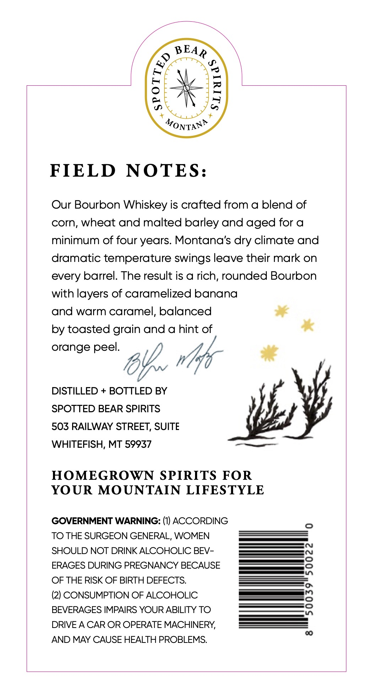
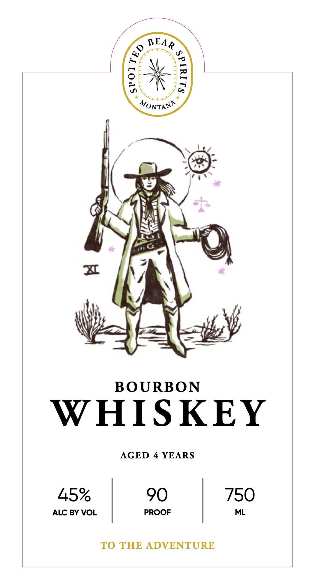
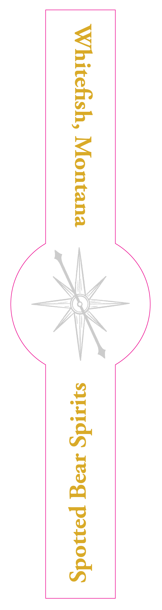

# TTB COLA Label Images - TTBID 26287001000505

**Brand Name:** SPOTTED BEAR SPIRITS

**Fanciful Name:** BOURBON WHISKEY

**Issue Date:** 10/19/2026

**Origin Code:** 30

**Product Class/Type:** 141

**Source:** [TTB Public COLA Registry](https://ttbonline.gov/colasonline/viewColaDetails.do?action=publicFormDisplay&ttbid=26287001000505)

## Label Images

### Back Label

### Front Label

### Label 3

## Extracted Label Text

*Text extracted via OCR - may contain errors*

*1 image(s) excluded: text did not meet readability threshold*

**Detected Proof:** 90
**Detected Age:** 4 Years

### Back Label

1
MONTANR
FIELD
NOTES:
Our Bourbon Whiskey is crafted from a blend of
corn, wheat and malted barley and aged for a
minimum of four years Montana's
climate and
dramatic temperature swings leave their mark on
every barrel: The result is a rich, rounded Bourbon
with layers of caramelized banana
and warm caramel, balanced
by toasted grain and a hint of
orange peel:
DISTILLED
BOTTLED BY
SPOTTED BEAR SPIRITS
503 RAILWAY STREET, SUITE
WHITEFISH, MT 59937
HOMEGROWN SPIRITS FOR
YOUR MOUNTAIN LIFESTYLE
GOVERNMENT WARNING: (1) ACCORDING
0
TO THE SURGEON GENERAL, WOMEN
SHOULD NOT DRINK ALCOHOLIC BEV -
ERAGES DURING PREGNANCY BECAUSE
1
OF THE RISK OF BIRTH DEFECTS:
(2) CONSUMPTION OF ALCOHOLIC
8
BEVERAGES IMPAIRS YOUR ABILITY TO
DRIVE A CAR OR OPERATE MACHINERY;
00
AND MAY CAUSE HEALTH PROBLEMS:
BEAR
(
dry

### Front Label

BEAD

Monty

ee

bey

OS

Slz

. =

I)

Wa

RG

buat

r\\

pte

\

Me

BOURBON

WHISKEY

AGED 4 YEARS

45%

90

ALC BY VOL

PROOF

| 750

TO THE ADVENTURE
