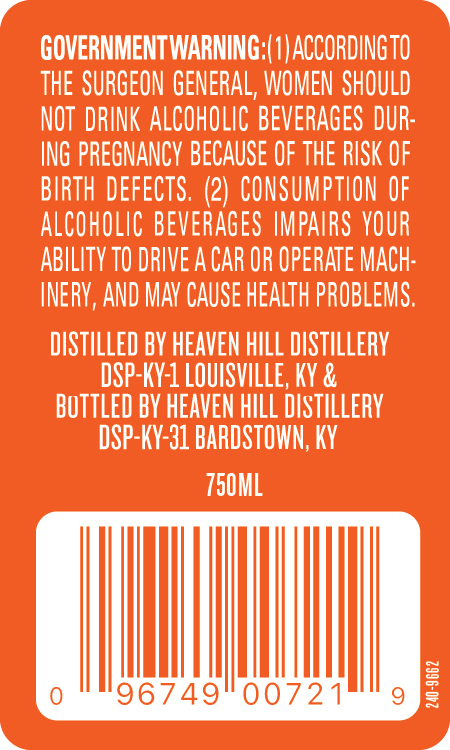
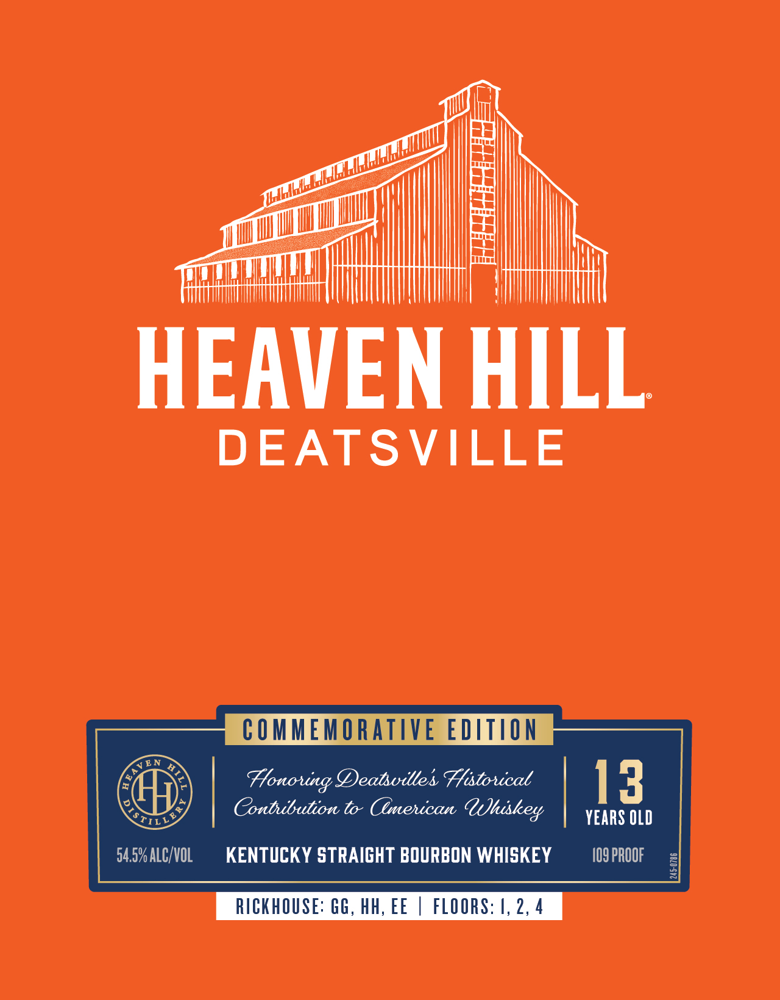

# TTB COLA Label Images - TTBID 26287001000511

**Brand Name:** HEAVEN HILL

**Fanciful Name:** DEATSVILLE

**Issue Date:** 10/21/2026

**Origin Code:** 22

**Product Class/Type:** 101

**Source:** [TTB Public COLA Registry](https://ttbonline.gov/colasonline/viewColaDetails.do?action=publicFormDisplay&ttbid=26287001000511)

## Label Images

### Back Label

### Front Label

### Label 3

## Extracted Label Text

*Text extracted via OCR - may contain errors*

*1 image(s) excluded: text did not meet readability threshold*

**Detected Proof:** 109

### Back Label

GOVERNMENTWARNING;(1| ACCORDINGTO
thE SURGEON GENERAL, WOMEN SHOULD
NOT  DRINK ALCOHOLIC BeveRAGES DUR:
ING PREGNANCY BECAUSE OF THE RISK OF
BIRTH DEFECTS. (2) CONSUMPTION OF
ALCOHOLIC BEVERAGeS IMPAIRS VOUR
ABILITY TO DRIVE A CAR OR OPERATE MAch:
INERY,AND MAV CAUSe Health PROBLEMS.
DISTILLED BV HEAVEN HILL DISTILLeRY
DSP-KY-1 LOUISVILLE, KY &
Buttled BY HEAVEN hLL DIstILLeRY
DSP-KY-31 BARDSTOWN; KY
750ML
96749
00721
3

### Front Label

HEAVEN HILL
DEATSVILLE
CO MMEMORATIVE EDITIOn
Honouing Deatsvilles Fhistouical
13
Contuibution to Cemenican
Uuhiskey
YEARS OLD
TILL
54.5% ALCKVOL
KENTUCKY STRAIGHT BOURBON WHISKEY
I09 PROOF
7
RICKHOUSE: GG, HH, EE
FLOORS: 4, 2, 4
VEN
