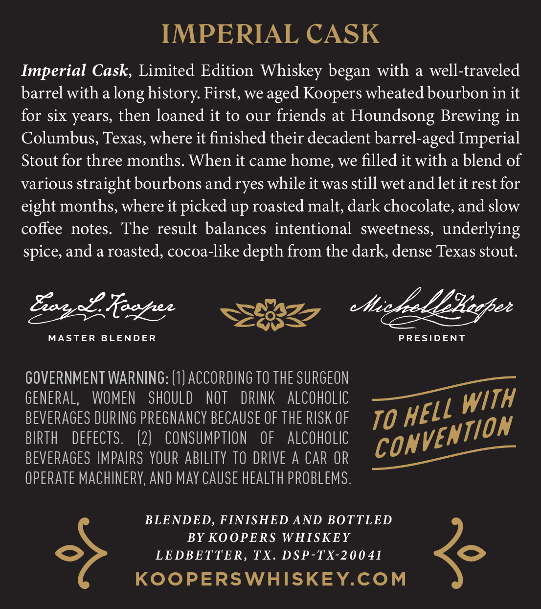
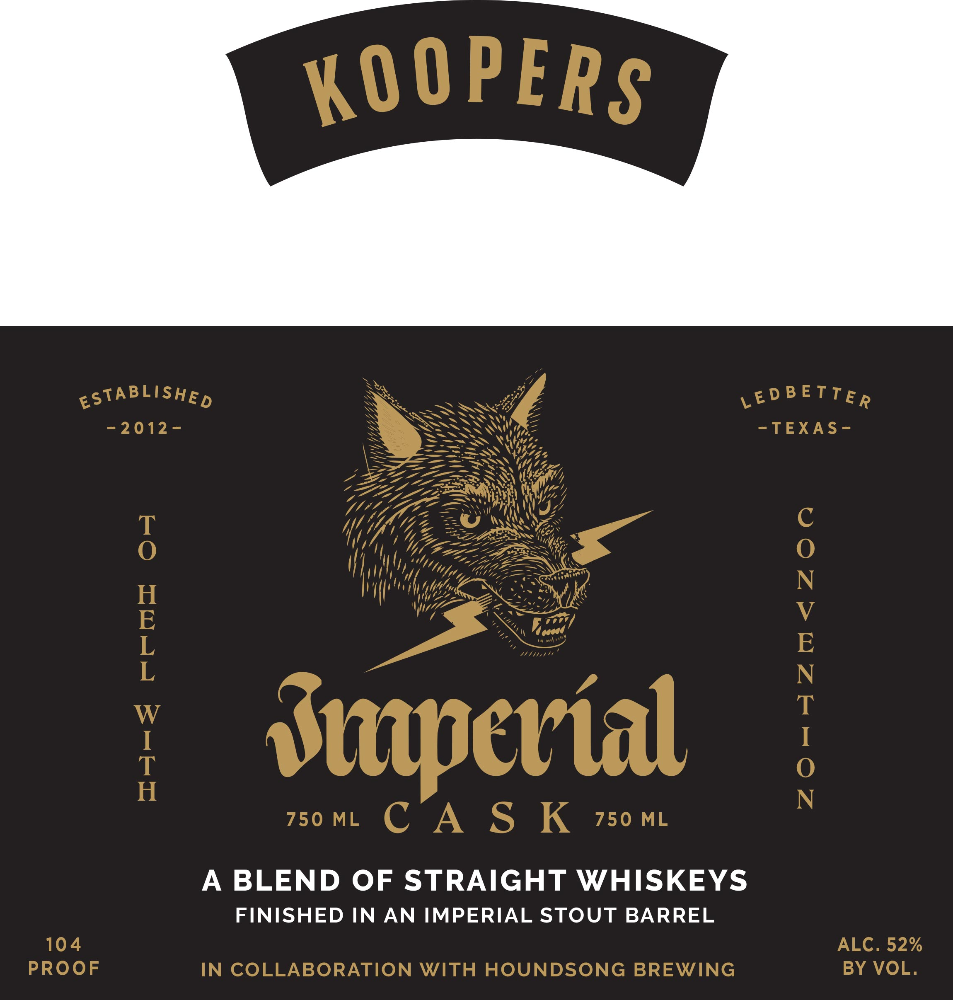

# TTB COLA Label Images - TTBID 26287001000584

**Brand Name:** KOOPERS WHISKEY

**Fanciful Name:** IMPERIAL CASK

**Issue Date:** 10/29/2026

**Origin Code:** 44

**Product Class/Type:** 120

**Source:** [TTB Public COLA Registry](https://ttbonline.gov/colasonline/viewColaDetails.do?action=publicFormDisplay&ttbid=26287001000584)

## Label Images

### Back Label

### Front Label

## Extracted Label Text

*Text extracted via OCR - may contain errors*

### Back Label

IMPERIAL CASK
Imperial Cask, Limited Edition Whiskey began with a well-traveled
barrel with a
history First, we
Koopers wheated bourbon in it
for Six years, then loaned it to our friends at
Houndsong Brewing in
Columbus, Texas, where it finished their decadent barrel-aged Imperial
Stout for three months. When it came home; we filled it with a blend of
various straight bourbons and ryes while it was still wet andlet it rest for
eight months, where it picked up roasted malt, dark chocolate, and slow
coffee
notes.
The result balances intentional sweetness,
underlying
spice, and a roasted, cocoa-like depth from the dark, dense Texas stout.
E982 Reezhee
C
Hiek
9 LEiegfee
MASTER
BLENDER
PRESIDENT
GOVERNMENT WARNING: (1) ACCORDing TO THE SURGEON
GENERAL,
WOMEN
SHOULD
NOT
DRINK
ALCohOLic
BEVERAGES DURING PREGNANCY BECAUSE OF THE RISK OF
TO
BIRTH
DEFECTS .
(2)
CONSUMPTION
OF
AlCOHOLIC
BEVERAGES IMPAIRS YOUR AbILITY TO DRIVE A CAR OR
OPERATE MACHINERY, AND May CAUSE hEAlTh PROBLEMS .
BLENDED, FINISHED AND BOTTLED
BY KOOPERS WHISKEY
LEDBETTER, TX. DSP-TX-20041
KOoPERSWHISKEYCOM
long
aged
With
HELL
convEnTiOn

### Front Label

KO 0PERS
ESTABLISHED
LE d B E TTE R
5
2012 -
-TEXAS -
8
L
Stapetial
1
750 ML
C A S K
750 ML
A
BLEND OF STRAIGHT WHISKEYS
FINISHED IN AN IMPERIAL STOUT BARREL
104
ALC. 52%
PROOF
IN COLLABORATION WITH HOUNDSONG BREWING
BY VOL.
