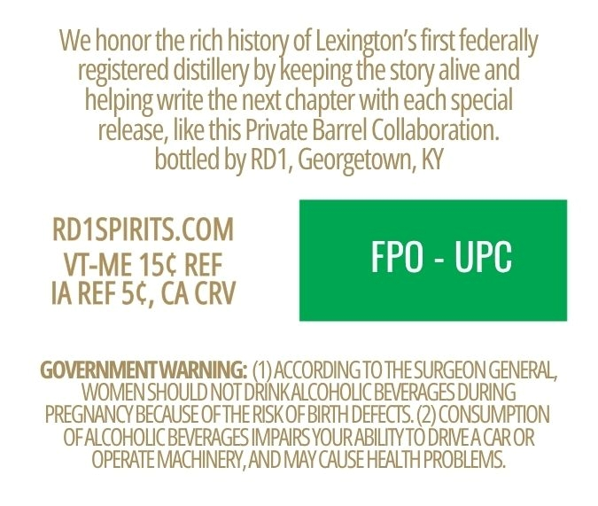
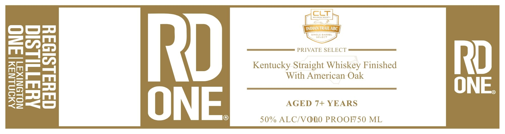

# TTB COLA Label Images - TTBID 26287001000629

**Brand Name:** RD ONE

**Issue Date:** 10/20/2026

**Origin Code:** 22

**Product Class/Type:** 109

**Source:** [TTB Public COLA Registry](https://ttbonline.gov/colasonline/viewColaDetails.do?action=publicFormDisplay&ttbid=26287001000629)

## Label Images

### Back Label

### Label 1

### Label 2

## Extracted Label Text

*Text extracted via OCR - may contain errors*

*1 image(s) excluded: text did not meet readability threshold*

**Detected Proof:** 100

### Back Label

We honor the rich hey of Leihsiats first federally
registered distillery by keeping the story alive and
helping write the next chapter with each special
release, like this Private Barrel Collaboration.
bottled by RD1, Georgetown, KY

RD1SPIRITS.COM
VI-ME 15¢ REF FPO - UPC
IAREF 5¢, CA CRV
GOVERNMENT WARNING: (1) ACCORDING TO THESURGEON GENERAL,
WOMEN SHOULD NOTDRINKALCOHOLIC BEVERAGES DURING
PREGNANCY BECAUSE OF THE RISK OF BIRTH DEFECTS. (2) CONSUMPTION
OFALCOHOLICBEVERAGES IMPAIRS YOUR ABILITY TO DRIVE A CAROR
OPERATE MACHINERY, AND MAY CAUSE HEALTH PROBLEMS.

### Label 1

CCT
INduan TRAIL ABC
L
4RREL
SELeCt
Rd
PRIVATE SELECT
Rd
8
KentuckySthaigherivhiskak Finished
ONE
ONE
AGED 7+ YEARS
50% ALC/VODO PROOF50 ML
