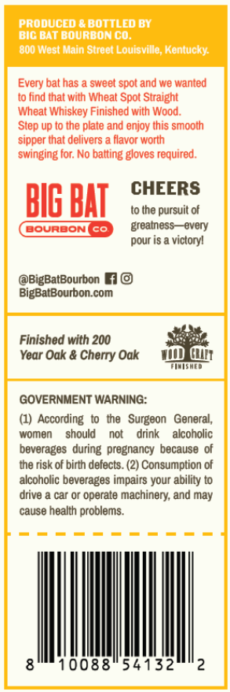
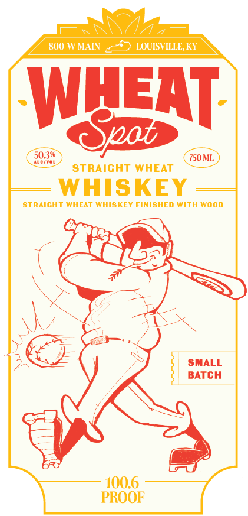

# TTB COLA Label Images - TTBID 26287001000728

**Brand Name:** WHEAT SPOT

**Issue Date:** 10/20/2026

**Origin Code:** 22

**Product Class/Type:** 140

**Source:** [TTB Public COLA Registry](https://ttbonline.gov/colasonline/viewColaDetails.do?action=publicFormDisplay&ttbid=26287001000728)

## Label Images

### Back Label

### Front Label

## Extracted Label Text

*Text extracted via OCR - may contain errors*

**Detected Proof:** 100.6

### Back Label

PRODUCED & BOTTLED BY
BIC BAT BOURBUN Co
b0@ West Laln Street Louisville; Kentucky
Every bat has
sweet spot and we wanted
t0 find that with Wheat Spot Straight
Wheat Whiskey Finished with Wood.
Step up t0 the plate and enjoy this smooth
sipper that delivers
flavor worth
swinging for: No batting gloves required.
CHEERS
BIg BHI
to the pursuit of
BOURBONI
Go
greatness _every
pour is a vicloryl
@BigBatBourbon
BigBatBourbon com
Finished with 200
Year Oak & Cherry Oak
GOVERNMENT WARNING:
According to  the   Surgeon
General,
women
should
not
drink
alcoholic
beverages   during   pregnancy because
the risk of birth defects_
Consumption of
alcoholic beverages impairs your ability
drive
car or operate machinery; and may
cause health problems.
10088
54132
2

### Front Label

800 W MAIN
LOUISVILLE KY
WLEAT:
50.39
Cpab
750ML
ALcfyol
STRAICHT WHEAT
WHISKEY
StraiCHT WHEAT WHISKET FINISHED With wood
SMALL
BATCH
100.6
PROOF
