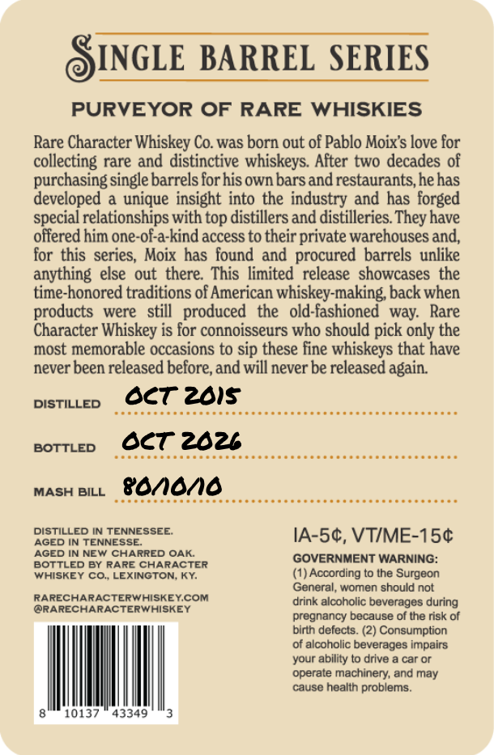
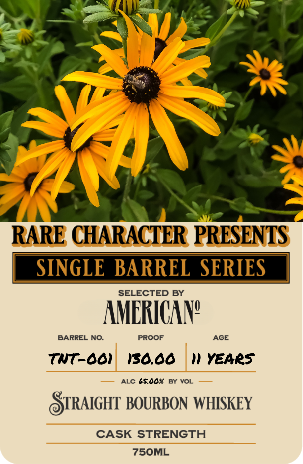

# TTB COLA Label Images - TTBID 26287001000731

**Brand Name:** RARE CHARACTER

**Issue Date:** 10/19/2026

**Origin Code:** 22

**Product Class/Type:** 101

**Source:** [TTB Public COLA Registry](https://ttbonline.gov/colasonline/viewColaDetails.do?action=publicFormDisplay&ttbid=26287001000731)

## Label Images

### Back Label

### Front Label

## Extracted Label Text

*Text extracted via OCR - may contain errors*

### Back Label

INGLE BARREL SERIES
PURVEYOR OF RARE WHISKIES
Rare Character Whiskey Co was born out of Pablo Moixs love for
collecting rare and distinctive whiskeys  After two decades of
purchasing single barrels for his own bars and restaurants, hehas
developed
unique insight into the industry and has forged
special relationships with top distillers and distilleries
have
offered him one-of-a-kind access to their private warehouses and,
for this series, Moix has found and procured barrels unlike
anything else  out  there   This  limited  release   showcases the
time-honored traditions of American whiskey-making back when
products
were
still   produced
the
old-fashioned
way:
Rare
Character Whiskey is for connoisseurs who should pick only the
most memorable occasions to sip these fine whiskeys that have
never been released before, and will never be released again:
DISTILLED
Oct 2815
BOTTLED
Oct 2026
MASH BILL
88n6/10
DISTILLED IN TENNESSEE
IA-Sc, VTIME-15c
AGED IN TENNESSE
AGED IN NEW CHARRED OAK
GOVERNMENT WARNING:
BOTTLED BY RARE CHARACTER
WHISKEY Co, LEXINGTON; KY
(1) According to the Surgeon
General, women should not
RARECHARACTERWHISKEYCOM
drink
alcoholic beverages during
ORARECHARACTERWHISKEY
pregnancy because f the risk of
birth defects.
Consumption
of alcoholic beverages Impalrs
your ability t0 drive
car Or
operate machinery; and may
cause health problems
10137
43349
They

### Front Label

RARE CHARACTER PRESENTS
SINGLE BARREL SERIES
SELECTED BY
AMERICAN?
BARREL NO:
PROOF
AGE
TNt_001
130.00
w1 YEArS
ALC 65.00%
BY VOL
STRAIGHT BOURBON WHISKEY
CASK STRENGTH
75OML
