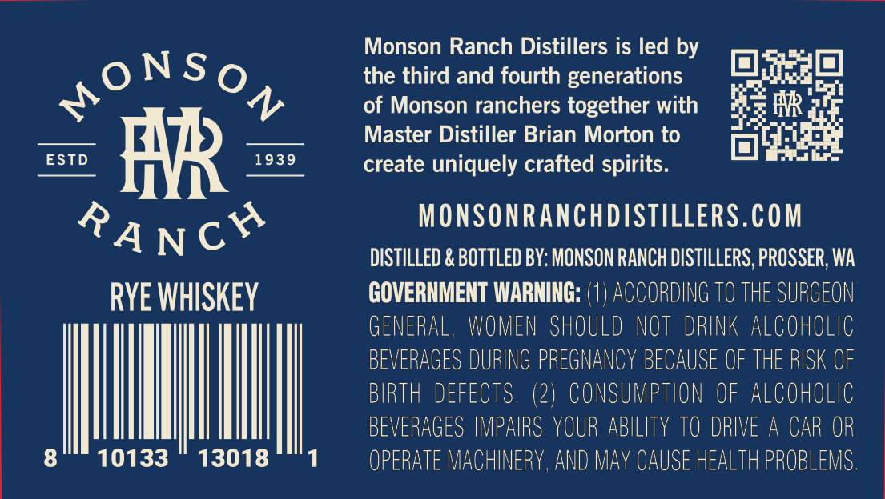
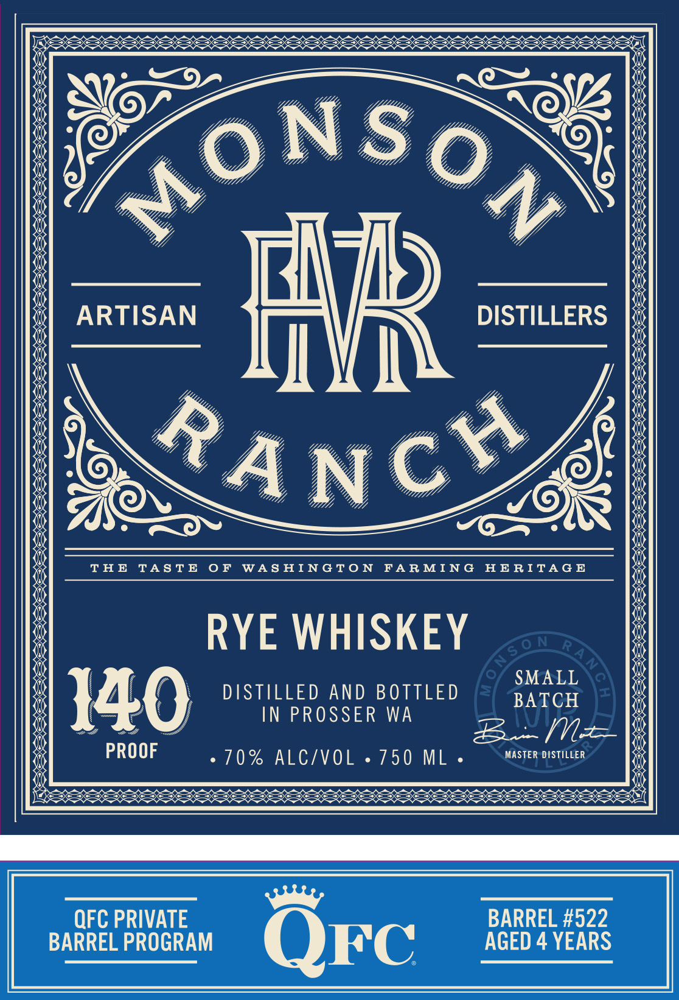

# TTB COLA Label Images - TTBID 26287001000783

**Brand Name:** MONSON RANCH DISTILLERS

**Issue Date:** 10/19/2026

**Origin Code:** 07

**Product Class/Type:** 142

**Source:** [TTB Public COLA Registry](https://ttbonline.gov/colasonline/viewColaDetails.do?action=publicFormDisplay&ttbid=26287001000783)

## Label Images

### Back Label

### Front Label

### Label 3

## Extracted Label Text

*Text extracted via OCR - may contain errors*

*1 image(s) excluded: text did not meet readability threshold*

**Detected Age:** 4 Years

### Back Label

Monson Ranch Distillers is led by

1]

1}

ONSo

the third and fourth generations

SY

+

of Monson ranchers together with

HR '

Master Distiller Brian Morton to

ere)

1939

create uniquely crafted spirits

fe]

AR =

MONSONRANCHDISTILLERS.COM

DISTILLED & BOTTLED BY: MONSON RANCH DISTILLERS, PROSSER, WA

Apr

RYE WHISKEY

GOVERNMENT WARNING: (1

) ACC

ORDING 10 THE SURGEON

GENERAL, WOMEN SHOULD NOT DRINK ALCOHOLIC

BEVERAGES DURING PREGNANCY BECAUSE OF THE RISK OF

BIRTH DEFECTS. (2) CONSUMPTION OF ALCOHOLIC

BEVERAGES IMPAIRS YOUR ABILITY TO DRIVE A CAR OR

8

NINN

10133

13018

OPERATE MACHINERY, AND MAY CAUSE HEALTH PROBLEMS

### Front Label

%

3S

<

Shs
RES

Rs

——.
REE

RS

ct

Se
a

me

omy

EX

RS

ey

———
REE

<

EX

3
SS

S

eS
LES

RS

me

Tes
LES

RS

RS

$
RS

SESE

Se
REE

a8

£
RS

me
RES

me

RES

<
RS

RS

x

THE TASTE OF WASHINGTON FARMING HERITAGE

RYE WHISKEY

DISTILLED AND BOTTLED = arcH

IN PROSSER WA
Bo [Nae

6 HO NLCAVOIL oc 750 IML MASTER DISTILLER

SS
RR ERES

a

RS

=

S%
RS

SEES

=

me

EX

RS

“OFC PRIVATE. PRIVATE BARREL #522
BARREL PROGRAM AGED 4 YEARS
