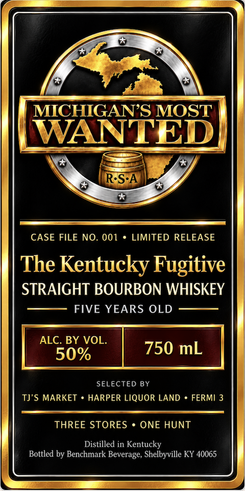
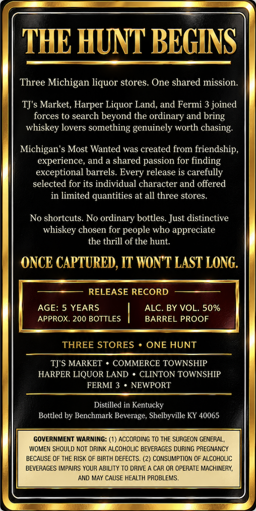

# TTB COLA Label Images - TTBID 26287001000799

**Brand Name:** MICHIGAN'S MOST WANTED

**Issue Date:** 10/21/2026

**Origin Code:** 22

**Product Class/Type:** 101

**Source:** [TTB Public COLA Registry](https://ttbonline.gov/colasonline/viewColaDetails.do?action=publicFormDisplay&ttbid=26287001000799)

## Label Images

### Label 1

### Label 2

## Extracted Label Text

*Text extracted via OCR - may contain errors*

**Detected Proof:** 100
**Detected Age:** 5 Years

### Label 1

MICHIGANS MOST
WANTED
RSA
CASE FILE NO. 001
LIMITED RELEASE
The Kentucky Fugitive
STRAIGHT BOURBON WHISKEY
FIVE YEARS OLD
ALC. BY VOL
50%
750 mL
SELECTED BY
TJ'$ MARKET
HARPER LIQUOR LAND
FERMI 3
THREE STORES
ONE HUNT
Distilled in Kentucky
Bottled by Benchmark Beverage, Shelbyville KY 40065

### Label 2

THE HUNT BEGINS
Three Michigan liquor stores. One shared mission
TJ's Market; Harper Liquor Land, and Fermi 3 joined
forces to search beyond the ordinary and
whiskey lovers something genuinely worth chasing:
Michigan's Most Wanted was created
friendship,
experience, and a shared passion for finding
exceptional barrels:
release is carefully
selected for its individual character and offered
in limited quantities at all three stores:
No shortcuts No ordinary bottles Just distinctive
whiskey chosen for people who appreciate
the thrill of the hunt.
ONCE CAPTURED, IT WONT LAST LONG.
RELEASE RECORD
AGE: 5 YEARS
ALC. BY VOL. 50%
APPROX. 200 BOTTLES
BARREL PROOF
THREE STORES
ONE HUNT
TJ'S MARKET
COMMERCE TOWNSHIP
HARPER LIQUOR LAND
CLINTON TOWNSHIP
FERMI 3
NEWPORT
Distilled in Kentucky
Bottled by Benchmark Beverage, Shelbyville KY 40065
GOVERNMENT WARNING: (1) ACCORDING To THE SURGEON GENERAL;
WOMEN SHOULD NOT DRINK ALCOHOLIC BEVERAGES DURING PREGNANCY
BECAUSE OF THE RISK OF BIRTH DEFECTS. (2) CONSUMPTION OF ALCOHOLIC
BEVERAGES IMPAIRS YOUR ABILITY T0 DRIVE
CAR OR OPERATE MACHINERY,
AND MAY CAUSE HEALTH PROBLEMS.
bring
from
Every
