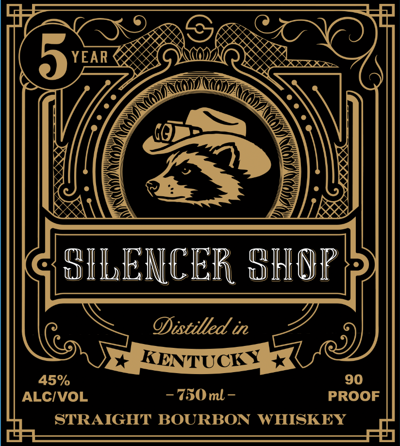
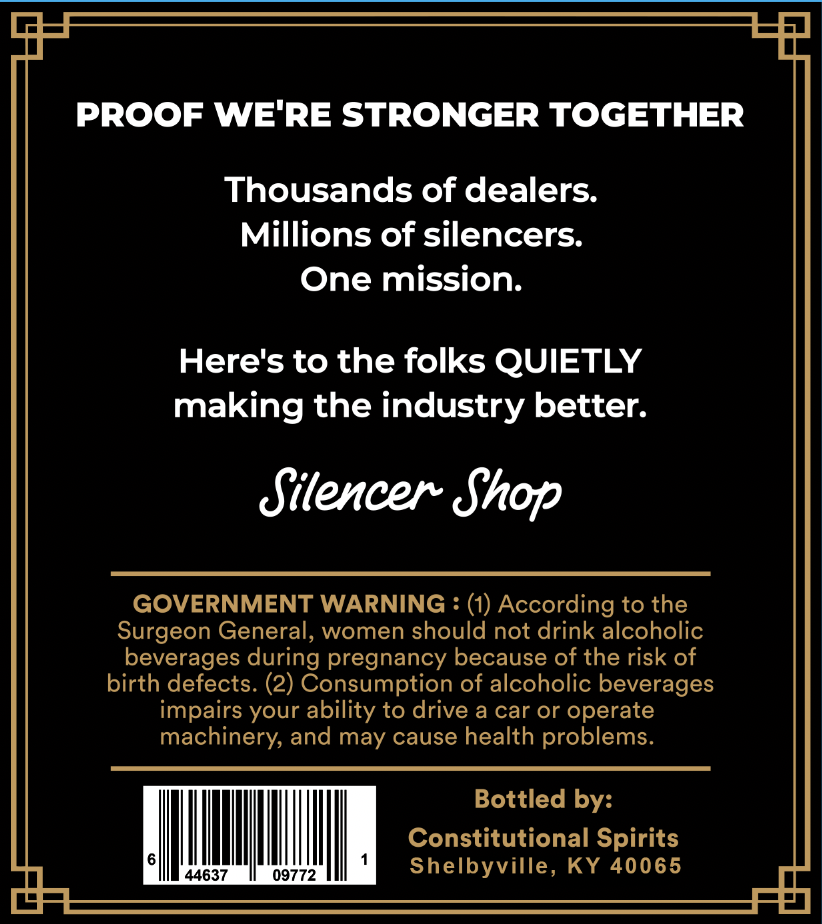

# TTB COLA Label Images - TTBID 26287001000809

**Brand Name:** SILENCER SHOP

**Issue Date:** 10/19/2026

**Origin Code:** 22

**Product Class/Type:** 101

**Source:** [TTB Public COLA Registry](https://ttbonline.gov/colasonline/viewColaDetails.do?action=publicFormDisplay&ttbid=26287001000809)

## Label Images

### Label 1

### Label 2

## Extracted Label Text

*Text extracted via OCR - may contain errors*

**Detected Proof:** 90

### Label 1

YEAR
SILENCER SHIOP
ODistilled in
KENTUCKY
45%
90
ALCIVOL
~750ml -
PROOF
STRAIGHT BOURBON
WHISKEY

### Label 2

PROOF WE'RE STRONGER TOGETHER
Thousands of dealers:
Millions of silencers:
One mission:
Here's to the folks QUIETLY
making the industry better.
Silencer Shop
GOVERNMENT WARNING
(1) According to the
Surgeon General, women should not drink alcoholic
beverages during pregnancy because of the risk of
birth defects. (2) Consumption of alcoholic beverages
impairs your ability to drive a car or operate
machinery; and may cause health problems_
Bottled by:
Constitutional Spirits
44637
09772
Shelbyville, KY 40065
