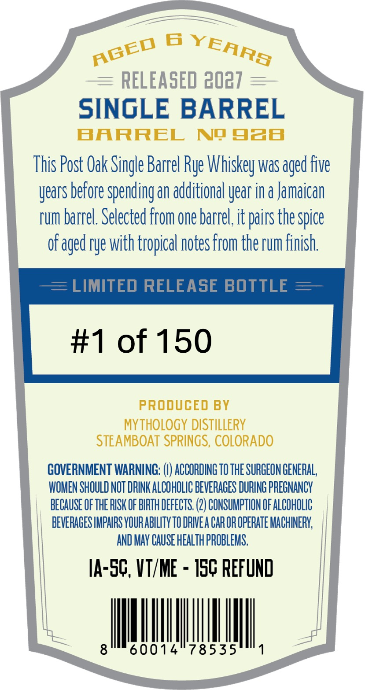
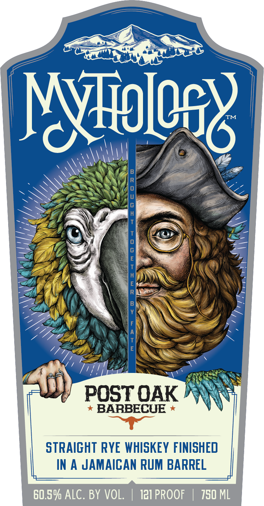

# TTB COLA Label Images - TTBID 26287001000853

**Brand Name:** MYTHOLOGY

**Issue Date:** 10/20/2026

**Origin Code:** 13

**Product Class/Type:** 102

**Source:** [TTB Public COLA Registry](https://ttbonline.gov/colasonline/viewColaDetails.do?action=publicFormDisplay&ttbid=26287001000853)

## Label Images

### Back Label

### Front Label

## Extracted Label Text

*Text extracted via OCR - may contain errors*

**Detected Proof:** 121

### Back Label

6
RELEASED 3027
SINGLE BARREL
BaRREL
Nq 938
This Post Oak Singte Barrel Rye Whiskey Was aged Five
years before spending an additional year in a Jamaican
rum barrel. Selected From one barrel it pairs thespice
of aged rye with tropical notes From the rum finish
LIMITED RELEASE BOTTLE
#1 of 150
PRODUCED BY
MythoLOGY DiSTILLERY
STEAMBOAT SPRINGS, COLORADO
GOVERNMENT WARNING:
ACCORDING TO THE SURGEON GENERAL,
WOMEN SHOULD NOT DRINK ALCOHOLIC BEVERAGES DURING PREGNANCY
because ofthE RISK OF BIRTH DEFECTS. (2) CONSUMPTHON OF ALCOHOLIC
BEVERAGES IMPAIRS VOURABILITY TO DRIVEA CAR OR OPERATE MACHINERK;
AND MAY CAUSE HEALTh PROBLEMS,
IA-SG,VT/ME
ISC Refund
8
60014
78535
YEARA
AGED

### Front Label

Nliolea&
8
#
T
0
G
[
Y
F
T
E
POST OAK
BARBECUE
stRAIGHT RyE whISKeY FINISHED
IN
4
JAMAICAN RUM BARREL
60.5% ALC. BY VOL.
121 PROOF
750 ML
