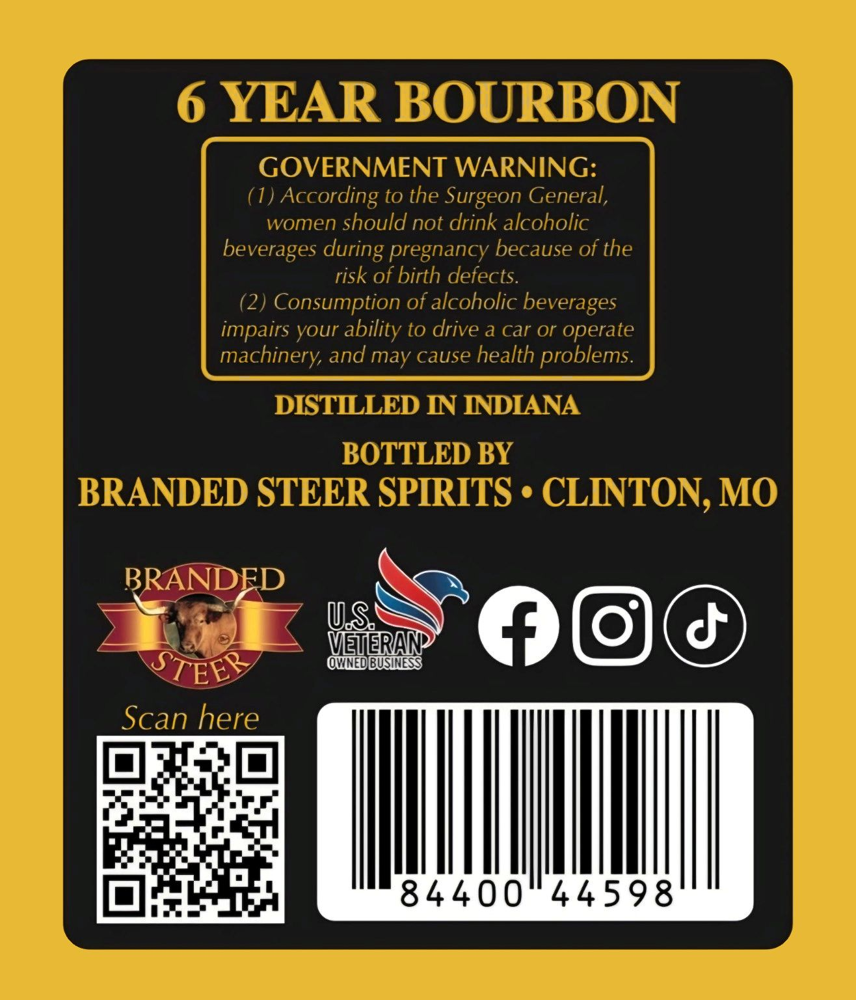
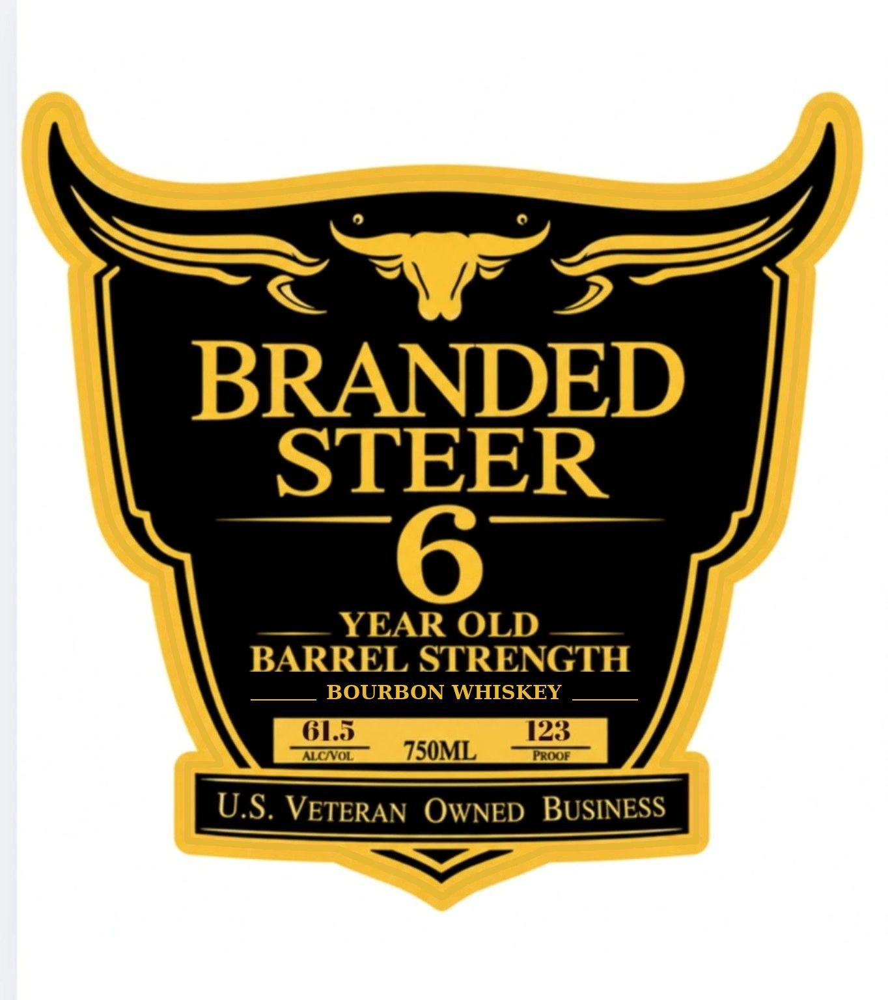

# TTB COLA Label Images - TTBID 26287001000887

**Brand Name:** BRANDED STEER

**Issue Date:** 10/28/2026

**Origin Code:** 29

**Product Class/Type:** 141

**Source:** [TTB Public COLA Registry](https://ttbonline.gov/colasonline/viewColaDetails.do?action=publicFormDisplay&ttbid=26287001000887)

## Label Images

### Back Label

### Front Label

## Extracted Label Text

*Text extracted via OCR - may contain errors*

**Detected Age:** 6 Years

### Back Label

6 YEAR BOURBON
GOVERNMENT WARNING:
(1)
According to the Surgeon General,
women should not drink alcoholic
beverages
pregnancy because of the
risk of birth defects.
(2) Consumption of alcoholic beverages
impairs your ability to drive a car or operate
machinery; and may cause health problems.
DISTILLED IN INDIANA
BOTTLED BY
BRANDED STEER SPIRITS + CLINTON, MO
BRANDFD
US
VEIERAN
STEER
@QNEDBUSIESS
Scan here
84400"44598
during

### Front Label

BRANDED
STEER

— YEAR OLD —__
BARREL STRENGTH

BOURBON WHISKEY

U.S. VETERAN OWNED BUSINESS
ee Tee NWSE, SPM
