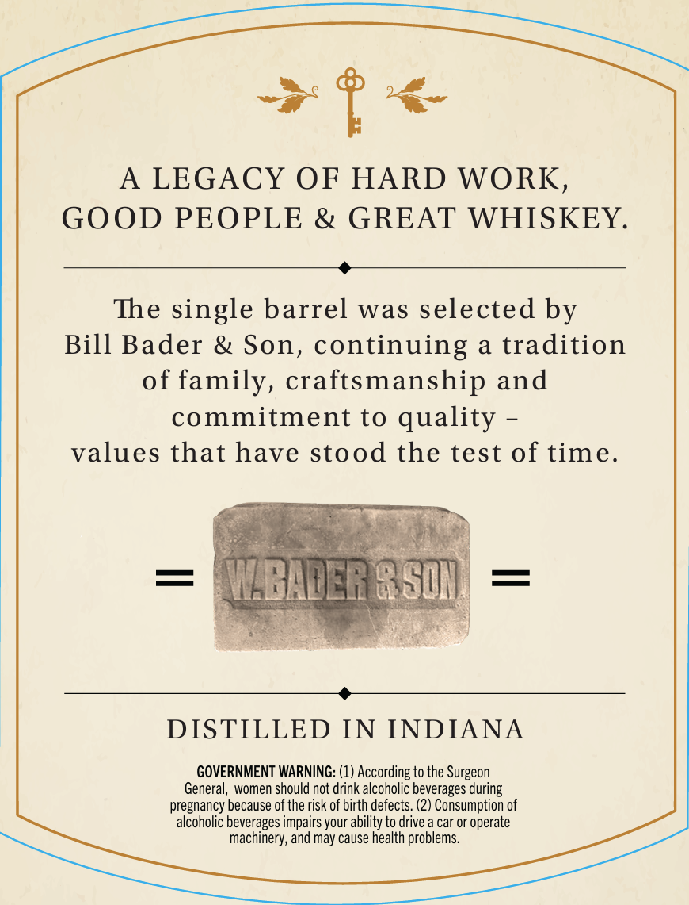
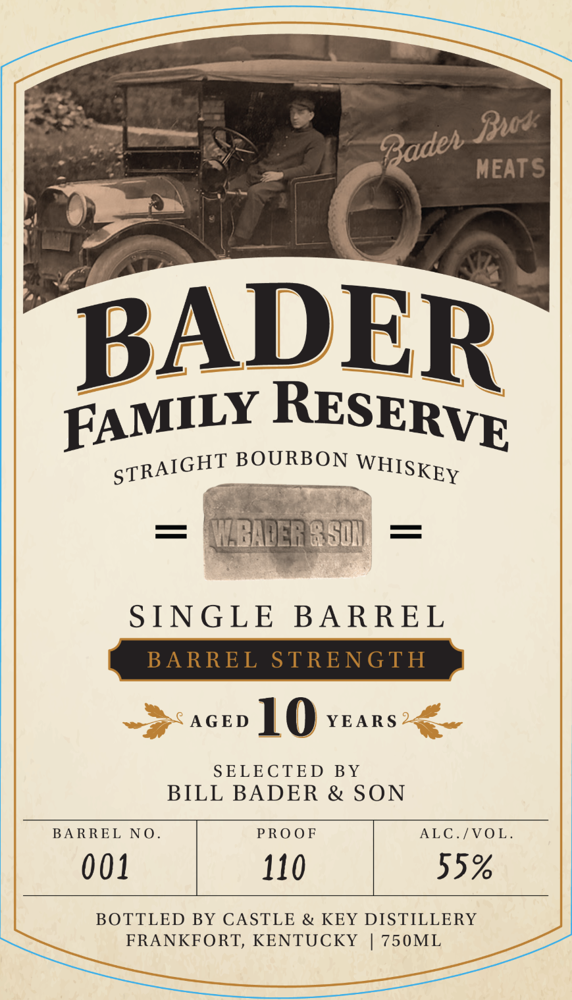

# TTB COLA Label Images - TTBID 26288001000061

**Brand Name:** BADER FAMILY RESERVE

**Issue Date:** 10/20/2026

**Origin Code:** 22

**Product Class/Type:** 101

**Source:** [TTB Public COLA Registry](https://ttbonline.gov/colasonline/viewColaDetails.do?action=publicFormDisplay&ttbid=26288001000061)

## Label Images

### Back Label

### Front Label

## Extracted Label Text

*Text extracted via OCR - may contain errors*

**Detected Proof:** 110
**Detected Age:** 10 Years

### Back Label

A
LEGACY OF HARD WORK,
GOOD PEOPLE
& GREAT WHISKEY.
The single barrel was selected by
Bill Bader & Son, continuing a tradition
of family, craftsmanship and
commitment to quality
values that have stood the test of time.
MBADERRS01
DISTILLED IN INDIANA
GOVERNMENT WARNING: (1) According to the Surgeon
General, women should not drink alcoholic beverages during
pregnancy because of the risk of birth defects: (2) Consumption of
alcoholic beverages impairs your ability to drive a car or operate
machinery, and may cause health problems

### Front Label

Bus
MEATS
BADER
BOURBON
MZBADERRSO1
SINGLE
BARREL
BARREL
STRENGTH
AGED
10
YEARS
SELECTED
BY
BILL BADER
& SON
BA RREL
N 0
PRO OF
ALC./VO L:
001
110
55%
BOTTLED BY CASTLE & KEY DISTILLERY
FRANKFORT, KENTUCKY
750ML
Badeh
RESERVE
FAMILY
STRAIGHT
WHISKEY
