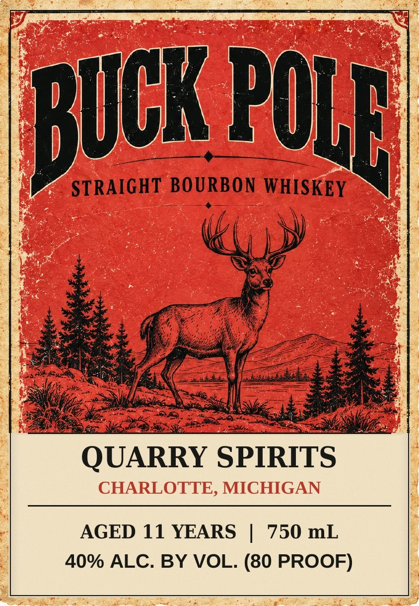
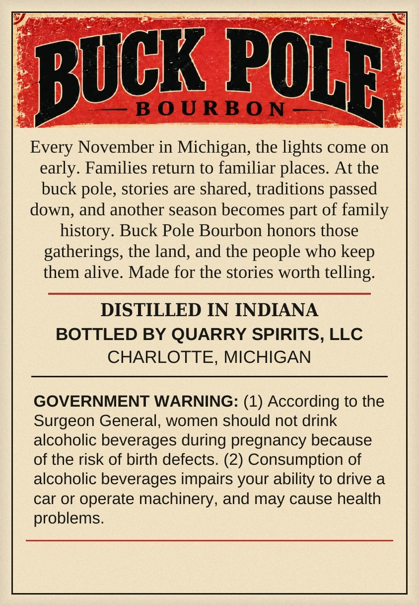

# TTB COLA Label Images - TTBID 26288001000065

**Brand Name:** BUCK POLE

**Issue Date:** 10/21/2026

**Origin Code:** 06

**Product Class/Type:** 101

**Source:** [TTB Public COLA Registry](https://ttbonline.gov/colasonline/viewColaDetails.do?action=publicFormDisplay&ttbid=26288001000065)

## Label Images

### Label 1

### Label 2

## Extracted Label Text

*Text extracted via OCR - may contain errors*

**Detected Proof:** 80
**Detected Age:** 11 Years

### Label 1

BUCK POLE

STRAIGHT BOD REY WHISKEY

QUARRY SPIRITS

AGED 11 YEARS | 750 mL
40% ALC. BY VOL. (80 PROOF)

### Label 2

Every November in Michigan, the lights come on
early. Families return to familiar places. At the
buck pole, stories are shared, traditions passed

down, and another season becomes part of family

history. Buck Pole Bourbon honors those
gatherings, the land, and the people who keep
them alive. Made for the stories worth telling.

DISTILLED IN INDIANA
BOTTLED BY QUARRY SPIRITS, LLC
CHARLOTTE, MICHIGAN

GOVERNMENT WARNING: (1) According to the
Surgeon General, women should not drink
alcoholic beverages during pregnancy because
of the risk of birth defects. (2) Consumption of
alcoholic beverages impairs your ability to drive a
car or operate machinery, and may cause health
problems.
