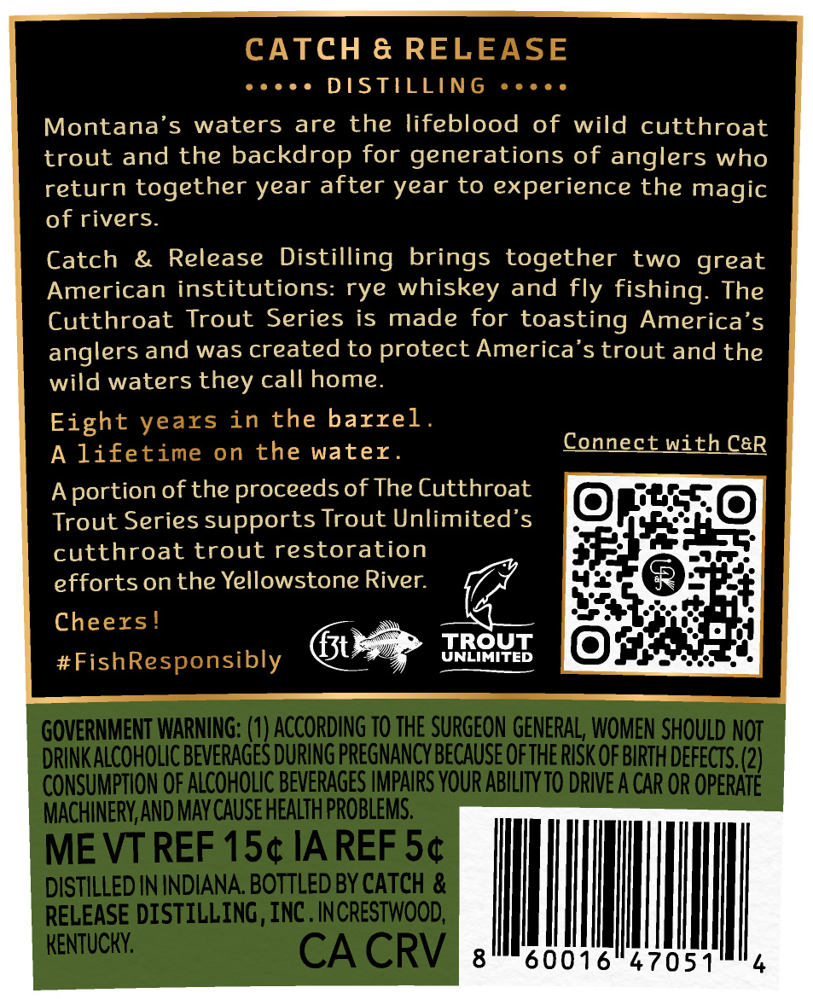
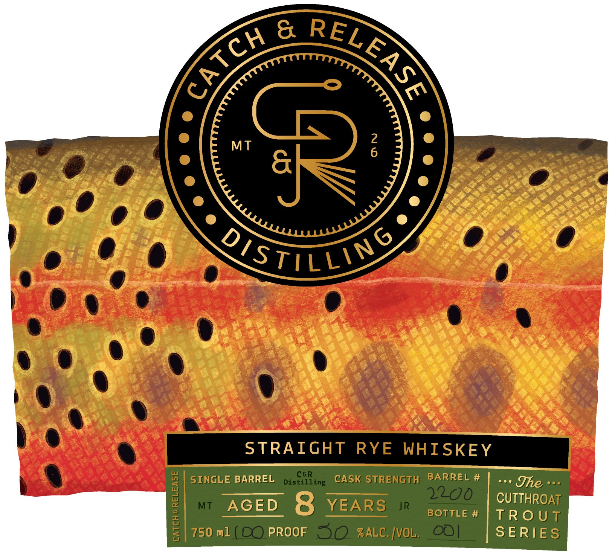
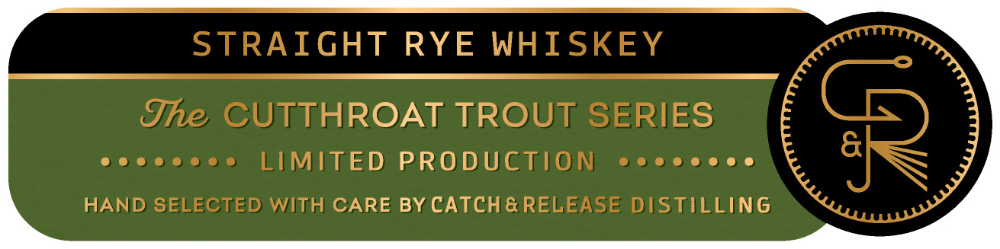

# TTB COLA Label Images - TTBID 26288001000069

**Brand Name:** CATCH & RELEASE

**Fanciful Name:** CUTTHROAT TROUT

**Issue Date:** 10/21/2026

**Origin Code:** 22

**Product Class/Type:** 102

**Source:** [TTB Public COLA Registry](https://ttbonline.gov/colasonline/viewColaDetails.do?action=publicFormDisplay&ttbid=26288001000069)

## Label Images

### Back Label

### Front Label

### Label 3

## Extracted Label Text

*Text extracted via OCR - may contain errors*

**Detected Proof:** 60
**Detected Age:** 8 Years

### Back Label

CATCH & RELEASE
DSTILLING
Montana's
waters are
the lifeblood
of wild cutthroat
trout and the backdrop for generations of anglers who
return together year after year to experience the magic
of rivers.
Catch
&
Release Distilling brings together
two great
American institutions: rye whiskey and
fishing:
The
Cutthroat Trout Series is made for toasting America'
anglers and was created to protect America's trout and the
wild waters they call home.
Eight
in the barrel
A lifetime on the water_
Connect With CGR
Aportion of the proceedsof The Cutthroat
Trout Series supports Trout Unlimited's
cutthroat trout restoration
effortson the Yellowstone River:
Cheers!
f3t
TROUT
#FishResponsibly
UNLIMITED
GOVERNMENT WARNING: (1) AccoRdinG TO THE SURGEON GENERAL, WOMEN SHOULD NOT
DRINK ALCOHOLIC BEVERAGES DURING PREGNANCY BECAuSE QFTHE RISK QF BIRTH DEfECTS. (2)
CONSUMPTION OF ALCOHOLIC BEVERAGES IMPAIRS YOUR ABILTYTO DRIVE A CAR OR OPERATE^
MACHINERY AND MAV CAUSE HEALTh PROBLEMS.
ME VT REF 15c IA REF S4
DISTILLED IN INDIANA BOTTLED BY CATCH &
RELEASE DISTILLING, INC . INCRESTWOOD;
KENTUCKY:
CA CRV
8
60016
47051
fly
years

### Front Label

&
2
MT
6
6
OistiLling
STRAIGHT
RYE
WHISKEY
SINGLE BARREL
DisCiling
CASK STRENGTH
BARREL #
Jhe
1
MT
AGED
8
YEARS
JR
Bottle #
CUTTHROAT
TR0 UT
750 ml
PROOF
30 %ALC: |vOL.
OO|
SERIES
RELEASE
CATCH

### Label 3

STRAIGHT RYE WHISKEY

The CUTTHROAT TROUT SERIES

eoccccses LIMITED PRODUCTION cccecoecs

HAND SELECTED WITH CARE BY CATCH& RELEASE DISTILLING
