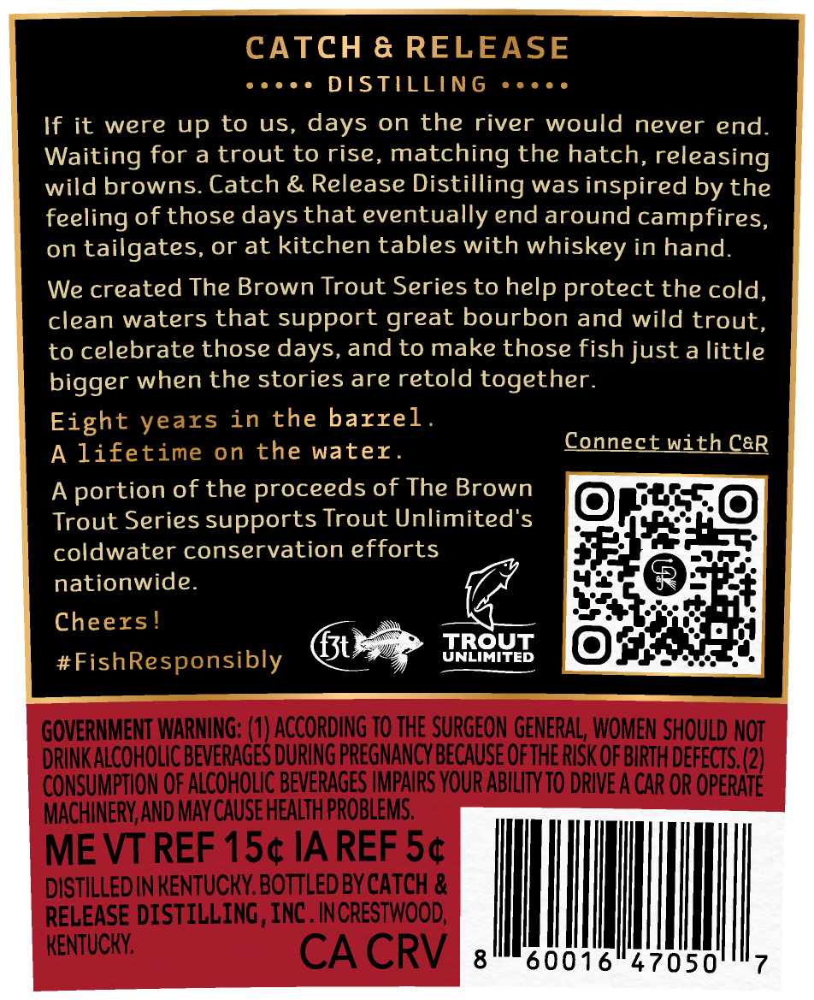
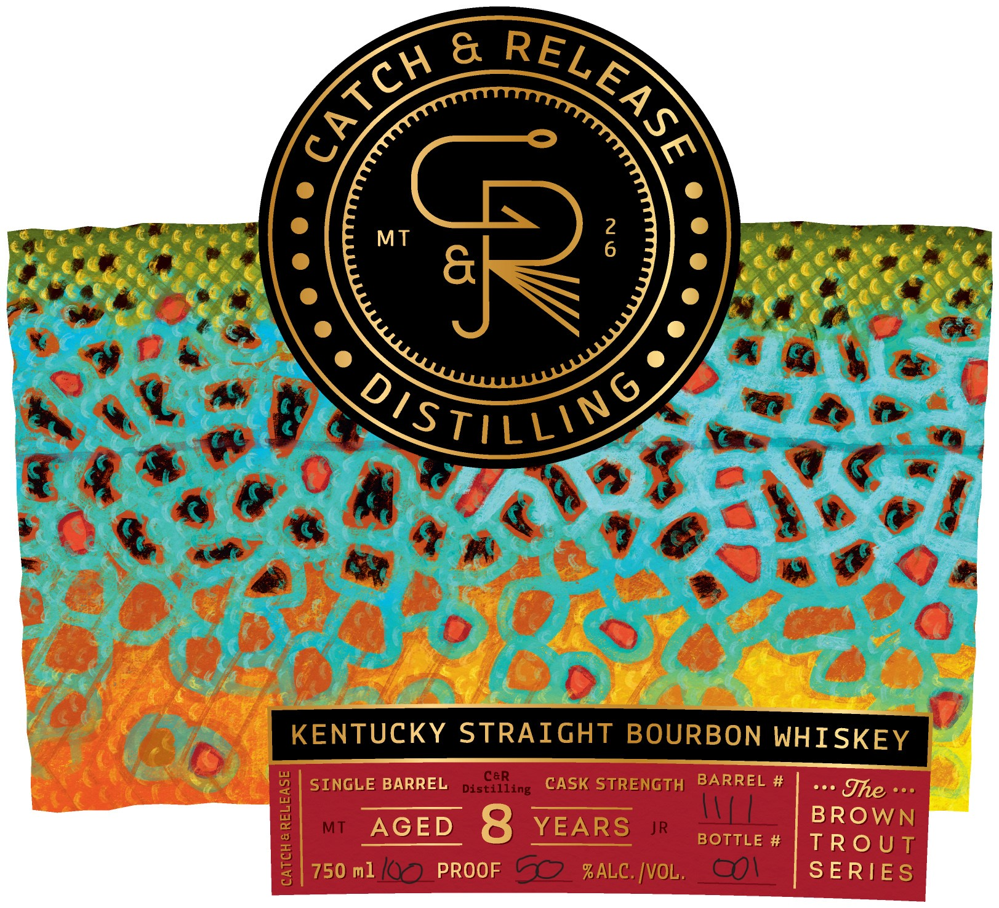
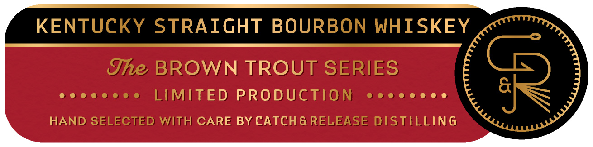

# TTB COLA Label Images - TTBID 26288001000070

**Brand Name:** CATCH & RELEASE

**Fanciful Name:** BROWN TROUT

**Issue Date:** 10/20/2026

**Origin Code:** 22

**Product Class/Type:** 101

**Source:** [TTB Public COLA Registry](https://ttbonline.gov/colasonline/viewColaDetails.do?action=publicFormDisplay&ttbid=26288001000070)

## Label Images

### Back Label

### Front Label

### Label 3

## Extracted Label Text

*Text extracted via OCR - may contain errors*

**Detected Proof:** 120
**Detected Age:** 8 Years

### Back Label

CATCH & RELEASE
DSTILLING
If it were
up to
uS,
days on the river would
never end
Waiting for a trout to rise,
matching the hatch, releasing
wild browns Catch & Release
Distilling was inspired by the
feeling of those days that eventually end around campfires,
on tailgates, or at kitchen tables with whiskey in hand:
We created The Brown Trout Series to help protect the cold,
clean waters that support great bourbon and wild trout,
to celebrate those days, and to make those fish just a little
bigger when the stories are retold together.
Eight
in the barrel _
A lifetime on the water_
Connect With CGR
A
portion of the proceeds of The Brown
Trout Series supports Trout Unlimited's
coldwater conservation efforts
nationwide.
Cheers!
f3t
TROUT
#FishResponsibly
UNLIMITED
GOVERNMENT WARNING: (1) ACcoRdING TO THE SURGEON GENERAL, WOMEN SHOULD NOT
DRINK ALCOHOLIC beveRAGES DURING PREGNANCY BECAuSE QeTHE RISK QF BIRTH defects (2)
CONSUMPTION OF ALCOHOLIC BEVERAGES IMPAIRS YOUR ABILITy TO DRIVE A CAR OR OPERATE
MACHINERY,AND MAY CAUSE HEALTH PROBLEMS,
ME VT REF 15c IA REF 5c
DISTILLED IN KENTUCKY BOTTLED BY CATCH &
RELEASE DISTILLING , INC . INCRESTWOOD,
KENTUCKY;
CA CRV
8
60016
47050
years

### Front Label

2
MT
6
6
istillins
6
KENTUCKY STRAIGHT BOURBON WHISKEY
SINGLE BARREL
Disciling
CASK STRENGTH BARREL #
Jhe
1
MT
AGED
8
YEARS
JR
BOTTLE #
BROWN
750 ml [00 PROOF
60
%ALC. [VOL.
SERIES
RELEASE
catch &

### Label 3

KENTUCKY STRAIGHT BOURBON WHISKEY

The BROWN TROUT SERIES

eecccoes LIMITED PRODUCTION ccccecee

HAND SELECTED WITH CARE BY CATCH& RELEASE DISTILLING
