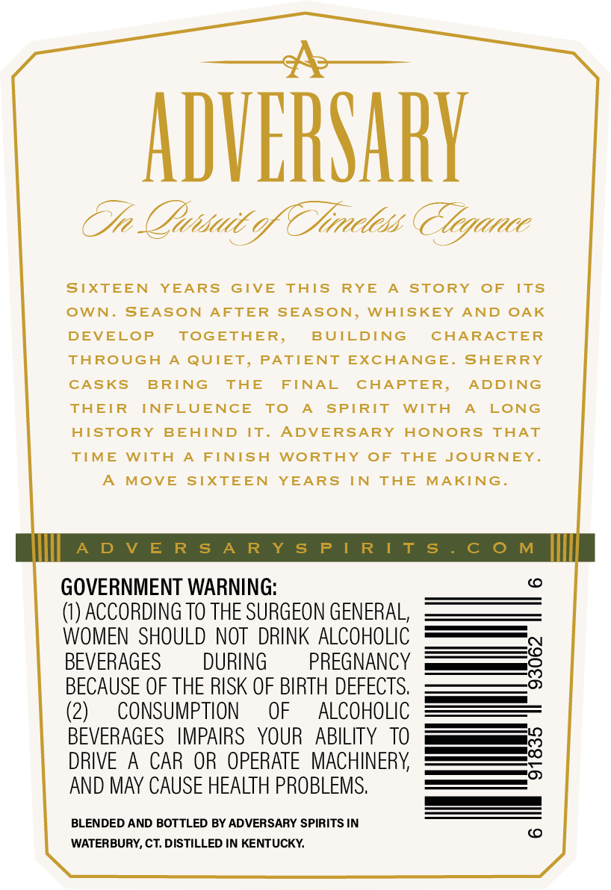
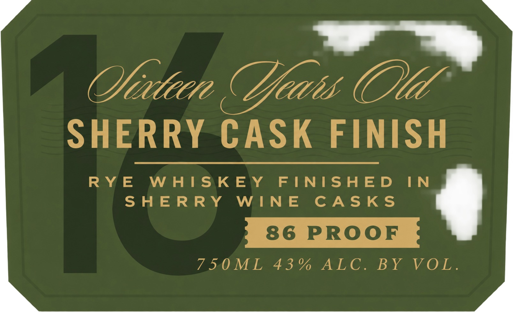
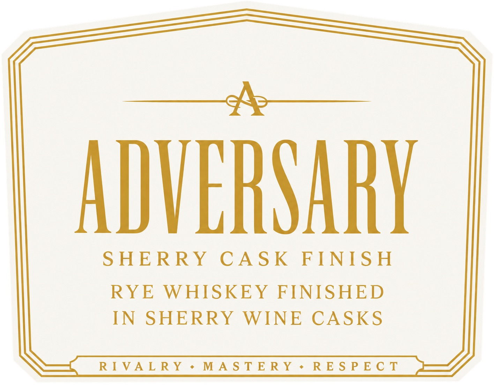
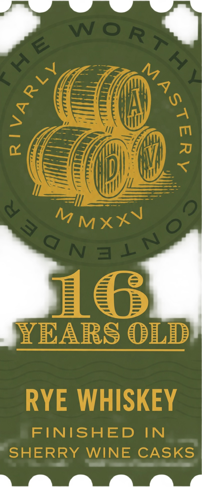

# TTB COLA Label Images - TTBID 26288001000154

**Brand Name:** ADVERSARY

**Fanciful Name:** RYE

**Issue Date:** 10/30/2026

**Origin Code:** 14

**Product Class/Type:** 102

**Source:** [TTB Public COLA Registry](https://ttbonline.gov/colasonline/viewColaDetails.do?action=publicFormDisplay&ttbid=26288001000154)

## Label Images

### Back Label

### Label 1

### Label 2

### Label 4

## Extracted Label Text

*Text extracted via OCR - may contain errors*

**Detected Proof:** 86
**Detected Age:** 16 Years

### Back Label

ADVERSARY
Tn Qhisadc o TJireless Tlegance
SIXTEEN
YEARS
GIVE
ThIS
RYE
SToRY
OF
ITS
OWN _
SEASON
AFTER SEASON,
WHISKEY
AND
OAK
DEVELOP
TOGETHER,
BUILDING
CHARACTER
TAROUGH
A QUIET, PATIENT
EXCHANGE. SHERRY
CASKS
BRING
THE
FINAL
CHAPTER,
ADDING
THEIR
INFLUENCE
To
SPIRIT
WITH
LONG
HISTORY
BEHIND
IT:
ADVERSARY
HoNORS
TAAT
TIME
WITA
FINISH
WORTHY
OF
THE
JOURNEY.
MOVE
SIXTEEN
YEARS
IN
THE
MAKING .
A D V E R s A R Y s P [ R [ t s
C 0 M
GOVERNMENT WARNING:
(1) ACCORDING TO THE SURGEON GENERAL,
WOMEN  SHOULD NOT  DRINK ALCOHOLIC
BEVERAGES
DURING
PREGNANCY
8
BECAUSE OF THE RISK OF BIRTH DEFECTS.
(2)
CONSUMPTION
OF
ALCOHOLIC
BEVERAGES
IMPAIRS
YOUR
ABILITY
TO
8
DRIVE
A
CAR OR  OPERATE  MACHINERY
AND MAY CAUSE HEALTH PROBLEMS.
BLENDED AND BOTTLED BY ADVERSARY SPIRITS IN
WATERBURY, CT: DISTILLED IN KENTUCKY

### Label 1

(Yeatirne

SHERRY CASK FINISH

RYE WHISKEY FINISHED IN

SHERRY WINE CASKS

7IOMEL 43% ALC. BY VOL.

q

### Label 2

ADVERSARY

SHERRY CASK FINISH

RYE WHISKEY FINISHED
IN SHERRY WINE CASKS

RIVALRY +MASTERY+s+ RESPECT

### Label 4

#roman09
M MXXV
16
YEARS OLD
RYE WHISKEY
FINISHED
IN
SHERRY
WINE
CASKS
Wo RTH
3
(
)
