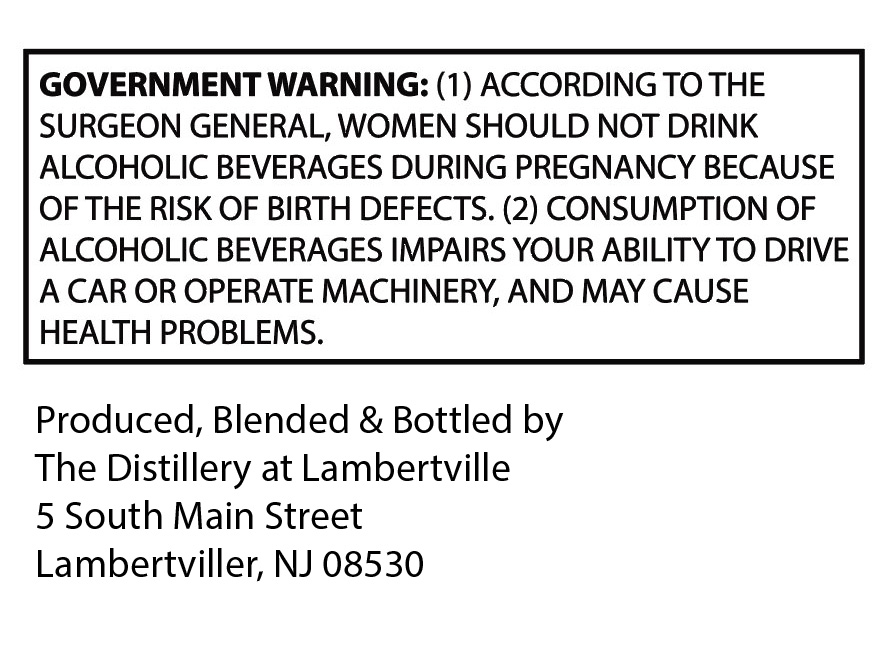
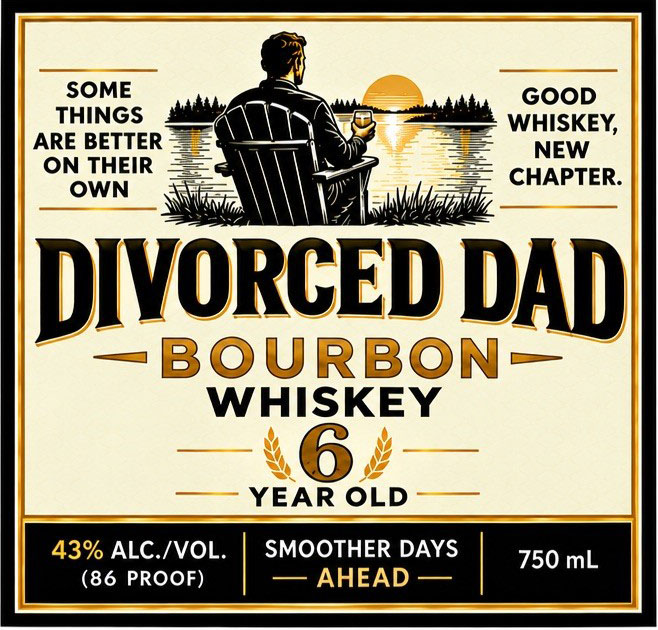

# TTB COLA Label Images - TTBID 26288001000186

**Brand Name:** DIVORCED DAD

**Issue Date:** 10/20/2026

**Origin Code:** 03

**Product Class/Type:** 141

**Source:** [TTB Public COLA Registry](https://ttbonline.gov/colasonline/viewColaDetails.do?action=publicFormDisplay&ttbid=26288001000186)

## Label Images

### Back Label

### Label 1

## Extracted Label Text

*Text extracted via OCR - may contain errors*

**Detected Proof:** 86

### Back Label

GOVERNMENT WARNING: (1) ACCORDING TO THE
SURGEON GENERAL, WOMEN SHOULD NOT DRINK
ALCOHOLIC BEVERAGES DURING PREGNANCY BECAUSE
OF THE RISK OF BIRTH DEFECTS. (2) CONSUMPTION OF
ALCOHOLIC BEVERAGES IMPAIRS YOUR ABILITY TO DRIVE
CAR OR OPERATE MACHINERY, AND MAY CAUSE
HEALTH PROBLEMS:
Produced, Blended & Bottled by
The Distillery at Lambertville
5 South Main Street
Lambertviller; NJ 08530

### Label 1

SOME
GOOD
THINGS
WHISKEY,
ARE BETTER
NEW
ON THEIR
CHAPTER:
OWN
DIVORCEDDADL
BOURBON
WHISKEY
0
YEAR OLD
43% ALC./VOL_
SMOOTHER DAYS
750 mL
(86 PROOF)
AHEAD
