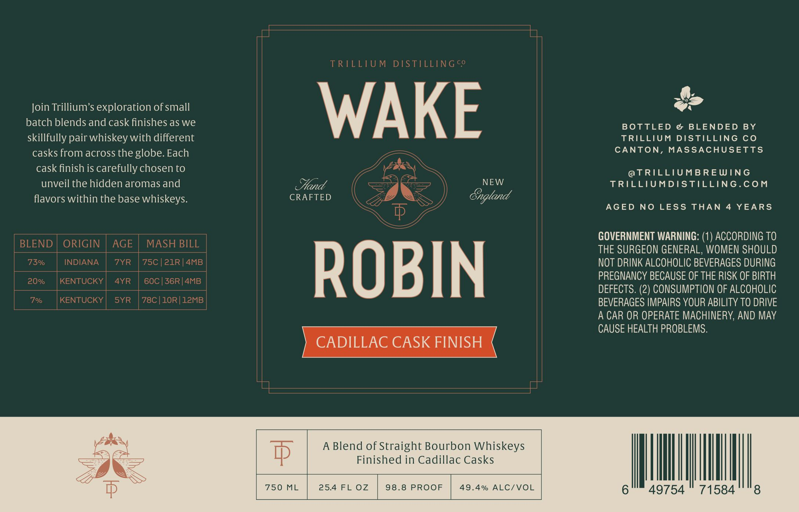

# TTB COLA Label Images - TTBID 26288001000259

**Brand Name:** TRILLIUM DISTILLING CO

**Issue Date:** 10/21/2026

**Origin Code:** 26

**Product Class/Type:** 121

**Source:** [TTB Public COLA Registry](https://ttbonline.gov/colasonline/viewColaDetails.do?action=publicFormDisplay&ttbid=26288001000259)

## Label Images

### Label 1

## Extracted Label Text

*Text extracted via OCR - may contain errors*

**Detected Proof:** 146
**Detected Age:** 4 Years

### Label 1

TRTLLTU M
DISTILLINGco
Join Trillium's exploration of small
WAKE
batch blends and cask finishes as we
BOTTLED
&
BLENDED
BY
skillfully
whiskey with different
TRILLIUM
DISTILLING Co
casks from across the globe. Each
CANTON, MASSACHUSETTS
cask finish is carefully chosen to
@TRILLIUMBREWING
unveil the hidden aromas and
Sand
NEW
TRILLIUMDISTILLING.COM
flavors within the base whiskeys.
CRAFTED
Sngland
AGED NO
LESS THAN
4
YEARS
GOVERNMENT WARNING: (1) ACCORDING TO
BLEND
ORIGIN
AGE
MASH BILL
THE SURGEON GENERAL, WOMEN SHOULD
73%
INDIANA
7YR
75C |21R | 4MB
NOT DRINK ALCOHOLIC BEVERAGES DURING
20%
KENTUCKY
4YR
60C | 36R|4MB
ROBIN
PREGNANCY BECAUSE OF THE RISK OF BIRTH
DEFECTS: (2) CONSUMPTION OF ALCOHOLIC
KENTUCKY
SYR
78C | 10R | 12MB
BEVERAGES IMPAIRS YOUR ABILITY TO DRIVE
A CAR OR OPERATE MACHINERY, AND MAY
CAUSE HEALTH PROBLEMS.
CADILLAC CASK FINISH
A Blend of Straight Bourbon Whiskeys
F
Finished in Cadillac Casks
750
ML
25.4 FL 0z
98.8 PROOF
49.4% ALC/VOL
49754
71584
8
pair-
'7o/
