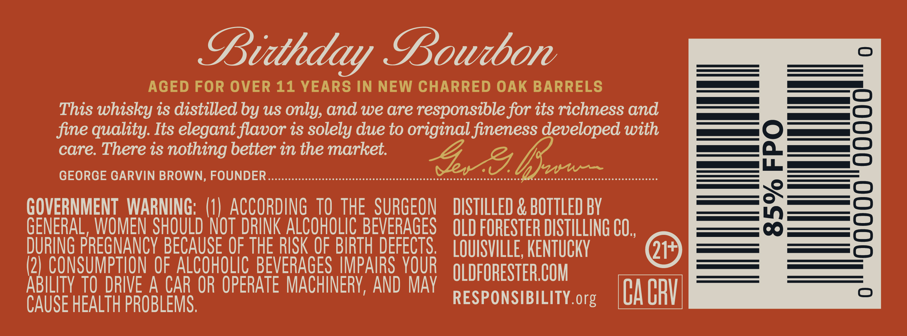
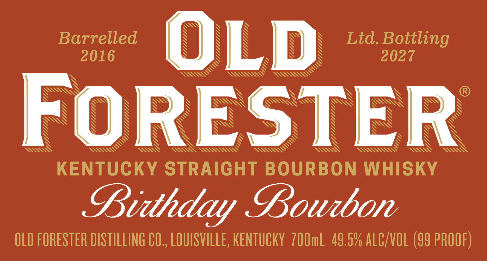
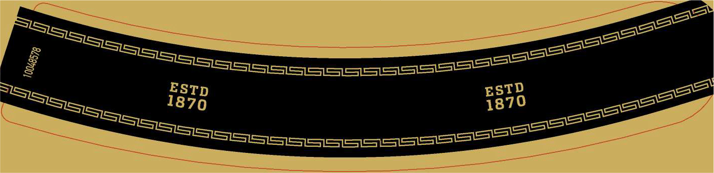
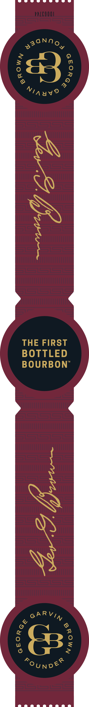
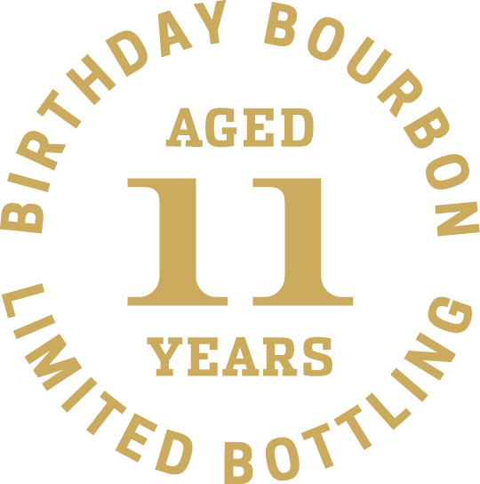

# TTB COLA Label Images - TTBID 26288001000453

**Brand Name:** OLD FORESTER

**Fanciful Name:** BIRTHDAY BOURBON 2027

**Issue Date:** 10/20/2026

**Origin Code:** 22

**Product Class/Type:** 101

**Source:** [TTB Public COLA Registry](https://ttbonline.gov/colasonline/viewColaDetails.do?action=publicFormDisplay&ttbid=26288001000453)

## Label Images

### Back Label

### Front Label

### Label 3

### Label 4

### Label 5

## Extracted Label Text

*Text extracted via OCR - may contain errors*

*3 image(s) excluded: text did not meet readability threshold*

**Detected Proof:** 99
**Detected Age:** 11 Years

### Back Label

DB

PBoudbor

AGED FOR OVER 11 YEARS IN NEW CHARRED OAK BARRELS

This whisky is distilled by us only, and we are responsible for its richness and

fine quality. Its elegant flavor is solely due to original fineness developed with

care. There is nothing better in the market

GEORGE GARVIN BROWN, FOUNDER

eae c cece ee cceeseccceeecceeeeccceeseeceseesccseesseeesesecseessesesesceeeses Oe eee cc een e cece ee cccseeccccesecreces

GOVERNMENT WARNING: (1) ACCORDING TO THE SURGEON DISTILLED & BOTTLED BY

GEN fa SEAR SHOULD NOT al ALCOROLIC BEVERAGES QLD FORESTER DISTILLING CO.,

DURING PR

EGNANCY BECA

E OFT

HE RISK call fee LOUISVILLE, KENTUCKY

@

to

ABILITY 1

CON Sane QF ALCOHOLIC BEVERAGES IMP

DRIVE A CAR OR OPERATE MACHINERY, AND MAY

OLDFORESTER.COM

CAUSE HEALTH PROBLEMS.

RESPONSIBILITY org

CACRY

### Front Label

Barrelled
OLD
Ltd. Bottling
2016
2027
FORESTER
KENTUCKY STRAIGHT BOURBON WHISKY
Bitthday Goubon
OLD FORESTER DISTILLING CO,, LOUISVILLE, KENTUCKY  7OOmL 49.5% ALC VOL (99 PROOF)
