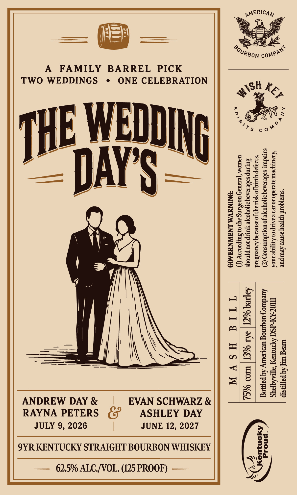

# TTB COLA Label Images - TTBID 26288001000782

**Brand Name:** THE WEDDING DAY'S

**Issue Date:** 10/27/2026

**Origin Code:** 22

**Product Class/Type:** 101

**Source:** [TTB Public COLA Registry](https://ttbonline.gov/colasonline/viewColaDetails.do?action=publicFormDisplay&ttbid=26288001000782)

## Label Images

### Label 1

## Extracted Label Text

*Text extracted via OCR - may contain errors*

**Detected Proof:** 125
**Detected Age:** 9 Years

### Label 1

“surajqoad y3feay asneo Aeur pue wreag wif Aq payastp
‘Czourypeurazesado so se v aatsp 0) Ayrpiqe nok MOGA-dSd Hpmusy aypradqpays
saredurt sa8ezaAag at[oyooye Jo uorydumsuoy (7) Auedutog wogmog uRILOUTY Aq pepog
*8}09Jap Y9.JIq Jo YstI ay) Jo asnesaq Asueusard
SULIp s3de.19A9q ITOYOoTe YULIp Jou pynoys Aapreq %CI Ry. %EI W090 %S, wp
UIWIOM ‘[eIaUa4 UOIdING ay} 0) SUIpIOIY (T)

*ONINUVA LNAWNUHAOD TTI4 HSVW

pMERICAy,

JUNE 12, 2027

EVAN SCHWARZ &
ASHLEY DAY

— 62.5% ALC/VOL. (125 PROOF) ——

©
“a
S
a
a
S
i=)
=

A FAMILY BARREL PICK
TWO WEDDINGS ¢ ONE CELEBRATION
|
9YR KENTUCKY STRAIGHT BOURBON WHISKEY

n
ao
eS)
=
ea)
ise
—
5
<
a

ANDREW DAY &
