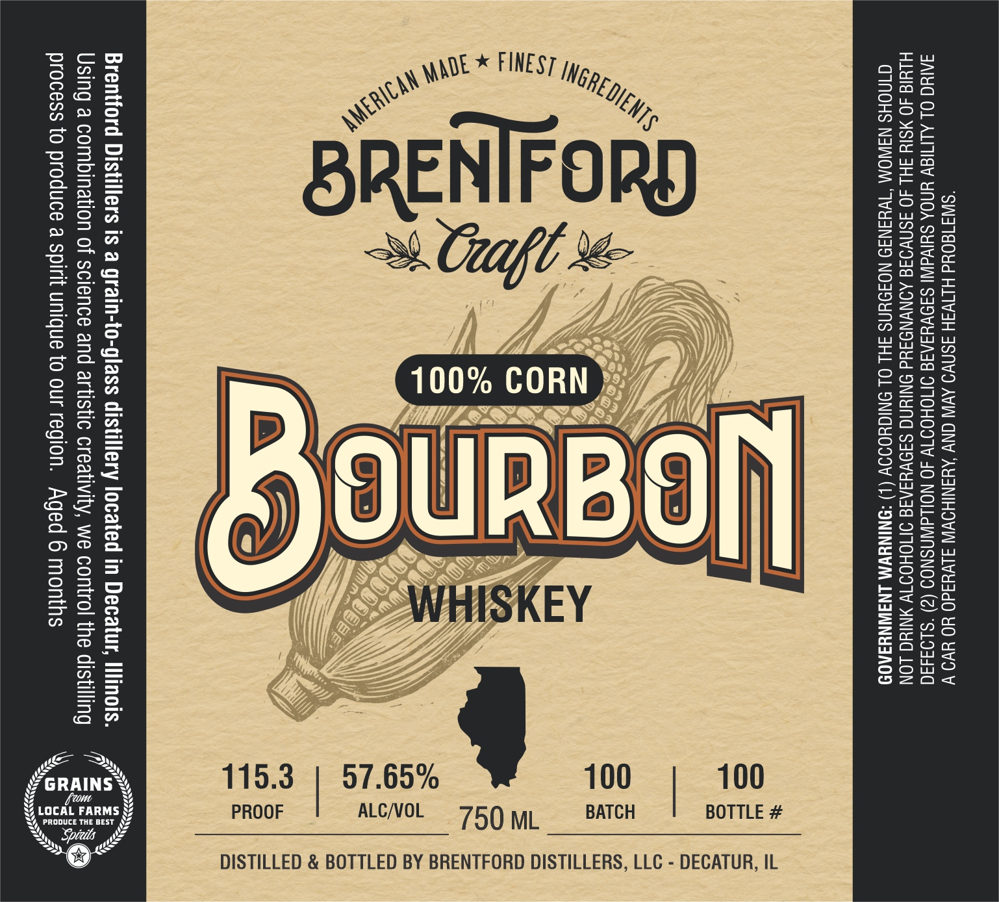

# TTB COLA Label Images - TTBID 26288001000783

**Brand Name:** BRENTFORD

**Issue Date:** 10/23/2026

**Origin Code:** 04

**Product Class/Type:** 141

**Source:** [TTB Public COLA Registry](https://ttbonline.gov/colasonline/viewColaDetails.do?action=publicFormDisplay&ttbid=26288001000783)

## Label Images

### Label 1

## Extracted Label Text

*Text extracted via OCR - may contain errors*

### Label 1

“SIWS180Ud HIIVSH ISN AVI CNV AYANIHOV S1Vuad0 HO YO Vv
JAIYG OL ALITIGY YNOA SUlVdIN SINVYIAIG OMOHODW 40 NOILAWNSNOS (2) °$193430

HLId 4O MSIY SHL 40 ASNVOAE AONVNOAYd ONING SA9VYSAIE OMOHOIT ANING LON
CINOHS N3WOM “TWHANID NOJOUNS FHL OL ONIGYOIOV (1) “ONINYWM LNAIWNYAA0D

Brentford Distillers is a grain-to-glass distillery located in Decatur,
Using a combination of science and artistic creativity, we control the di

process to produce a spirit unique to our region. Aged 6 months

BOTTLE #

750 ML BATCH

ALC/VOL

PROOF

DISTILLED & BOTTLED BY BRENTFORD DISTILLERS, LLC - DECATUR, IL
