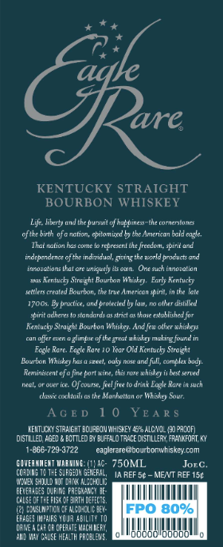
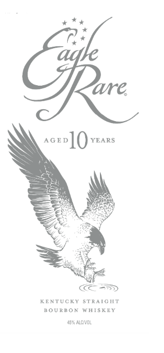
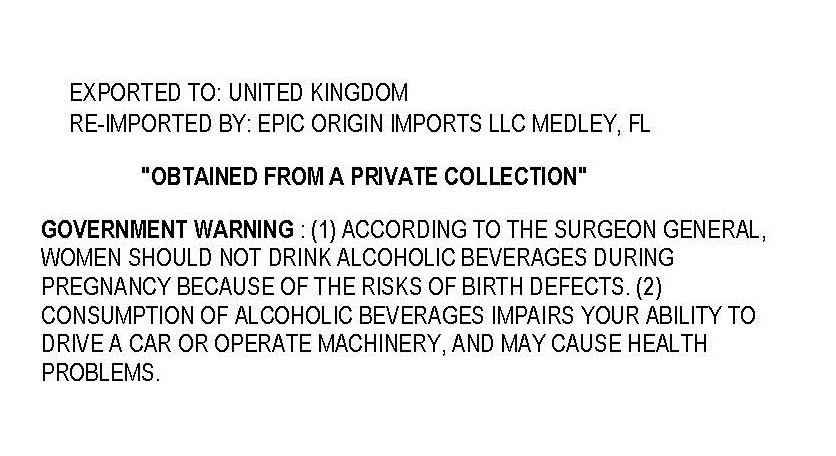

# TTB COLA Label Images - TTBID 26288001000801

**Brand Name:** EAGLE RARE

**Fanciful Name:** AGED 10 YEARS

**Issue Date:** 10/20/2026

**Origin Code:** 00

**Product Class/Type:** 101

**Source:** [TTB Public COLA Registry](https://ttbonline.gov/colasonline/viewColaDetails.do?action=publicFormDisplay&ttbid=26288001000801)

## Label Images

### Back Label

### Front Label

### Label 3

## Extracted Label Text

*Text extracted via OCR - may contain errors*

**Detected Age:** 10 Years

### Back Label

4%

*

f+

ave,

KENTUCKY STRAIGHT

BOURBON WHISKEY

fei and the prt of happinesthcomentones

ofthe bith ofa notion, atom the American al eal

Th nation homeo een thee spi and

independene oft ind, ging worl products ond

Innastons hat oe nig tsa. One ch ansation

‘na Kentucky Sight Bourdon Why. Early Retcky

eter raed Bourbon there Amero pi inthe late

17008. By practic, nd rtd by a, ober died

spirit edere to stondrds srt as tho eased for

Reatck Seaight Bourbon Whisk. And fev oher hiss

eee te pe ee,

Fag Reve. Fai Rar 10 Vor Od Kentucky Straight

Bourn Whey atte oy cae fl cope bay,

Reminst fain ort wie, thioe whist ered

actor bree Of course, flit rink Lgl Rare in. ch

leicht oth Mankation or Wid Sor

AGED

10

YEARS

ISTE ED BOTTLED BY BUA TRACE ISTRY, FRI. A

NTUDY STRAIGHT OUR WHS 5 ALE. PRON

1-866-720-9722

aglerare@bourbonuhiskey.com

coven

We:

Ac: 750ML.

Jore.

(ons

TSH

EFA, Ia REF 5¢ MENT REF 15¢

OWE SHLD a Ae

ai

‘wis

HUREO TH GT

OTT

2 ESP TL OFAC ke

HAGE WPS WOR ALTE 10

(NEA FETE ACHE,

LALLA

ND AY CAUSE HEALTH PROLEVS,

### Front Label

ave,

COS

KENTUCKY STRAIGHT
BOURBON WHISKEY

sss ALL

### Label 3

EXPORTED TO: UNITED KINGDOM
RE-IMPORTED BY: EPIC ORIGIN IMPORTS LLC MEDLEY, FL
"OBTAINED FROMA PRIVATE COLLECTION"
GOVERNMENT WARNING : (1) ACCORDING TO THE SURGEON GENERAL,
WOMEN SHOULD NOT DRINK ALCOHOLIC BEVERAGES DURING
PREGNANCY BECAUSE OF THE RISKS OF BIRTH DEFECTS. (2)
CONSUMPTION OF ALCOHOLIC BEVERAGES IMPAIRS YOUR ABILITY TO
DRIVEA CAR OR OPERATE MACHINERY, AND MAY CAUSE HEALTH
PROBLEMS .
