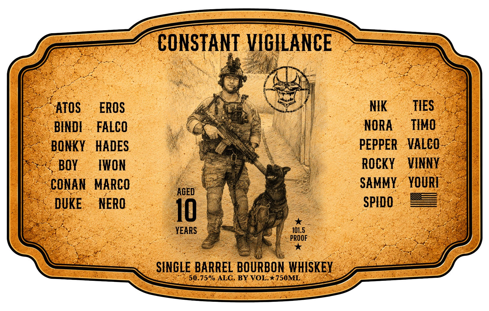
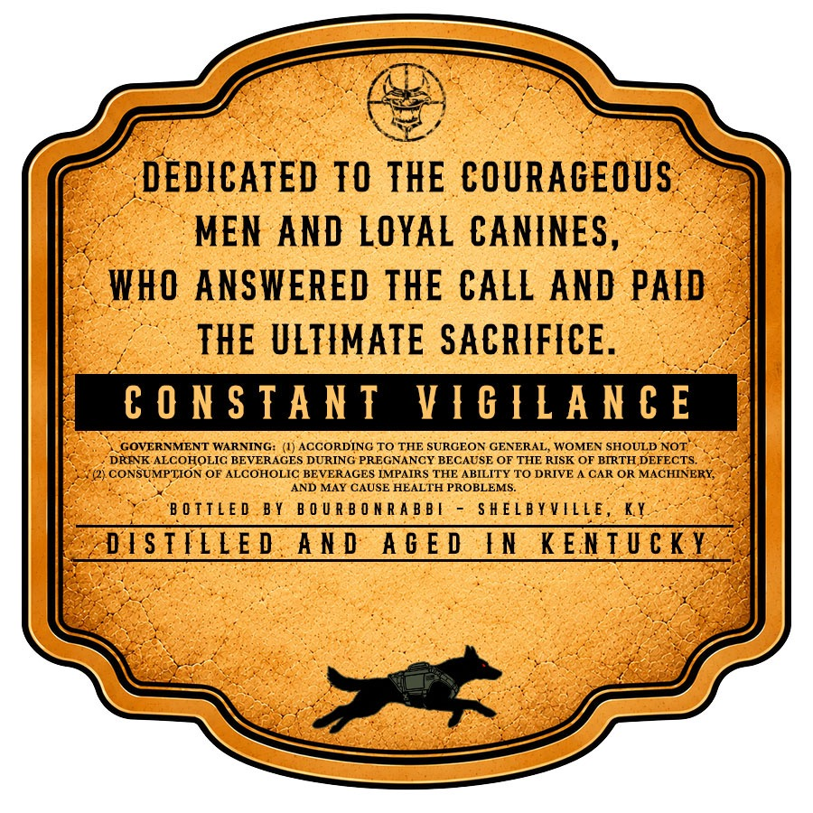

# TTB COLA Label Images - TTBID 26288001000808

**Brand Name:** CONSTANT VIGILANCE

**Issue Date:** 10/23/2026

**Origin Code:** 22

**Product Class/Type:** 141

**Source:** [TTB Public COLA Registry](https://ttbonline.gov/colasonline/viewColaDetails.do?action=publicFormDisplay&ttbid=26288001000808)

## Label Images

### Label 1

### Label 2

## Extracted Label Text

*Text extracted via OCR - may contain errors*

**Detected Proof:** 101.5
**Detected Age:** 10 Years

### Label 1

CONSTANT VIGILANCE
ATOS
EROS
NIK
TIES
BINDL
FALCO
NORA
TIMO
BONKY
HADES
PEPPER
VALCO
BOY
FWON
Rocky
VINNY
CONAN
MARCO
SAMMY
YOURI
AGED
DUKE
NERO
SPIDO
10
YEARS
101.5
PROOF
SINGLE BARREL BOURBON WHISKEY
50.75% ALC: BY VOL* 750ML

### Label 2

oy

EDICATED TO THE COURAGE US

“MEN AND LOYAL CANINES,

WHO ANSWERED THE CALL AND PAID

THE ULTIMATE SACRIFICE

CONSTANT VIGILANCE

DRINK ALCOHOLIC BEVERAGES DURING PREGNANCY BECAUSE OF THE RISK OF BIRTHDEFECTS.

{GOVERNMENT WARNI

)RDING TO THE SURGEON GENERAL, WOMEN SHOULD.

| CONSUMPTION OF ALCOHOLIC BEVERAGES IMPAIRS THE. ste TO DRIVE A CAR OR MACHINE!

AND MAY CAUSE HEAL’

BOTTLED BY BOURBONRABBI

SHELBYVILLE, ye

DISTILLED AND AGED IN KENTUCKY
