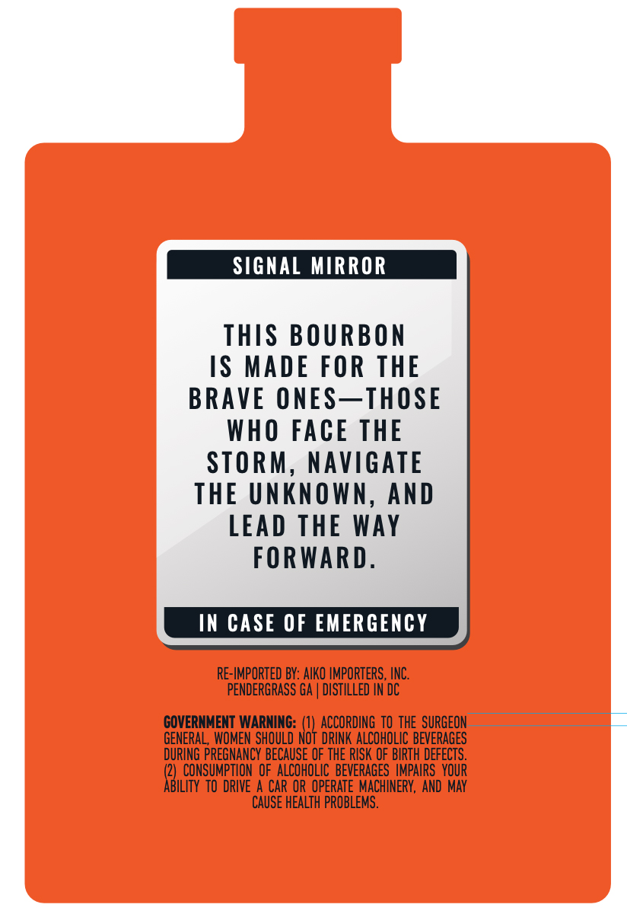
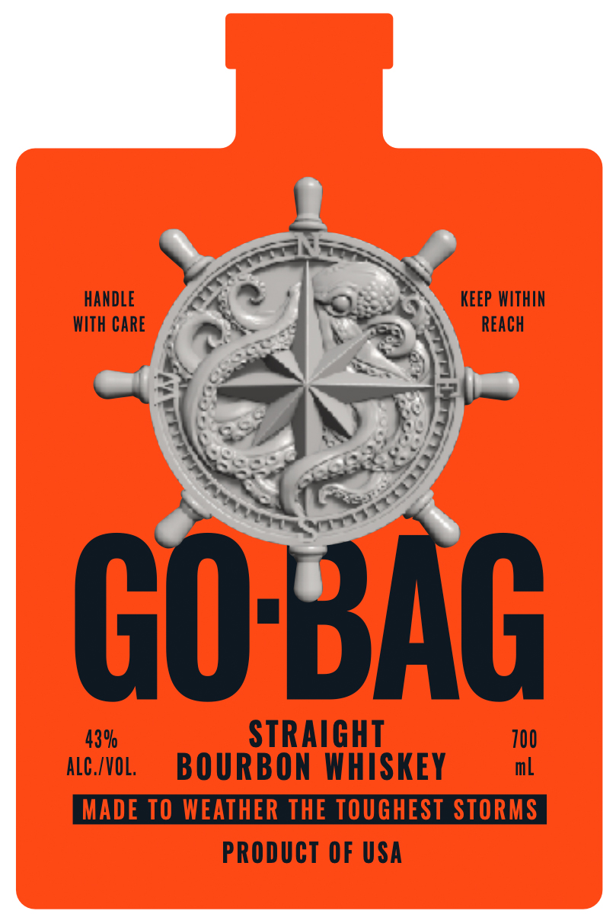
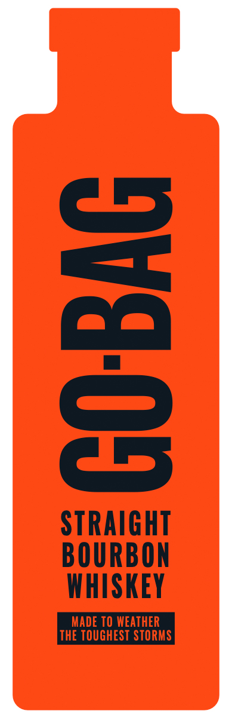
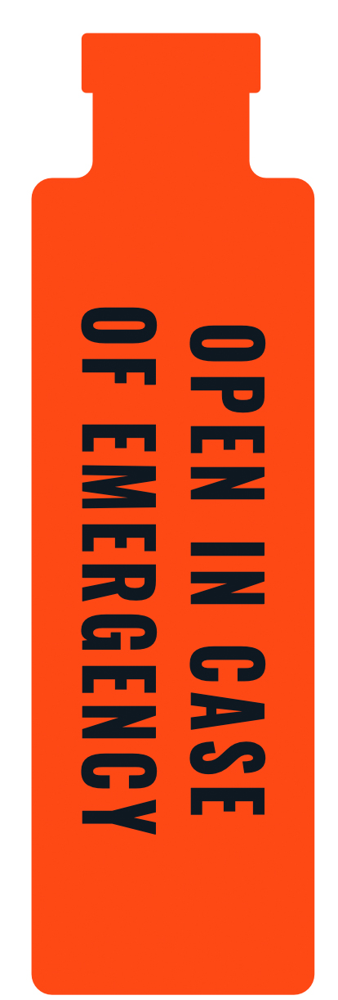

# TTB COLA Label Images - TTBID 26289001000052

**Brand Name:** GO-BAG

**Issue Date:** 11/03/2026

**Origin Code:** 00

**Product Class/Type:** 101

**Source:** [TTB Public COLA Registry](https://ttbonline.gov/colasonline/viewColaDetails.do?action=publicFormDisplay&ttbid=26289001000052)

## Label Images

### Back Label

### Front Label

### Label 3

### Label 4

## Extracted Label Text

*Text extracted via OCR - may contain errors*

*1 image(s) excluded: text did not meet readability threshold*

**Detected Proof:** 86

### Back Label

SIGNAL MIRROR
ThS BOURBON
IS MADE FOR THE
BRAVE ONES_THOSE
WhO FACE THE
STORM
NAVIGATE
THE UnKNOWN,
AND
LEAD THE WAy
FORWARD:
IN CASE OF EMERGENCY
RE-IMPORTED BY: AIKO IMPORTERS , INC;
PENDERGRASS GA
DISTILLED IN DC
COVERNMENT WARNING:
ACCORDING TO thE  SURGEON
GENERAL , WOMEN SHOULD Not DRINK ALCOHOLIC BEVERAGES
DURING PREGNANCY BECAUSE OF THE RISK OF BIRTH DEFECTS.
CONSUMPTION oF  ALCOHOLIC   BEVERAGES  IMPAIRS   YOUR
ABILITY to DRIVE A CAR OR OPERATE MACHINERY, AND May
CAUSE HEALTh PROBLEMS .

### Front Label

handLe
keep WITHIN
WIth Care
ReaCh
GO BAG
43%
STRAIGHT
700
alC /VOL;
BOURBON WHISKEY
mL
MADE TO WEATHER THE TOUGHEST STORMS
PRODUCT OF USA

### Label 3

3
STRAIGHT
BOURBON
WHISKEY
MADE TO WEATHER
THE TOUGHEST STORMS
