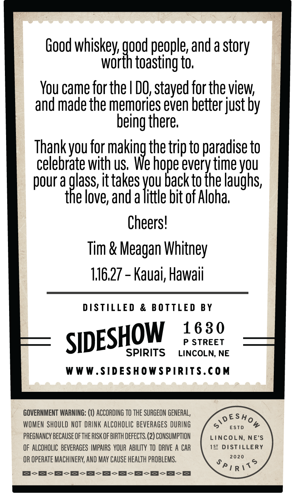
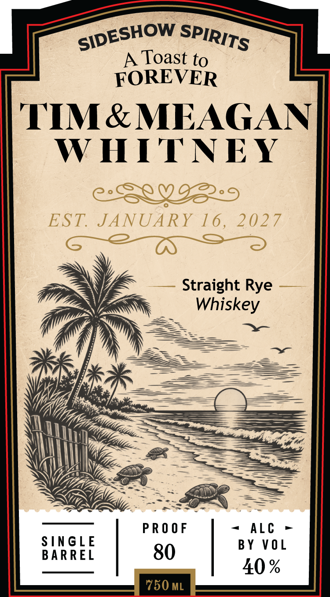

# TTB COLA Label Images - TTBID 26289001000135

**Brand Name:** SIDESHOW SPIRITS

**Issue Date:** 11/05/2026

**Origin Code:** 31

**Product Class/Type:** 102

**Source:** [TTB Public COLA Registry](https://ttbonline.gov/colasonline/viewColaDetails.do?action=publicFormDisplay&ttbid=26289001000135)

## Label Images

### Back Label

### Front Label

## Extracted Label Text

*Text extracted via OCR - may contain errors*

**Detected Proof:** 80

### Back Label

Good whiskey, good people, andastory
worth toasting to.
You came for the | DO, stayed for the view,
and made the memories even better just by
being there.
Thank you for making the trip to paradise to
celebrate with us. We hope every time you
pour a pass, ittakes you back to the laughs,
the love, and alittle bit of Aloha,
Cheers!
Tim & Meagan Whitney
116.27 - Kauai, Hawaii
DISTILLED & BOTTLED BY
HOW 1630
SIDES P STREET
SPIRITS LINCOLN, NE
WWW.SIDESHOWSPIRITS.COM
GOVERNMENT WARNING: (1) ACCORDING TO THE SURGEON GENERAL, vESHo
WOMEN SHOULD NOT DRINK ALCOHOLIC BEVERAGES DURING > esto &
PREGNANCY BECAUSE OF THE RISK OF BIRTH DEFECTS. (2) CONSUMPTION LINCOLN, NE’S
OF ALCOHOLIC BEVERAGES IMPAIRS YOUR ABILITY TO DRIVE A CAR 1St DISTILLERY
OR OPERATE MACHINERY, AND MAY CAUSE HEALTH PROBLEMS. Si. a <?
FT

### Front Label

Toast to
FOREVER
TIM & MEAGAN
W HTNEY
O
EST
JANUARY 16 ,
2027
Straight Rye
Whiskey
PR O 0 F
Alc
S[NGLE
BY V0 L
BARREL
80
40 %
750 ML
SIDESHOW
SPIRITS
