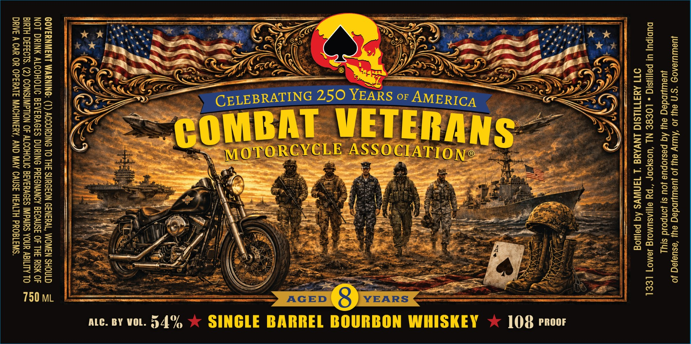

# TTB COLA Label Images - TTBID 26289001000146

**Brand Name:** BOURBON

**Issue Date:** 10/21/2026

**Origin Code:** 43

**Product Class/Type:** 141

**Source:** [TTB Public COLA Registry](https://ttbonline.gov/colasonline/viewColaDetails.do?action=publicFormDisplay&ttbid=26289001000146)

## Label Images

### Label 1

## Extracted Label Text

*Text extracted via OCR - may contain errors*

### Label 1

JUALUUJ@AON *S*f) eUI JO ‘AWY ay] Jo jueWDdeg ey ‘esuejeq Jo
Juawpindeg ayy Aq pesiopue Jou si jonpoid sjyL

DUDIPU UI PaJISIG « LOESE NL ‘UOSYoDP “py e[lIASUMOLg JeMO7 LEEL
OTT AYATIUSIC LNVAYA ‘L TaNWVS Aq peliog

~ er 2S RRO nee

108 Proor

BY WOL.

GOVERNMENT WARNING: (1) ACCORDING TO THE SURGEON GENERAL, WOMEN SHOULD =
NOT DRINK ALCOHOLIC BEVERAGES DURING PREGNANCY BECAUSE OF THE RISK OF Ss

BIRTH DEFECTS. (2) CONSUMPTION OF ALCOHOLIC BEVERAGES IMPAIRS YOUR ABILITY TO rm
DRIVE A CAR OR OPERATE MACHINERY, AND MAY CAUSE HEALTH PROBLEMS.
