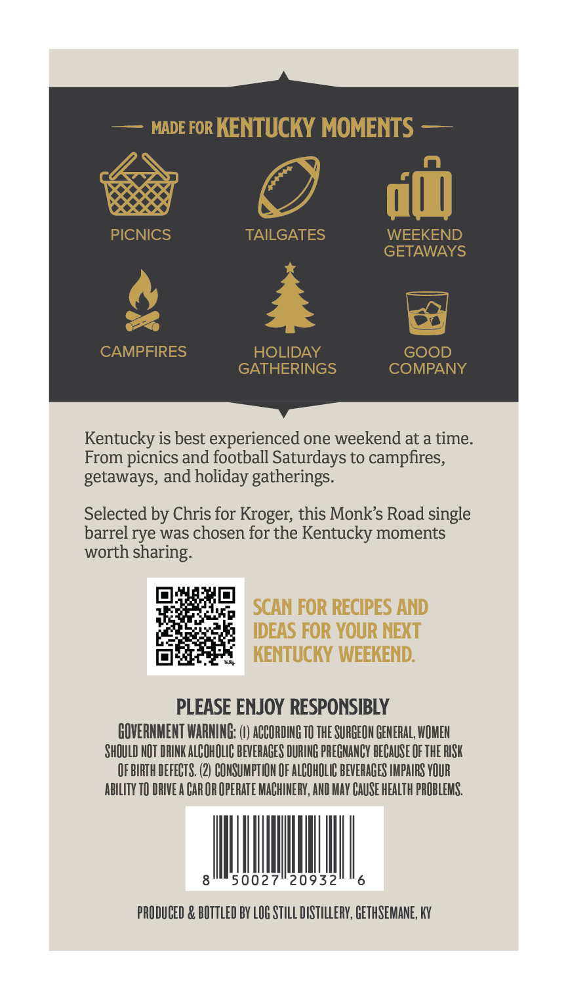
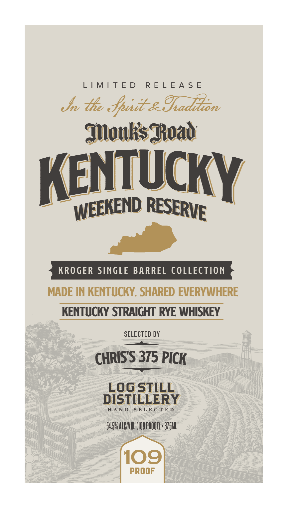

# TTB COLA Label Images - TTBID 26289001000265

**Brand Name:** MONK'S ROAD

**Issue Date:** 10/22/2026

**Origin Code:** 22

**Product Class/Type:** 102

**Source:** [TTB Public COLA Registry](https://ttbonline.gov/colasonline/viewColaDetails.do?action=publicFormDisplay&ttbid=26289001000265)

## Label Images

### Back Label

### Front Label

## Extracted Label Text

*Text extracted via OCR - may contain errors*

**Detected Proof:** 109

### Back Label

MADE FOR KENTUCKY MOMENTS
PICNICS
TAILGATES
WEEKEND
GETAWAYS
CAMPFIRES
HOLIDAY
GOOD
GATHERINGS
COMPANY
Kentucky is best experienced one weekend at a time.
From picnics and football Saturdays to campfires,
getaways, and holiday gatherings.
Selected by Chris for Kroger; this Monks Road single
barrel rye was chosen for the Kentucky moments
worth sharing:
SCAN FOR RECIPES AND
IDEAS FOR YOUR NEXT
KENTUCKY WEEKEND:
PLEASE ENJOY RESPONSIBLY
GOVERNMENT WARNING:
ACCORDING TO THE SURGEON GENERAL; WOMEN
SHOULD NOT DRINK ALCOHOLIC BEVERAGES DURING PREGNANCY BECAUSE OF THE RISK
OF BIRTH DEFECTS. (2) CONSUMPT ION OF ALCOHOLIC BEVERAGES IMPAIRS YOUR
abiLITy TO DRIVE A CAR OR OPERATE MACHINERY, AND MAY CAUSE HEALTh PROBLEMS.
50027
20932
PRODUCED & BOTTLED BY LOG STILL DISTILLERY; GETHSEMANE, KY

### Front Label

LIMITED RELEASE

+e the ae

eenTUcRY

KROGER SINGLE BARREL COLLECTION

MADE IN KENTUCKY. SHARED EVERYWHERE
KENTUCKY STRAIGHT RYE WHISKEY

SELECTED BY
———

CHRIS'S 375 PICK

LOG STILL
DISTILLERY

HAND SELECTED

5A. ALC/VOL (109 PROGE) «375M

109

PROOF
