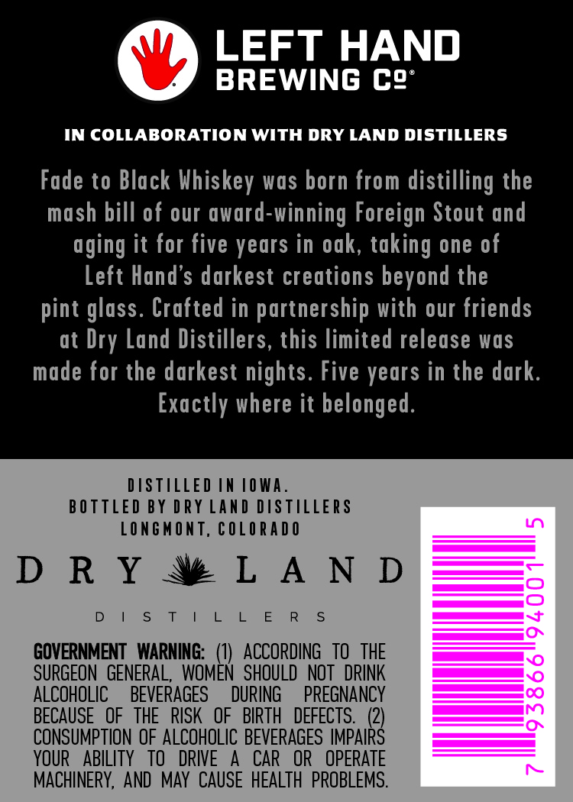

# TTB COLA Label Images - TTBID 26289001000321

**Brand Name:** DRY LAND DISTILLERS

**Fanciful Name:** FADE TO BLACK

**Issue Date:** 10/21/2026

**Origin Code:** 13

**Product Class/Type:** 140

**Source:** [TTB Public COLA Registry](https://ttbonline.gov/colasonline/viewColaDetails.do?action=publicFormDisplay&ttbid=26289001000321)

## Label Images

### Back Label

### Front Label

## Extracted Label Text

*Text extracted via OCR - may contain errors*

*1 image(s) excluded: text did not meet readability threshold*

### Back Label

LEFT HAND
BREWING C2’

IN COLLABORATION WITH DRY LAND DISTILLERS

Fade to Black Whiskey was born from distilling the
mash bill of our award-winning Foreign Stout and
aging it for five years in oak, taking one of
Left Hand’s darkest creations beyond the
pint glass. Crafted in partnership with our friends
at Dry Land Distillers, this limited release was
made for the darkest nights. Five years in the dark.
Exactly where it belonged.

DISTILLED IN 1OWA.
BOTTLED BY DRY LAND DISTILLERS
LONGMONT, COLORADO

DRY NWLAND

Dol Ss ty 1 & Ee Rs

GOVERNMENT WARNING: (1) ACCORDING TO THE
SURGEON GENERAL, WOMEN SHOULD NOT DRINK
ALCOHOLIC  BEVERA DURING _ PREGNANCY
BECAUSE OF THE RISK OF BIRTH DEFECTS. (2)
CONSUMPTION OF ALCOHOLIC BEVERAGES IMPAIRS
YOUR ABILITY TO DRIVE A CAR OR OPERATE
MACHINERY, AND MAY CAUSE HEALTH PROBLEMS.
