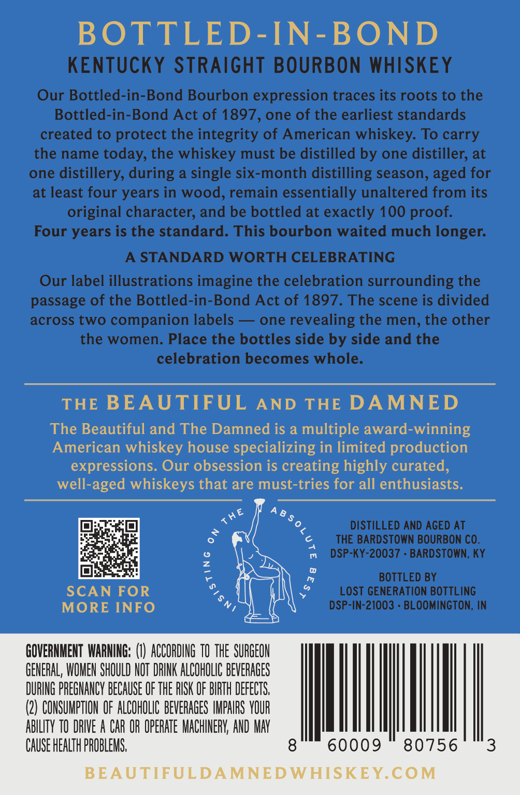
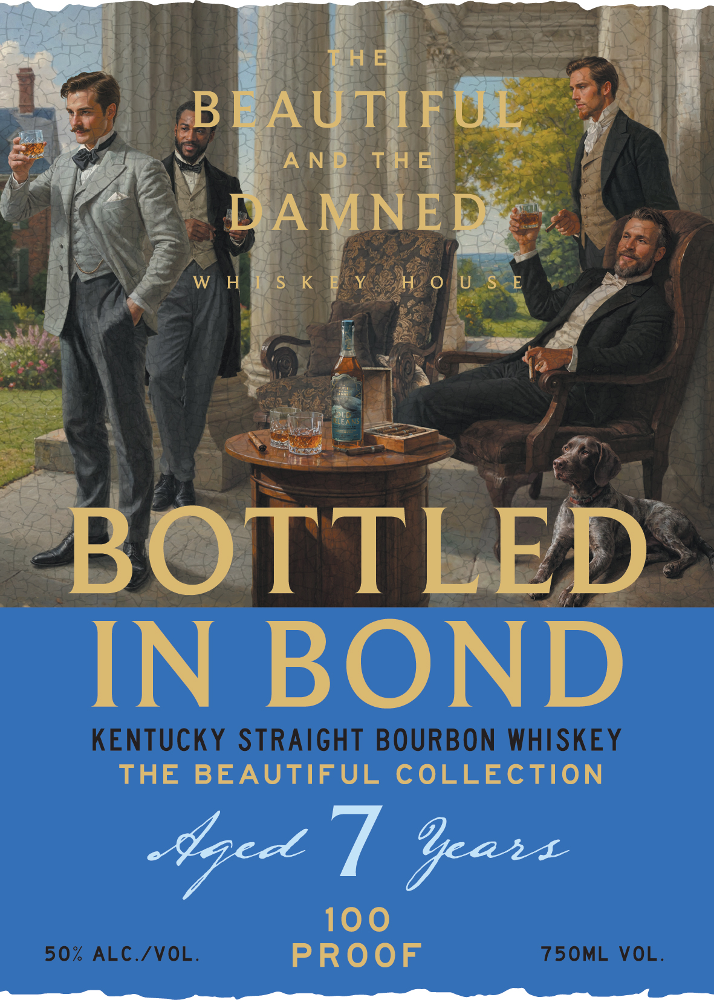

# TTB COLA Label Images - TTBID 26289001000437

**Brand Name:** BOTTLED IN BOND

**Issue Date:** 10/21/2026

**Origin Code:** 19

**Product Class/Type:** 101

**Source:** [TTB Public COLA Registry](https://ttbonline.gov/colasonline/viewColaDetails.do?action=publicFormDisplay&ttbid=26289001000437)

## Label Images

### Back Label

### Front Label

## Extracted Label Text

*Text extracted via OCR - may contain errors*

**Detected Proof:** 100

### Back Label

BOTTLED-IN-BOND
KENTUCKY StRAiGHT BOURBON WHISKEY
Our Bottled-in-Bond Bourbon expression traces its roots to the
Bottled-in-Bond Act of 1897, one of the earliest standards
created to protect the integrity of American whiskey. To carry
the name today, the whiskey must be distilled by one distiller; at
one
distillery, during a single six-month distilling season,
for
at least four years in wood, remain essentially unaltered from its
original character; and be bottled at exactly 100 proof:
Four years is the standard. This bourbon waited much longer:
STANDARD WORTH CELEBRATING
Our label illustrations imagine the celebration surrounding the
passage of the Bottled-in-Bond Act of 1897. The scene is divided
across two
companion labels
one revealing the men, the other
the women. Place the bottles side by side and the
celebration becomes whole.
THE BEAUTIFUL
AND
THE DAMNED
The Beautiful and The Damned is a multiple award-winning
American whiskey house specializing in limited production
expressions. Our obsession is creating highly curated,
well-aged whiskeys that are must-tries for all enthusiasts.
A 8
DISTILLED AND AGED AT
THE BARDSTOWN BOURBON CO_
DSP-KY-20037
BARDSTOWN, KY
2
BOTTLED BY
SCAN FOR
LoST GENERATION BOTTLING
MORE INFO
DSP-IN-21003
BLOOMINGTON, IN
GOVERNMENT WARNING; (€) ACCORDING TO THe SURGEON
GENERAL; WOMEN SHOULD NOT DRINK ALCHOLIC BEVERAGES
DURING PREGNANCY BECAUSE OF THE RISK OF BIRTH DEFECTS,
(2} CONSUMPTHON OF ALCOHOLIC BEVERAGES IMPAIRS VOUR
ABILITY TO DRIVE A CAR OR OpERATe MACHINERV; AND MAY
CAUSE HEALTh PROBLEMS;
60009
80756
3
BEAUTIFULDAMNEDWHISKEY COM
aged
THE
1
(

### Front Label

TH E
BEA UTIFUL
A NPDZ
TH E
DAMNED
W HJs K EYSSH 0 U S E
OLL
ILEA NS
BOTTLED
IN BOND
KENTUCKY STRAIGHT BOURBON WHISKEY
THE
BEAUTIFUL
COLLECTION
Yc ] %canz
100
50%
ALC./VOL:
PROoF
75OML
VOL.
