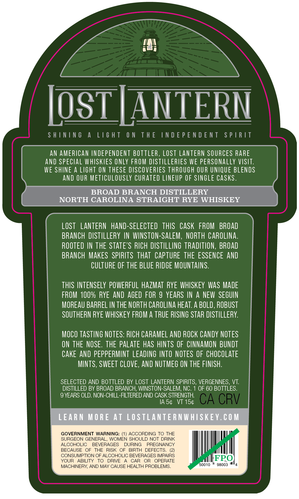
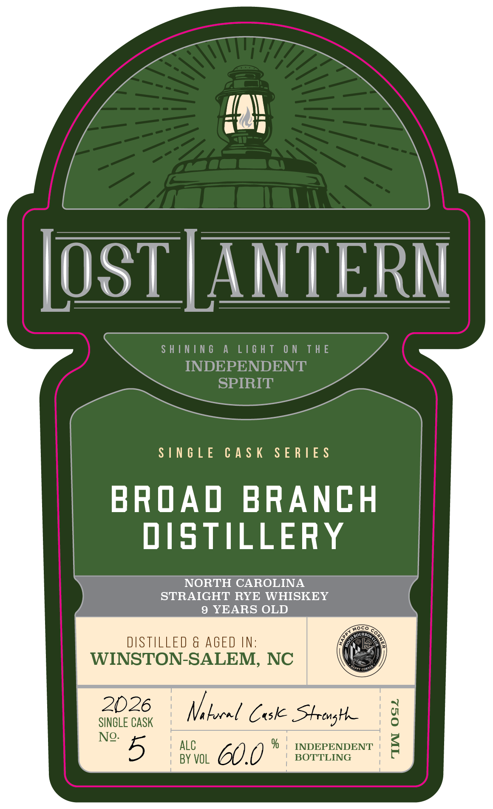
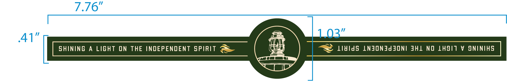

# TTB COLA Label Images - TTBID 26289001000477

**Brand Name:** LOST LANTERN

**Issue Date:** 10/21/2026

**Origin Code:** 46

**Product Class/Type:** 102

**Source:** [TTB Public COLA Registry](https://ttbonline.gov/colasonline/viewColaDetails.do?action=publicFormDisplay&ttbid=26289001000477)

## Label Images

### Back Label

### Front Label

### Label 3

## Extracted Label Text

*Text extracted via OCR - may contain errors*

**Detected Age:** 9 Years

### Back Label

SHINING A LIGHT ON THE INDEPENDENT SPIRIT
AN AMERICAN INDEPENDENT BOTTLER, LOST LANTERN SOURCES RARE
AND SPECIAL WHISKIES ONLY FROM DISTILLERIES WE PERSONALLY VISIT.
WE SHINE A LIGHT ON THESE DISCOVERIES THROUGH OUR UNIQUE BLENDS
AND OUR METICULOUSLY CURATED LINEUP OF SINGLE CASKS.
BROAD BRANCH DISTILLERY
LOST LANTERN HAND-SELECTED THIS CASK FROM BROAD
BRANCH DISTILLERY IN WINSTON-SALEM, NORTH CAROLINA.
ROOTED IN THE STATE'S RICH DISTILLING TRADITION, BROAD
BRANCH MAKES SPIRITS THAT CAPTURE THE ESSENCE AND
CULTURE OF THE BLUE RIDGE MOUNTAINS.

THIS INTENSELY POWERFUL HAZMAT RYE WHISKEY WAS MADE
FROM 100% RYE AND AGED FOR 9 YEARS IN A NEW SEGUIN
MOREAU BARREL IN THE NORTH CAROLINA HEAT. A BOLD, ROBUST
SOUTHERN RYE WHISKEY FROM A TRUE RISING STAR DISTILLERY.
MOCO TASTING NOTES: RICH CARAMEL AND ROCK CANDY NOTES
ON THE NOSE. THE PALATE HAS HINTS OF CINNAMON BUNDT
CAKE AND PEPPERMINT LEADING INTO NOTES OF CHOCOLATE
MINTS, SWEET CLOVE, AND NUTMEG ON THE FINISH.

SELECTED AND BOTTLED BY LOST LANTERN SPIRITS, VERGENNES, VT.
DISTILLED BY BROAD BRANCH, WINSTON-SALEM, NC. 1 OF 60 BOTTLES.

9 YEARS OLD. NON-CHILL-FILTERED AND CASK STRENGTH.

IAS¢ VT 15¢
GOVERNMENT WARNING: (1) ACCORDING TO THE a
SURGEON GENERAL, WOMEN SHOULD NOT DRINK
ALCOHOLIC BEVERAGES DURING PREGNANCY
BECAUSE OF THE RISK OF BIRTH DEFECTS. (2) \| mill |
CONSUMPTION OF ALCOHOLIC BEVERAGES IMPAIRS
YOUR ABILITY TO DRIVE A CAR OR OPERATE . “ll De
MACHINERY, AND MAY CAUSE HEALTH PROBLEMS. 50010 98003 "4

### Front Label

\OST | ANTERN

SHINING A LIGHT ON THE

INDEPENDENT

SPIRIT

SINGLE CASK SERIES

BROAD BRANCH

DISTILLERY

NORTH CAROLINA

STRAIGHT RYE WHISKEY

9 YEARS OLD

DISTILLED & AGED IN

WINSTON-SALEM, NC

2026

SINGLE CASK

Ni local Cause Strong

“5

ALC

BY VOL

GO. 0 % INDEPENDENT

### Label 3

| SHINING A LIGHT ON THE INDEPENDENT SPIRIT @& ii V LididS LNJONAddONI JHL NO LHSIT V ONINIHS |
