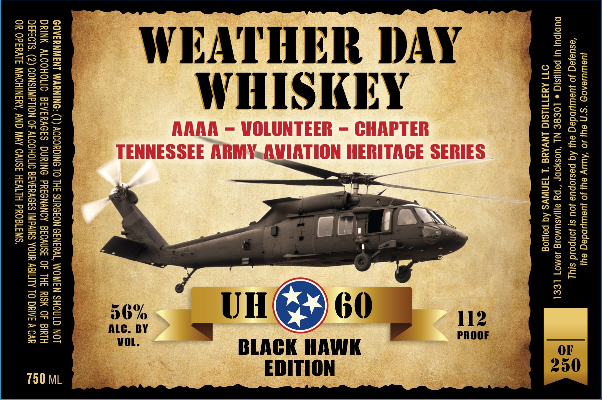

# TTB COLA Label Images - TTBID 26289001000614

**Brand Name:** WEATHER DAY

**Fanciful Name:** BLACK HAWK EDITION

**Issue Date:** 10/25/2026

**Origin Code:** 43

**Product Class/Type:** 140

**Source:** [TTB Public COLA Registry](https://ttbonline.gov/colasonline/viewColaDetails.do?action=publicFormDisplay&ttbid=26289001000614)

## Label Images

### Label 1

## Extracted Label Text

*Text extracted via OCR - may contain errors*

### Label 1

JU@WIUJEA09 *S*f ayl JO ‘AWY ey Jo JUeWDdeg ayy
‘esuajeq Jo Juawindeg ey Aq pasiopue jou s| Jonpoid siyy
DUDIPU| UI PAIISIG © LOESE NL ‘UOsyODP “py eI[lASUMO1g J8EMO] LEEL
OTT AMSTHLSIC LNVANG ‘L TANS Aq palyog

iR DAY
iY

BLACK HAWK
EDITION

=
—
LZ
—_
=
—_
—

=
a
=
rw NX
=
Sc ocal
—_

GOVERNMENT WARNING: (1) ACCORDING TO THE SURGEON GENERAL, WOMEN SHOULD NOT
DRINK ALCOHOLIC BEVERAGES DURING PREGNANCY BECAUSE OF THE RISK OF BIRTH
DEFECTS. (2) CONSUMPTION OF ALCOHOLIC BEVERAGES IMPAIRS YOUR ABILITY TO DRIVE A CAR
OR OPERATE MACHINERY, AND MAY CAUSE HEALTH PROBLEMS.
